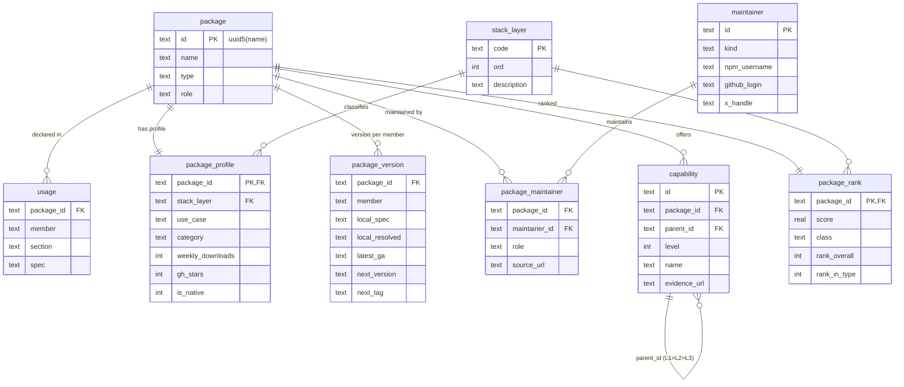

# Dry run: `react-native-reanimated`

Built 2026-10-05 23:14 Colombo time (UTC+5:30) from cached evidence on the box: the npm registry doc, the npm downloads API, the jsDelivr file listing for 4.7.1, the GitHub API (via `gh`, authenticated), `pnpm-lock.yaml`, and the Reanimated docs site (fetched with curl, and all 65 evidence URLs returned HTTP 200).

## Why this package

The ranking (`RANKING.md`, formula `blast-v2`) puts it at **#5 overall and #2 within the react-native type**, with score 62.12 and class **CORE-SPINE**. Only `react-native`, `react`, `expo` and `zod` score higher, and the first three are the core this dry run is meant to skip. It has **10 installed packages that require it as a peer** (react-native-custom-pull-refresh, react-native-drawer-layout, react-native-fast-confetti, react-native-fast-shimmer, react-native-keyboard-controller, react-native-reanimated-carousel, react-native-reanimated-skeleton, react-native-redash, sonner-native, victory-native). It is declared by **9 workspace members**, and it sits in the runtime closure of 15 of the 32 importers. It is a sacred pin (4.7.1), ships native Android/iOS code, and depends on `react-native-worklets` (L2). That makes it the clearest L3 spine package: if it goes, every animated UI kit above it goes too.

For comparison: react-native-worklets 55.9 (CORE-SPINE, #8), react-native-gesture-handler 53.23 (CORE-SPINE, #9), react-native-nitro-modules 43.76 (CORE-SPINE, #17), expo-modules-core 43.56 (CORE-SPINE, #18), react-native-skia 32.47 (CORE-SPINE, #36).

Score components (points): peer 14.2, dependents 8.1, consumers 11.7, reach 7.0, layer 13.0, native 4, sacred 4.

## How the tables link

Every new table hangs off `package.id`, a UUID v5 of the npm name, so it stays the same across rebuilds. `capability` also points at itself through `parent_id` to form the L1 > L2 > L3 tree. `package_profile.stack_layer` and `package_rank.stack_layer` point at the `stack_layer` vocabulary table.

## 1. `package` (existing row)

| id | name | type | role | is_rn | rn_evidence | npm_latest |
|---|---|---|---|---|---|---|
| 6062afeb-e037-5d34-9b3a-ff5f6f62c469 | react-native-reanimated | react-native | runtime | 1 | name,peer:react-native,keyword | 4.7.1 |

`usage` rows (existing), 10 declarations:

| member | section | spec |
|---|---|---|
| @repo/admin | peerDependencies | >=4.6.0 |
| @repo/ai | dependencies | 4.3.1 |
| @repo/ai | peerDependencies | * |
| @repo/classroom | peerDependencies | >=4.6.0 |
| @repo/community | dependencies | ^4.6.0 |
| @repo/library | peerDependencies | ^4.6.0 |
| @repo/profile | dependencies | ^4.6.0 |
| @repo/self | dependencies | ^4.6.0 |
| @repo/ui | dependencies | ^4.7.1 |
| gurudevi-mobile | dependencies | 4.7.1 |

## 2. `package_profile`

| field | value |
|---|---|
| package_id | 6062afeb-e037-5d34-9b3a-ff5f6f62c469 |
| homepage | https://docs.swmansion.com/react-native-reanimated |
| repository_url | https://github.com/software-mansion/react-native-reanimated |
| github_repo | software-mansion/react-native-reanimated |
| docs_url | https://docs.swmansion.com/react-native-reanimated/docs/ |
| npm_url | https://www.npmjs.com/package/react-native-reanimated |
| bugs_url | https://github.com/software-mansion/react-native-reanimated/issues |
| license | MIT |
| description | More powerful alternative to Animated library for React Native. |
| keywords | ["react-native", "react", "native", "reanimated"] |
| created_at | 2018-03-07 19:04 Colombo |
| last_publish_at | 2026-10-04 05:44 Colombo |
| latest_published_at | 2026-10-02 19:28 Colombo |
| weekly_downloads | 10979650 |
| downloads_window | last-week |
| gh_stars | 11020 |
| gh_open_issues | 327 |
| gh_forks | 1524 |
| gh_archived | 0 |
| gh_pushed_at | 2026-10-05 22:36 Colombo |
| gh_owner | software-mansion |
| gh_owner_type | Organization |
| use_case | Animation engine: shared values, animated styles, layout animations, CSS-style transitions on the UI thread |
| stack_layer | L3-UI-PRIMITIVES |
| category | animation |
| classification_source | curated |
| is_native | 1 |
| native_kind | mobile-native |
| native_evidence | android-src,ios-src,podspec;codegenConfig@latest |
| native_checked_version | 4.7.1 |
| deprecated |  |
| profile_file | profiles/react-native-reanimated.md |
| checked_at | 2026-10-05T23:14+05:30 |
| sources | npm: https://registry.npmjs.org/react-native-reanimated, downloads: https://api.npmjs.org/downloads/point/last-week/react-native-reanimated, files: https://data.jsdelivr.com/v1/packages/npm/react-native-reanimated@4.7.1?structure=flat, github: https://api.github.com/repos/software-mansion/react-native-reanimated |

Notes:
- `gh_open_issues` comes from GitHub's `open_issues_count`, which **includes open pull requests**.
- `is_native=1` is based on the files in the 4.7.1 tarball: `android-src,ios-src,podspec;codegenConfig@latest`.
- `use_case`, `stack_layer` and `category` are curated judgement (`classification_source=curated`), checked against the docs pages listed under capabilities.

## 3. `package_version` (one row per declaring member)

| member | importer | section | local_spec | lock_specifier | drift_reason | local_resolved | local_on_tag | latest_ga | local_vs_latest | next_tag | next_version | next_is_newer |
|---|---|---|---|---|---|---|---|---|---|---|---|---|
| @repo/admin | packages/admin | peerDependencies | >=4.6.0 | 4.7.1 | root pnpm override | 4.7.1 | latest | 4.7.1 | equal | nightly | 4.8.0-nightly-20261004-7cb928218 | 1 |
| @repo/ai | packages/ai | dependencies | 4.3.1 | 4.7.1 | root pnpm override | 4.7.1 | latest | 4.7.1 | equal | nightly | 4.8.0-nightly-20261004-7cb928218 | 1 |
| @repo/ai | packages/ai | peerDependencies | * | 4.7.1 | root pnpm override | 4.7.1 | latest | 4.7.1 | equal | nightly | 4.8.0-nightly-20261004-7cb928218 | 1 |
| @repo/classroom | packages/classroom | peerDependencies | >=4.6.0 | 4.7.1 | root pnpm override | 4.7.1 | latest | 4.7.1 | equal | nightly | 4.8.0-nightly-20261004-7cb928218 | 1 |
| @repo/community | packages/community | dependencies | ^4.6.0 | 4.7.1 | root pnpm override | 4.7.1 | latest | 4.7.1 | equal | nightly | 4.8.0-nightly-20261004-7cb928218 | 1 |
| @repo/library | packages/library | peerDependencies | ^4.6.0 | 4.7.1 | root pnpm override | 4.7.1 | latest | 4.7.1 | equal | nightly | 4.8.0-nightly-20261004-7cb928218 | 1 |
| @repo/profile | packages/profile | dependencies | ^4.6.0 | 4.7.1 | root pnpm override | 4.7.1 | latest | 4.7.1 | equal | nightly | 4.8.0-nightly-20261004-7cb928218 | 1 |
| @repo/self | packages/self | dependencies | ^4.6.0 | 4.7.1 | root pnpm override | 4.7.1 | latest | 4.7.1 | equal | nightly | 4.8.0-nightly-20261004-7cb928218 | 1 |
| @repo/ui | packages/ui | dependencies | ^4.7.1 | 4.7.1 | root pnpm override | 4.7.1 | latest | 4.7.1 | equal | nightly | 4.8.0-nightly-20261004-7cb928218 | 1 |
| gurudevi-mobile | apps/gurudevi-mobile | dependencies | 4.7.1 | 4.7.1 |  | 4.7.1 | latest | 4.7.1 | equal | nightly | 4.8.0-nightly-20261004-7cb928218 | 1 |

dist-tags (npm, as of the check): `reanimated-1` = 1.13.4 (published 2022-02-14 21:36 Colombo), `reanimated-2` = 2.17.0 (published 2023-04-24 13:16 Colombo), `reanimated-3` = 3.19.5 (published 2025-12-22 20:20 Colombo), `latest` = 4.7.1 (published 2026-10-02 19:28 Colombo), `nightly` = 4.8.0-nightly-20261004-7cb928218 (published 2026-10-04 05:44 Colombo).

Reading it:
- **Local vs GA.** All members resolve to 4.7.1, which is exactly npm `latest`, and `latest` is not a prerelease. Nothing is ahead or behind.
- **Override at work.** The manifest specs are mixed (`4.7.1`, `^4.7.1`, `^4.6.0`, `>=4.6.0`, `*`, and **`4.3.1` in `@repo/ai` dependencies**). The lockfile specifier is `4.7.1` everywhere because the root `overrides` block has `react-native-reanimated: 4.7.1`. `drift_reason` records this. `@repo/ai`'s exact `4.3.1` pin is stale and is being silently overridden, which is worth cleaning up so the manifest says what actually ships.
- **Next.** Reanimated publishes no `next`, `rc` or `beta` tag. The forward-looking tag is **`nightly`** (4.8.0-nightly-20261004-7cb928218). Major lines are kept on `reanimated-1/2/3` tags.
- **Peer-range check (verified with node-semver 7).** On npm, 4.7.1 declares `react-native: "0.86 - 0.88"` and `react-native-worklets: "0.13.x"`. Strict semver says **`0.88.0-rc.3` does not satisfy `0.86 - 0.88`** (prereleases are excluded unless `includePrerelease` is set). The worklets pin 0.13.0 does satisfy its range. The lockfile records the peers as `react-native: 0.88.0-rc.3`, consistent with the root `overrides` block that pins react-native. In practice your override is what keeps pnpm quiet, not the upstream range. The docs compatibility table lists 4.7.x as supporting RN 0.86, 0.87 and 0.88 (stable lines), and worklets 0.13.x only.

## 4. `maintainer` + `package_maintainer`

Only fields that npm or GitHub returned are filled. X handles come from GitHub's `twitter_username` profile field, which the user sets themselves, so they are labelled self-declared. Email is stored in the DB as npm returns it but is left out of this file.

| role | kind | npm_username | github_login | name | company | x_handle | detail | link_source |
|---|---|---|---|---|---|---|---|---|
| org | github-org |  | software-mansion | Software Mansion |  | swmansion | Software Mansion (GitHub org that owns the repo) | https://api.github.com/orgs/software-mansion |
| repo-owner | github-org |  | software-mansion | Software Mansion |  | swmansion | software-mansion/react-native-reanimated | https://api.github.com/repos/software-mansion/react-native-reanimated |
| npm-maintainer | npm-user | piaskowyk |  |  |  |  |  | https://registry.npmjs.org/react-native-reanimated |
| npm-maintainer | npm-user | swm-bot |  |  |  |  |  | https://registry.npmjs.org/react-native-reanimated |
| npm-maintainer | npm-user | tjzel |  |  |  |  |  | https://registry.npmjs.org/react-native-reanimated |
| latest-publisher | npm-trusted-publisher |  |  | GitHub Actions (npm trusted publishing via github OIDC) |  |  | 4.7.1 | https://registry.npmjs.org/react-native-reanimated/4.7.1 |
| top-contributor | github-user |  | tjzel | Tomasz Żelawski | Software Mansion | tjzeldev | 881 commits (GitHub contributors API, repo-wide) | https://api.github.com/repos/software-mansion/react-native-reanimated/contributors |
| top-contributor | github-user |  | MatiPl01 | Mateusz Łopaciński |  | MatiPl01 | 647 commits (GitHub contributors API, repo-wide) | https://api.github.com/repos/software-mansion/react-native-reanimated/contributors |
| top-contributor | github-user |  | tomekzaw | Tomasz Zawadzki | @software-mansion | tomekzaw_ | 635 commits (GitHub contributors API, repo-wide) | https://api.github.com/repos/software-mansion/react-native-reanimated/contributors |
| top-contributor | github-user |  | piaskowyk | Krzysztof Piaskowy | Software Mansion |  | 416 commits (GitHub contributors API, repo-wide) | https://api.github.com/repos/software-mansion/react-native-reanimated/contributors |
| top-contributor | github-user |  | Latropos | Alex Cynk |  |  | 136 commits (GitHub contributors API, repo-wide) | https://api.github.com/repos/software-mansion/react-native-reanimated/contributors |
| top-contributor | github-user |  | jgonet | Jakub Gonet | @software-mansion |  | 134 commits (GitHub contributors API, repo-wide) | https://api.github.com/repos/software-mansion/react-native-reanimated/contributors |
| top-contributor | github-user |  | kmagiera | Krzysztof Magiera | @software-mansion |  | 134 commits (GitHub contributors API, repo-wide) | https://api.github.com/repos/software-mansion/react-native-reanimated/contributors |
| top-contributor | github-user |  | patrycjakalinska | Patrycja Kalińska | @software-mansion | patkalinska | 127 commits (GitHub contributors API, repo-wide) | https://api.github.com/repos/software-mansion/react-native-reanimated/contributors |
| top-contributor | github-user |  | bartlomiejbloniarz | Bartłomiej Błoniarz |  |  | 122 commits (GitHub contributors API, repo-wide) | https://api.github.com/repos/software-mansion/react-native-reanimated/contributors |

Identity caveat: npm `piaskowyk` and GitHub `piaskowyk` (Krzysztof Piaskowy, Software Mansion) are very likely the same person, and the npm email is on swmansion.com. The same goes for npm `tjzel` and GitHub `tjzel`. They are still **kept as separate rows** because no API asserts the link. The latest publisher is `GitHub Actions` through npm trusted publishing (OIDC), not a person.

## 5. `capability` (6 L1, 20 L2, 46 L3)

```mermaid
flowchart LR
  ROOT["react-native-reanimated"]
  ROOT --> cd59aafde["L1: Shared-value animation core"]
  cd59aafde --> c002b8142["L2: Shared & derived values"]
  c002b8142 --> cf21f2a85["L3: useSharedValue"]
  c002b8142 --> c09313dd6["L3: useDerivedValue"]
  c002b8142 --> c1793ed9b["L3: makeMutable"]
  cd59aafde --> c659133ee["L2: Binding to views"]
  c659133ee --> ca9d1e0c2["L3: useAnimatedStyle"]
  c659133ee --> cc7aee499["L3: useAnimatedProps"]
  c659133ee --> ca1fc7afd["L3: createAnimatedComponent"]
  cd59aafde --> c4a6bb98c["L2: Reactions & frame loop"]
  c4a6bb98c --> c10a3982d["L3: useAnimatedReaction"]
  c4a6bb98c --> cfc0ac981["L3: useFrameCallback"]
  c4a6bb98c --> ce14d3ad1["L3: cancelAnimation"]
  ROOT --> ca9c79b36["L1: Animation functions (drivers & modifiers)"]
  ca9c79b36 --> c3e253fef["L2: Time-based"]
  c3e253fef --> cd816d123["L3: withTiming"]
  ca9c79b36 --> c09d11413["L2: Physics-based"]
  c09d11413 --> cff90f7c7["L3: withSpring"]
  c09d11413 --> c30fb7678["L3: withDecay"]
  ca9c79b36 --> c0e97ab75["L2: Modifiers / composition"]
  c0e97ab75 --> c35ce6dfd["L3: withSequence"]
  c0e97ab75 --> c6c2e5c90["L3: withRepeat"]
  c0e97ab75 --> c34f84531["L3: withDelay"]
  c0e97ab75 --> c0a2e5ade["L3: withClamp"]
  ROOT --> c6925d489["L1: CSS animations & transitions (declarative, Reanimated 4)"]
  c6925d489 --> cf6b9fedf["L2: CSS transitions"]
  cf6b9fedf --> c9a04017e["L3: transitionProperty / transitionDuration"]
  cf6b9fedf --> cf2536583["L3: transitionTimingFunction"]
  cf6b9fedf --> cb199d49d["L3: transitionBehavior"]
  cf6b9fedf --> c778aee3c["L3: Pseudo selectors"]
  c6925d489 --> c590d80bf["L2: CSS animations (keyframes)"]
  c590d80bf --> c6dfc9b37["L3: animationName (keyframes)"]
  c590d80bf --> c4c4fadf2["L3: animationIterationCount / Direction"]
  c590d80bf --> cd24b8c63["L3: animationFillMode / PlayState"]
  c590d80bf --> cd9eab302["L3: Animation callbacks"]
  ROOT --> c1540dd79["L1: Layout animations"]
  c1540dd79 --> c98b7a9a7["L2: Entering / exiting"]
  c1540dd79 --> c2d36c7bb["L2: Keyframe animations"]
  c1540dd79 --> c4c653b45["L2: Layout transitions"]
  c4c653b45 --> c9c8f51fa["L3: Custom layout animations"]
  c4c653b45 --> ca6f37ab4["L3: List layout animations"]
  c1540dd79 --> c714306d3["L2: Shared element transitions (experimental)"]
  ROOT --> c48991fe5["L1: Input-driven animation (scroll, gesture, device, events)"]
  c48991fe5 --> cac79056d["L2: Scroll"]
  cac79056d --> c10803c31["L3: useAnimatedScrollHandler"]
  cac79056d --> c18a2ea1a["L3: useScrollOffset"]
  cac79056d --> c17cf9330["L3: scrollTo"]
  c48991fe5 --> c0ce4d3f2["L2: Gestures"]
  c48991fe5 --> c93beb040["L2: Device & accessibility"]
  c93beb040 --> c59df88cc["L3: useAnimatedSensor"]
  c93beb040 --> ccd383dc1["L3: useAnimatedKeyboard (deprecated)"]
  c93beb040 --> c347cf37d["L3: useReducedMotion / ReducedMotionConfig"]
  c48991fe5 --> c9441f736["L2: Custom event handlers"]
  c9441f736 --> c480ea09c["L3: useEvent / useHandler"]
  c9441f736 --> c42a6ebf4["L3: useComposedEventHandler"]
  ROOT --> cd0734d96["L1: Utilities, native escape hatches & tooling"]
  cd0734d96 --> cf825fc99["L2: Math & colour utilities"]
  cf825fc99 --> c14399f4c["L3: interpolate"]
  cf825fc99 --> c68582ba4["L3: interpolateColor"]
  cf825fc99 --> c946ec554["L3: clamp"]
  cf825fc99 --> c0b9f5db5["L3: contrastColor"]
  cd0734d96 --> c79bcb4c1["L2: Native escape hatches"]
  c79bcb4c1 --> ccb2d25b7["L3: measure"]
  c79bcb4c1 --> c0dff2573["L3: setNativeProps"]
  c79bcb4c1 --> c12a4543c["L3: dispatchCommand"]
  cd0734d96 --> c31339487["L2: Debugging & configuration"]
  c31339487 --> c5185ac94["L3: Logger configuration"]
  c31339487 --> c32059ecc["L3: Feature flags"]
  cd0734d96 --> c6b8dcc2e["L2: Platform & test support"]
  c6b8dcc2e --> c4c0ed0e9["L3: Web support"]
  c6b8dcc2e --> c4b53cc6b["L3: Testing with Jest"]
  c6b8dcc2e --> c80710184["L3: Compatibility matrix"]
```

- **L1 Shared-value animation core**: UI-thread state model: worklets (functions workletized by the react-native-worklets Babel plugin) compute styles and react to events on the UI thread, driven by shared values. ([evidence](https://docs.swmansion.com/react-native-reanimated/docs/guides/worklets/))
  - **L2 Shared & derived values**: Mutable values readable on JS and UI threads; derived values recompute on the UI thread. ([evidence](https://docs.swmansion.com/react-native-reanimated/docs/core/useSharedValue/))
    - **L3 useSharedValue**: Create a shared value (hook). ([evidence](https://docs.swmansion.com/react-native-reanimated/docs/core/useSharedValue/))
    - **L3 useDerivedValue**: Shared value computed from other shared values on the UI thread. ([evidence](https://docs.swmansion.com/react-native-reanimated/docs/core/useDerivedValue/))
    - **L3 makeMutable**: Create a shared value outside a component (advanced). ([evidence](https://docs.swmansion.com/react-native-reanimated/docs/advanced/makeMutable/))
  - **L2 Binding to views**: Connect shared values to component styles and native props. ([evidence](https://docs.swmansion.com/react-native-reanimated/docs/fundamentals/animating-styles-and-props/))
    - **L3 useAnimatedStyle**: Style object recomputed on the UI thread when its shared values change. ([evidence](https://docs.swmansion.com/react-native-reanimated/docs/core/useAnimatedStyle/))
    - **L3 useAnimatedProps**: Animated props object for animating properties of third-party components (non-style props). ([evidence](https://docs.swmansion.com/react-native-reanimated/docs/core/useAnimatedProps/))
    - **L3 createAnimatedComponent**: Wrap any component so it accepts animated styles/props. ([evidence](https://docs.swmansion.com/react-native-reanimated/docs/core/createAnimatedComponent/))
  - **L2 Reactions & frame loop**: Run UI-thread code in response to value changes or on every frame. ([evidence](https://docs.swmansion.com/react-native-reanimated/docs/category/advanced-apis/))
    - **L3 useAnimatedReaction**: React to shared-value changes with a worklet. ([evidence](https://docs.swmansion.com/react-native-reanimated/docs/advanced/useAnimatedReaction/))
    - **L3 useFrameCallback**: Per-frame UI-thread callback. ([evidence](https://docs.swmansion.com/react-native-reanimated/docs/advanced/useFrameCallback/))
    - **L3 cancelAnimation**: Stop a running animation on a shared value. ([evidence](https://docs.swmansion.com/react-native-reanimated/docs/core/cancelAnimation/))
- **L1 Animation functions (drivers & modifiers)**: Imperative animation builders assigned to shared values. ([evidence](https://docs.swmansion.com/react-native-reanimated/docs/category/animations/))
  - **L2 Time-based**: Duration + easing driven animation. ([evidence](https://docs.swmansion.com/react-native-reanimated/docs/animations/withTiming/))
    - **L3 withTiming**: Animate to a target over a duration with an easing curve. ([evidence](https://docs.swmansion.com/react-native-reanimated/docs/animations/withTiming/))
  - **L2 Physics-based**: Spring and velocity-decay simulations. ([evidence](https://docs.swmansion.com/react-native-reanimated/docs/animations/withSpring/))
    - **L3 withSpring**: Spring physics (mass/stiffness/damping or duration/dampingRatio). ([evidence](https://docs.swmansion.com/react-native-reanimated/docs/animations/withSpring/))
    - **L3 withDecay**: Velocity decay, e.g. fling after a gesture. ([evidence](https://docs.swmansion.com/react-native-reanimated/docs/animations/withDecay/))
  - **L2 Modifiers / composition**: Wrap animations to sequence, repeat, delay or clamp them. ([evidence](https://docs.swmansion.com/react-native-reanimated/docs/fundamentals/applying-modifiers/))
    - **L3 withSequence**: Run animations one after another. ([evidence](https://docs.swmansion.com/react-native-reanimated/docs/animations/withSequence/))
    - **L3 withRepeat**: Repeat an animation (optionally reversed). ([evidence](https://docs.swmansion.com/react-native-reanimated/docs/animations/withRepeat/))
    - **L3 withDelay**: Start an animation after a delay. ([evidence](https://docs.swmansion.com/react-native-reanimated/docs/animations/withDelay/))
    - **L3 withClamp**: Modifier that keeps an animation inside a range; docs: use it with withSpring. ([evidence](https://docs.swmansion.com/react-native-reanimated/docs/animations/withClamp/))
- **L1 CSS animations & transitions (declarative, Reanimated 4)**: Web-CSS-like declarative API on style props; no shared values needed. ([evidence](https://docs.swmansion.com/react-native-reanimated/docs/category/css-transitions/))
  - **L2 CSS transitions**: Animate style changes between renders. ([evidence](https://docs.swmansion.com/react-native-reanimated/docs/css-transitions/overview/))
    - **L3 transitionProperty / transitionDuration**: Which props transition and for how long. ([evidence](https://docs.swmansion.com/react-native-reanimated/docs/css-transitions/transition-property/))
    - **L3 transitionTimingFunction**: Easing for transitions. ([evidence](https://docs.swmansion.com/react-native-reanimated/docs/css-transitions/transition-timing-function/))
    - **L3 transitionBehavior**: Whether discrete properties transition too ('allow-discrete'); default 'normal' transitions only continuous ones. ([evidence](https://docs.swmansion.com/react-native-reanimated/docs/css-transitions/transition-behavior/))
    - **L3 Pseudo selectors**: Transition a property on hovered / pressed / focused state without putting that state in React. ([evidence](https://docs.swmansion.com/react-native-reanimated/docs/css-transitions/pseudo-selectors/))
  - **L2 CSS animations (keyframes)**: Keyframe animations declared in styles. ([evidence](https://docs.swmansion.com/react-native-reanimated/docs/css-animations/overview/))
    - **L3 animationName (keyframes)**: Keyframe definition object. ([evidence](https://docs.swmansion.com/react-native-reanimated/docs/css-animations/animation-name/))
    - **L3 animationIterationCount / Direction**: Looping and direction control. ([evidence](https://docs.swmansion.com/react-native-reanimated/docs/css-animations/animation-iteration-count/))
    - **L3 animationFillMode / PlayState**: Hold end state; pause/resume. ([evidence](https://docs.swmansion.com/react-native-reanimated/docs/css-animations/animation-play-state/))
    - **L3 Animation callbacks**: onAnimationStart/End etc. ([evidence](https://docs.swmansion.com/react-native-reanimated/docs/css-animations/animation-callbacks/))
- **L1 Layout animations**: Animate components when they mount, unmount or change layout. ([evidence](https://docs.swmansion.com/react-native-reanimated/docs/category/layout-animations/))
  - **L2 Entering / exiting**: Predefined mount/unmount animations (FadeIn, SlideOut...). ([evidence](https://docs.swmansion.com/react-native-reanimated/docs/layout-animations/entering-exiting-animations/))
  - **L2 Keyframe animations**: Custom multi-step layout keyframes. ([evidence](https://docs.swmansion.com/react-native-reanimated/docs/layout-animations/keyframe-animations/))
  - **L2 Layout transitions**: Animate position/size changes (LinearTransition...). ([evidence](https://docs.swmansion.com/react-native-reanimated/docs/layout-animations/layout-transitions/))
    - **L3 Custom layout animations**: Write your own layout animation worklet. ([evidence](https://docs.swmansion.com/react-native-reanimated/docs/layout-animations/custom-animations/))
    - **L3 List layout animations**: itemLayoutAnimation: layout transition applied when Animated.FlatList item layout changes. ([evidence](https://docs.swmansion.com/react-native-reanimated/docs/layout-animations/list-layout-animations/))
  - **L2 Shared element transitions (experimental)**: Transform a component from one screen into one on another (sharedTransitionTag). Docs: experimental, behind a feature flag, not recommended for production yet. ([evidence](https://docs.swmansion.com/react-native-reanimated/docs/shared-element-transitions/overview/))
- **L1 Input-driven animation (scroll, gesture, device, events)**: Feed native events into UI-thread animation. ([evidence](https://docs.swmansion.com/react-native-reanimated/docs/category/scroll/))
  - **L2 Scroll**: Scroll-position driven animation and imperative scrolling. ([evidence](https://docs.swmansion.com/react-native-reanimated/docs/category/scroll/))
    - **L3 useAnimatedScrollHandler**: Worklet scroll event handler. ([evidence](https://docs.swmansion.com/react-native-reanimated/docs/scroll/useAnimatedScrollHandler/))
    - **L3 useScrollOffset**: Shared value tracking the offset of a ScrollView / FlatList / FlashList; detects horizontal vs vertical. ([evidence](https://docs.swmansion.com/react-native-reanimated/docs/scroll/useScrollOffset/))
    - **L3 scrollTo**: Scroll a ScrollView from the UI thread. ([evidence](https://docs.swmansion.com/react-native-reanimated/docs/scroll/scrollTo/))
  - **L2 Gestures**: Drive shared values from react-native-gesture-handler callbacks. ([evidence](https://docs.swmansion.com/react-native-reanimated/docs/fundamentals/handling-gestures/))
  - **L2 Device & accessibility**: Sensors, keyboard and reduced-motion preference. ([evidence](https://docs.swmansion.com/react-native-reanimated/docs/category/device/))
    - **L3 useAnimatedSensor**: Accelerometer/gyroscope etc. as shared values. ([evidence](https://docs.swmansion.com/react-native-reanimated/docs/device/useAnimatedSensor/))
    - **L3 useAnimatedKeyboard (deprecated)**: Keyboard height/state as shared values. Docs: deprecated, migrate to react-native-keyboard-controller (already in this monorepo). ([evidence](https://docs.swmansion.com/react-native-reanimated/docs/device/useAnimatedKeyboard/))
    - **L3 useReducedMotion / ReducedMotionConfig**: Respect OS reduce-motion setting. ([evidence](https://docs.swmansion.com/react-native-reanimated/docs/device/useReducedMotion/))
  - **L2 Custom event handlers**: Build worklet handlers for any native event. ([evidence](https://docs.swmansion.com/react-native-reanimated/docs/advanced/useEvent/))
    - **L3 useEvent / useHandler**: Low-level worklet event handler hooks. ([evidence](https://docs.swmansion.com/react-native-reanimated/docs/advanced/useHandler/))
    - **L3 useComposedEventHandler**: Combine several worklet handlers. ([evidence](https://docs.swmansion.com/react-native-reanimated/docs/advanced/useComposedEventHandler/))
- **L1 Utilities, native escape hatches & tooling**: Math/colour helpers, direct native access, debugging and platform support. ([evidence](https://docs.swmansion.com/react-native-reanimated/docs/category/utilities/))
  - **L2 Math & colour utilities**: UI-thread helpers for mapping values. ([evidence](https://docs.swmansion.com/react-native-reanimated/docs/category/utilities/))
    - **L3 interpolate**: Map a value from an input range to an output range. ([evidence](https://docs.swmansion.com/react-native-reanimated/docs/utilities/interpolate/))
    - **L3 interpolateColor**: Interpolate between colours. ([evidence](https://docs.swmansion.com/react-native-reanimated/docs/utilities/interpolateColor/))
    - **L3 clamp**: Clamp a value to bounds. ([evidence](https://docs.swmansion.com/react-native-reanimated/docs/utilities/clamp/))
    - **L3 contrastColor**: Returns 'white' or 'black', whichever has the greater WCAG contrast against a colour (like CSS contrast-color()). ([evidence](https://docs.swmansion.com/react-native-reanimated/docs/utilities/contrastColor/))
  - **L2 Native escape hatches**: Synchronous measurement and direct native updates from the UI thread. ([evidence](https://docs.swmansion.com/react-native-reanimated/docs/category/advanced-apis/))
    - **L3 measure**: Synchronously measure a view on the UI thread. ([evidence](https://docs.swmansion.com/react-native-reanimated/docs/advanced/measure/))
    - **L3 setNativeProps**: Set native props directly, bypassing React. ([evidence](https://docs.swmansion.com/react-native-reanimated/docs/advanced/setNativeProps/))
    - **L3 dispatchCommand**: Run a native component command (e.g. focus) directly from the UI thread. ([evidence](https://docs.swmansion.com/react-native-reanimated/docs/advanced/dispatchCommand/))
  - **L2 Debugging & configuration**: Logger, call stacks, slow-motion, feature flags. ([evidence](https://docs.swmansion.com/react-native-reanimated/docs/category/debugging/))
    - **L3 Logger configuration**: configureReanimatedLogger: make API-misuse warnings more or less verbose. ([evidence](https://docs.swmansion.com/react-native-reanimated/docs/debugging/logger-configuration/))
    - **L3 Feature flags**: Static and dynamic flags to opt in to experimental changes or opt out of new defaults. ([evidence](https://docs.swmansion.com/react-native-reanimated/docs/guides/feature-flags/))
  - **L2 Platform & test support**: Web support, Jest testing and the compatibility matrix. ([evidence](https://docs.swmansion.com/react-native-reanimated/docs/guides/compatibility/))
    - **L3 Web support**: Run on react-native-web. ([evidence](https://docs.swmansion.com/react-native-reanimated/docs/guides/web-support/))
    - **L3 Testing with Jest**: Jest setup and helpers. ([evidence](https://docs.swmansion.com/react-native-reanimated/docs/guides/testing/))
    - **L3 Compatibility matrix**: Which Reanimated minor supports which RN / worklets versions. ([evidence](https://docs.swmansion.com/react-native-reanimated/docs/guides/compatibility/))

## 6. `package_rank`

| class | score | rank_overall | rank_in_type | type_pct | direct_consumers_rt | dependents_transitive_all | peer_dependents | peer_dependents_required | fan_out_direct | fan_out_transitive | importer_reach_runtime | is_native | sacred_pin |
|---|---|---|---|---|---|---|---|---|---|---|---|---|---|
| CORE-SPINE | 62.12 | 5 | 2 | 65.0 | 9 | 11 | 13 | 10 | 2 | 4 | 15 | 1 | 1 |

- class_reason: policy: sacred pin (graph-only class would be STRUCTURAL); L3-UI-PRIMITIVES, required-peer dependents=10, all transitive dependents=11, runtime reach=15/32
- removal_effect: stays installed as a required peer of 10 package(s) (pnpm auto-installs peers) but they lose their pinned version
- Upstream (what it needs): hard deps react-native-is-edge-to-edge, semver; peers react, react-native, react-native-worklets.
- Downstream (what breaks without it): react-native-custom-pull-refresh, react-native-drawer-layout, react-native-fast-confetti, react-native-fast-shimmer, react-native-keyboard-controller, react-native-reanimated-carousel, react-native-reanimated-skeleton, react-native-redash, sonner-native, victory-native require it as a peer, and expo-gl, expo-router, react-native-skia list it as an optional peer.

## What could not be verified

- **Which capabilities your code actually uses.** The box has your manifests and lockfile, not your source, so this tree describes what the package offers, not how you use it. The next step would be to grep imports (`useSharedValue`, `withSpring`, `entering=`) in `C:\x`.
- **Contributor counts** are repo-wide (the repo is a monorepo that also contains react-native-worklets), not specific to this package.
- **Weekly downloads** is npm's last-week point value on the check date, which is a moving number.
