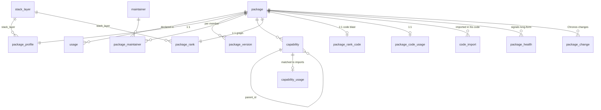

# RN Terrain: schema

`rn_packages.db` (SQLite) as of 2026-10-05 23:46 Colombo. Step-1 `package`/`usage` unchanged. Step-2 profile/rank/capability unchanged. New tables this pass: `code_import`, `package_code_usage`, `package_rank_code`, `package_health`, `package_change` (Chronos-owned), `capability_usage`.

## Row counts

| table | rows |
|---|---|
| package | 387 |
| usage | 865 |
| stack_layer | 14 |
| package_profile | 387 |
| package_version | 865 |
| maintainer | 712 |
| package_maintainer | 2853 |
| capability | 72 |
| package_rank | 387 |
| code_import | 0 |
| package_code_usage | 0 |
| package_rank_code | 0 |
| package_health | 11448 |
| package_change | 28 |
| capability_usage | 0 |

## New tables

### `code_import`
One row per import/require/export-from symbol (or side-effect) found in his monorepo source.

| column | type | notes |
|---|---|---|
| id | INTEGER PK | |
| file_path | TEXT | repo-relative |
| member | TEXT | workspace member |
| package_id | TEXT FK | nullable if specifier not in package index |
| specifier | TEXT | raw module specifier |
| symbol | TEXT | imported/exported name (null for side-effect/require/dynamic) |
| kind | TEXT | default/named/namespace/side-effect/type-only/require/dynamic |
| line | INTEGER | |
| npm_name | TEXT | mapped package name (scoped/subpath stripped) |

### `package_code_usage` / `package_rank_code`
Per-package code blast metrics and class (`CODE-SPINE` … `INSTALLED-UNUSED` / `DEV-ONLY`). Populated after code-usage scan.

### `package_health`
Long-form signals: `(package_id, signal_group, signal, value, unit, source_url, checked_at)`. Groups: security, maintenance, quality, size, adoption, rn_fit. Leading-edge peer/RC mismatches are **not** stored as risks.

### `package_change` (Chronos)
Columns: `package_uuid`, `npm_name`, `from_version`, `to_version`, `release_date`, `change_kind`, `summary`, `affects_naveen`, `source_url`, `verified_at`. Load via `load_changes.py` from `changes/package_change.csv`.

### `capability_usage`
Links capability rows to files/symbols in his code (filled with capabilities for code-blast top packages).

## Views (existing)
- `v_versions`, `v_package_overview` (from step 2)

## Rebuild notes
- Do not drop step-1/2 tables casually. `build_terrain.py` still recreates step-2 tables — re-run dry_run / health / code loaders after.
- Chronos owns change timelines; never invent package_change rows here.

## Signal ingest (2026-10-06)
See `signals/README.md`. `signal` (one row per dated source item, gated by state) → `signal_link` (typed edges to package | capability | pattern | version_band | combo | change | file | person | org | watch | idea) → `signal_promotion` (audit row when a confirmed signal becomes a change/capability/pattern row). `combo` = a named set of package@range. View `v_signals_by_package` rolls links up to the package.
