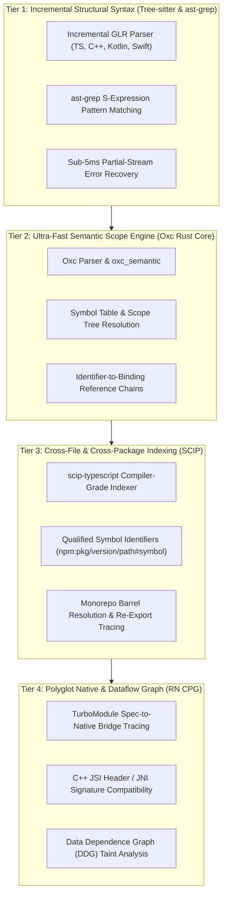
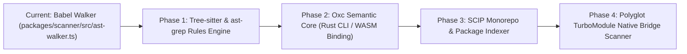

# Advanced Code Graphs, Tree-sitter, and Source Code Analysis Specification

> **Document Classification:** Engineering Architecture & Next-Gen Code Intelligence  
> **Status:** Active Standard & Future Roadmap (2026–2030)  
> **Repository:** `rn-terrain` (`c:\projects\rn-terrain`)  
> **Target Subsystems:** `@intuitui-labs/rn-terrain-scanner`, TCDI Engine, Agent Grounding Guardrail  

---

## Executive Summary: Beyond Naive Single-File ASTs

Until recently, code analysis in package auditing and AI agent verification relied primarily on **naive, single-file AST walkers** (such as Babel `@babel/traverse` or basic TypeScript AST visitors). While sufficient for basic syntax matching, this approach fundamentally fails in modern monorepos and complex cross-platform ecosystems like React Native.

Naive AST walkers process source files as isolated syntax islands. They cannot resolve cross-file import aliases, cannot trace symbol flow through re-export barrels, cannot perform type-directed disambiguation, and are completely blind to the **polyglot native boundary** (where TypeScript specs cross into C++ JSI, Android JNI/Kotlin, and iOS Objective-C++/Swift). Furthermore, single-file Babel parsing imposes high memory and garbage collection overhead in large monorepos.

This document defines the **Modern Code Intelligence Stack (2026)** and **Future Signals (2027–2030)** for `rn-terrain`. We transition from naive AST matching to a layered architecture combining **Tree-sitter (incremental syntax)**, **Oxc (high-throughput semantic scope resolution)**, **SCIP (compiler-grade cross-file symbol indexing)**, **Code Property Graphs (CPG with dataflow/taint tracking)**, and **Cross-Language TurboModule Native Bridging**.

---

## 1. The 5 Fatal Blind Spots of Naive AST Walkers

A review of traditional single-file AST walkers (such as `packages/scanner/src/ast-walker.ts`) reveals five structural blind spots when verifying modern agent code or package upgrades:

```
┌─────────────────────────────────────────────────────────────────────────────┐
│                      THE NAIVE AST FAILURE MATRIX                           │
├────────────────────────────────┬────────────────────────────────────────────┤
│ 1. Aliasing & Barrel Blindness │ Cannot trace `import * as G` or            │
│                                │ `export { foo as bar } from './barrel'`     │
├────────────────────────────────┼────────────────────────────────────────────┤
│ 2. Type-Directed Disambiguation│ Identical identifiers (e.g. `onPress`) have│
│                                │ different semantics based on type contract │
├────────────────────────────────┼────────────────────────────────────────────┤
│ 3. Dataflow & Taint Absence    │ Cannot determine if deprecated return value│
│                                │ flows into an active native view           │
├────────────────────────────────┼────────────────────────────────────────────┤
│ 4. Polyglot Native Wall        │ Blind to C++ JSI vtables, JNI signatures,   │
│                                │ and iOS ObjC++ header breaks               │
├────────────────────────────────┼────────────────────────────────────────────┤
│ 5. Streaming & Parse Choke     │ Full-file parsers choke on partial agent   │
│                                │ streams; V8 GC stalls on 50k+ files        │
└────────────────────────────────┴────────────────────────────────────────────┘
```

### 1.1 Aliasing, Destructuring, and Re-export Barrels
In modern React Native libraries (e.g., `react-native-gesture-handler` v2), developers and AI agents write:
```typescript
import * as RNGH from 'react-native-gesture-handler';
const { usePanGesture } = RNGH; // Aliased extraction
// or:
import { GestureHandlerRootView as Root } from '@repo/ui/gestures'; // Re-export barrel
```
A naive AST matcher inspecting `ImportSpecifier.imported.name` will either miss the aliased usage or falsely report a violation when a wrapper library safely shims a deprecated symbol.

### 1.2 Type-Directed Semantic Disambiguation
In TypeScript, syntactic tokens are ambiguous without type resolution. Two packages may export a hook or prop with identical syntax (`useTheme`, `onPress`, `createNavigator`). A purely syntactic AST walker cannot determine whether `useTheme` originates from `@react-navigation/native` or `@shopify/restyle` without resolving the type binding.

### 1.3 Dataflow & Taint Analysis Absence
A symbol may be deprecated or risky only when invoked in a specific execution path. For example, calling `useAnimatedStyle` is stable, but returning a non-worklet function inside it causes a runtime native thread crash. A naive AST walker sees only the function call; it cannot perform dataflow analysis to inspect what flows into the callback.

### 1.4 The Polyglot Native Wall (React Native's Unique Reality)
React Native is not just JavaScript or TypeScript. It is a four-language hybrid:
$$\text{TypeScript Spec} \longleftrightarrow \text{Codegen C++ JSI} \longleftrightarrow \text{Android JNI / Kotlin} \longleftrightarrow \text{iOS ObjC++ / Swift}$$
A package bump (e.g., Reanimated 3.15 $\to$ 3.16) may compile cleanly in TypeScript with zero AST errors, yet crash with a SIGSEGV at runtime because a native C++ header changed its virtual method table or an Android `.so` binary was compiled against a mismatched NDK ABI. Naive ASTs stop at the JS boundary.

### 1.5 Streaming Generation & Error Recovery
When AI coding agents stream tokens, code is temporarily incomplete. Traditional parsers throw syntax errors and abort. Modern code intelligence requires **error-tolerant, incremental parsing** that produces a usable concrete syntax tree even while the agent is halfway through generating a function.

---

## 2. Comparative Matrix: Code Analysis Technologies (2025–2026)

| Dimension | Naive AST (Babel / ESLint) | Tree-sitter & `ast-grep` | Oxc Semantic (Rust) | SCIP (Sourcegraph) | Code Property Graph (CPG / Joern) | Agent-Native Graph RAG (MCP) |
|---|---|---|---|---|---|---|
| **Core Layer** | Syntax (Single-file) | Concrete Syntax Tree (CST) | Semantic AST & Scope Tree | Multi-repo Symbol Protocol | AST + CFG + DDG Unified | Entity-Relationship Knowledge Graph |
| **Language Support** | JS / TS only | 100+ languages (TS, C++, Kotlin, Swift) | JS / TS / JSX / TSX | Polyglot (via language indexers) | C/C++, Java/Kotlin, JS/TS | Multi-language via embeddings & AST |
| **Parsing Engine** | Recursive descent / JS | Incremental GLR (C/Rust) | Hand-written Rust parser | Compiler frontend (tsc / rustc) | Full compiler frontends | Tree-sitter / SCIP hybrid |
| **Throughput / Speed** | ~5–10 MB/s (Node V8) | **~80–120 MB/s** (C/Rust) | **~100–150 MB/s** (Rust SIMD) | Batch indexing (1–5 min) | Heavy offline indexing (minutes) | Graph traversal: 5–30ms |
| **Error Recovery** | Poor / Aborts on error | **Exceptional** (GLR recovery) | Good (tolerates missing tokens) | Strict (requires valid build) | Strict (compiler-grade) | Inherits underlying indexer |
| **Scope & Binding** | Manual traversal (`scope.getBinding`) | Via S-expression queries | **Built-in Scope & Symbol IDs** | **Exact qualified symbol strings** | Complete interprocedural scope | High-level symbol graph |
| **Cross-File Links** | ❌ None | ❌ None (Single-file CST) | ⚠️ Module-level (Rolldown) | **✅ Compiler-Grade Graph** | **✅ Interprocedural Call Graph** | **✅ Multi-hop Graph Traversal** |
| **Taint / Dataflow** | ❌ None | ❌ None | ⚠️ Basic scope reachability | ❌ None (Reference graph only) | **✅ Full Program Dependence** | ⚠️ Path retrieval |
| **Agent Guardrail Fit** | Poor (Slow, brittle) | **Excellent** for pattern matching | **Excellent** for microsecond linting | **Best** for cross-repo symbol check | Best for security/safety verification | **Best** for agent contextual prompts |

---

## 3. The 4-Tier Modern Code Intelligence Stack

To achieve complete version integrity, `rn-terrain` organizes code analysis into four specialized tiers:



### 3.1 Tier 1: Tree-sitter & `ast-grep` (The Incremental Syntax Layer)
*   **Incremental GLR Engine:** Tree-sitter builds a concrete syntax tree (CST) and updates it in microseconds when a file is edited. If an agent changes 5 lines in a 1,000-line file, Tree-sitter re-parses only the modified subtree.
*   **Error Tolerance:** If an agent streams half-formed code (`const gesture = Gesture.Pan().`), Tree-sitter inserts an `ERROR` node and continues parsing subsequent functions cleanly.
*   **`ast-grep` Structural Queries:** Replaces brittle AST visitors with expressive pattern queries:
    ```yaml
    # ast-grep rule: Detect legacy RNGH v1 hook usage
    id: rngh-legacy-v1-hook
    language: typescript
    rule:
      pattern: usePanGesture($$$ARGS)
      inside:
        stopBy: end
        pattern: import { $$$BEFORE, usePanGesture, $$$AFTER } from 'react-native-gesture-handler'
    fix: Gesture.Pan()
    ```

### 3.2 Tier 2: Oxc Semantic (The High-Throughput Scope Resolver)
*   **Rust Oxidation:** Developed as part of the VoidZero / Oxc ecosystem. Parses JavaScript and TypeScript at over 100 MB/s.
*   **`oxc_semantic`:** Resolves all identifiers to their declaring scopes in memory:
    ```rust
    // Oxc constructs:
    // 1. Scopes: Root -> Module -> Function -> Block
    // 2. Symbols: Declared identifiers mapped to SymbolId
    // 3. References: IdentifierReference mapped to resolved SymbolId or Unresolved
    ```
*   **Resolution Power:** Immediately disambiguates whether `usePanGesture` is an imported package function, a locally declared variable, or a component prop, without running a full TypeScript type check.

### 3.3 Tier 3: SCIP (Source Code Intelligence Protocol)
*   **Standardized by Sourcegraph:** Replaced LSIF as the universal protocol for compiler-grade code intelligence.
*   **Canonical Qualified Symbol Identifiers:** Encodes package coordinates, versions, file paths, and symbol signatures into an immutable string:
    ```
    scip-typescript npm react-native-gesture-handler 2.16.0 src/v2/index.d.ts/Gesture#Pan().
    ```
*   **Barrel Resolution:** If `apps/gurudevi-mobile` imports from `@repo/ui`, SCIP traces through `@repo/ui/src/index.ts` down to the exact node in `react-native-gesture-handler`, establishing whether the target symbol exists in the installed package version.

### 3.4 Tier 4: The React Native Polyglot CPG (Code Property Graph)
*   **Unifying AST + CFG + DDG:** A Code Property Graph links syntax, control flow, and data flow into a unified property graph.
*   **Cross-Language TurboModule Tracing:**
    ```
    [TypeScript] Spec: interface Spec extends TurboModule { getOrientation(): string; }
         │ (Codegen)
         ▼
    [C++ JSI] Header: class JSI_EXPORT NativeOrientationSpecJSI : public JavaTurboModule { ... }
         │ (JNI / Cxx bridge)
         ▼
    [Android / Kotlin] Class: class OrientationModule(reactContext: ReactApplicationContext) : NativeOrientationSpec
    ```
*   **ABI Compatibility Verification:** When upgrading a native package, the CPG compares the C++ JSI export table and JNI function signatures against the React Native core engine. If a symbol was deleted in C++ or an NDK ABI diverged, the CPG flags a **HIGH_SEVERITY_ABI_COLLISION** before Gradle runs.

---

## 4. Future Signals & Frontiers (2026–2030)

```
┌─────────────────────────────────────────────────────────────────────────────┐
│                   FUTURE SIGNALS IN CODE INTELLIGENCE                       │
├─────────────────────────────────────────────────────────────────────────────┤
│ Signal 1: Temporal Code Knowledge Graphs (TCKG)                             │
│ Bitemporal tracking of symbol graphs across release intervals               │
├─────────────────────────────────────────────────────────────────────────────┤
│ Signal 2: Microsecond In-Memory Graph Daemons                               │
│ Persistent RAM graphs communicating with AI agents via local IPC/MCP        │
├─────────────────────────────────────────────────────────────────────────────┤
│ Signal 3: Neuro-Symbolic Verification (Decision Model + Graph Path)         │
│ Symbolic graph invariants evaluated by calibrated decision heads            │
├─────────────────────────────────────────────────────────────────────────────┤
│ Signal 4: Speculative Dependency Graph Sandboxing                           │
│ Testing dependency graph mutations in memory without disk/npm side-effects  │
└─────────────────────────────────────────────────────────────────────────────┘
```

### 4.1 Signal 1: Temporal Code Knowledge Graphs (TCKG)
Traditional code graphs index a snapshot of code at a single git commit. A **Temporal Code Knowledge Graph** introduces **Bitemporal Validity** (from TCDI) directly to code graph edges:
$$\mathcal{E}(u, v, t) = \{(u, \text{calls}, v) \mid t \in [t_{\text{valid\_from}}, t_{\text{valid\_to}})\}$$
*   **Temporal Querying:** An agent can query: *"What was the full call graph of `useAnimatedGestureHandler` in Reanimated 2.8.0, and what was its replacement graph in Reanimated 3.16.0?"*
*   **Lineage Tracing:** Tracing how an API signature morphed across 15 releases over 3 years, allowing automatic generation of multi-hop migration codemods.

### 4.2 Signal 2: Microsecond In-Memory Graph Daemons (LSP + MCP Bridging)
Instead of re-indexing files on demand, a persistent background daemon holds the repository's concrete graph in shared memory:
*   **Event-Driven Updates:** File-save events or editor keystrokes trigger $<5\text{ms}$ Tree-sitter incremental graph updates.
*   **Agent MCP Tools:** AI agents query the daemon directly via MCP endpoints:
    *   `graph_get_callers(symbol: string)`
    *   `graph_get_native_bridge(turboModule: string)`
    *   `graph_verify_diff(patch: string)`
*   This replaces slow, multi-second CLI scans with instant in-memory responses.

### 4.3 Signal 3: Neuro-Symbolic Verification (Decision Models + Graph Paths)
Pure symbolic graphs can be overly rigid, while pure LLMs can hallucinate. The neuro-symbolic approach combines both:
1.  **Symbolic Substrate (Graph Engine):** Finds the exact path from user code to a package API and verifies symbol existence.
2.  **Calibrated Decision Model (Clef-Flash / Microsoft-Decision-1):** Ingests the graph path and evaluates the semantic risk:
    $$\text{Predicate}(\text{"Will this graph modification cause UI thread stutters?"}) = 0.94$$
3.  The symbolic path guarantees factual grounding, while the decision model evaluates non-deterministic runtime qualities.

### 4.4 Signal 4: Speculative Dependency Graph Sandboxing
Before modifying `package.json` or downloading gigabytes of node modules, the sandboxing engine simulates the upgrade in memory:
*   It overlays the new package's SCIP index onto the monorepo's existing SCIP graph.
*   Every severed edge (broken import, changed parameter type, removed export) is identified immediately.
*   The agent is presented with the exact list of breaks before any disk writes occur.

---

## 5. Architectural Implementation Plan for RN-Terrain

To upgrade `packages/scanner` and the TCDI engine in `c:\projects\rn-terrain`:



### Phase 1: Integrate Tree-sitter & `ast-grep` into `@intuitui-labs/rn-terrain-scanner`
*   Add `@ast-grep/napi` as a core dependency in `packages/scanner`.
*   Replace manual Babel AST visitor loops in `ast-walker.ts` with compiled `ast-grep` rules.
*   Benefit: 10x faster scans, support for JSX/TSX patterns without Babel plugin configuration errors.

### Phase 2: High-Speed Scope Resolution via Oxc
*   Adopt `oxc-parser` / `oxc_semantic` (via Node N-API bindings or compiled Rust CLI).
*   Perform instant symbol-to-scope binding to eliminate false positives on locally aliased variables.

### Phase 3: Monorepo SCIP Indexing
*   Implement `scip-typescript` indexing for active monorepos (e.g. `c:\x`).
*   Store SCIP symbol tables in the bitemporal SQLite database (`api_symbols` table), linking consumer files directly to package versions.

### Phase 4: Polyglot React Native Native Boundary Analysis
*   Add Tree-sitter C++ (`tree-sitter-cpp`) and Tree-sitter Kotlin (`tree-sitter-kotlin`) parsers to `packages/scanner`.
*   Scan TurboModule specs in TypeScript and match them against C++ JSI headers and Kotlin module files.
*   Flag native ABI mismatches before native compilation runs.

---

## 6. Concrete Code Prototype: Tree-sitter / `ast-grep` Engine in TypeScript

Below is the concrete implementation replacing naive AST visits with pattern-matched, error-tolerant `ast-grep` queries:

```typescript
// packages/scanner/src/tree-sitter-matcher.ts
import { parse, SgNode } from '@ast-grep/napi';

export interface CodePatternRule {
  id: string;
  package: string;
  severity: 'DEPRECATED' | 'REMOVED' | 'BROKEN';
  pattern: string;
  replacement?: string;
  message: string;
}

export interface PatternFinding {
  ruleId: string;
  package: string;
  severity: string;
  filePath: string;
  line: number;
  column: number;
  matchedText: string;
  replacement?: string;
}

export class TreeSitterCodeMatcher {
  private rules: CodePatternRule[] = [];

  registerRule(rule: CodePatternRule): void {
    this.rules.push(rule);
  }

  scanFile(filePath: string, sourceCode: string): PatternFinding[] {
    const findings: PatternFinding[] = [];
    
    // Parse using Tree-sitter N-API with automatic error recovery
    const root: SgNode = parse('typescript', sourceCode).root();

    for (const rule of this.rules) {
      // Find all AST nodes matching the structural pattern
      const matches = root.findAll(rule.pattern);

      for (const match of matches) {
        const range = match.range();
        findings.push({
          ruleId: rule.id,
          package: rule.package,
          severity: rule.severity,
          filePath,
          line: range.start.line + 1,
          column: range.start.column,
          matchedText: match.text(),
          replacement: rule.replacement
        });
      }
    }

    return findings;
  }
}
```

---

## 7. Conclusion

By evolving from **naive single-file ASTs** to **Code Graphs and Tree-sitter Semantic Engines**:
1.  **AI Agents are Grounded:** Hallucinated or severed APIs are caught in microseconds with exact symbol paths.
2.  **Monorepos are Traversed:** Barrel re-exports and monorepo workspace links no longer obscure dependency usage.
3.  **Native React Native is Protected:** The cross-language boundary (TypeScript $\to$ C++ JSI $\to$ Android/iOS) is made transparent, eliminating runtime crashes before builds start.
