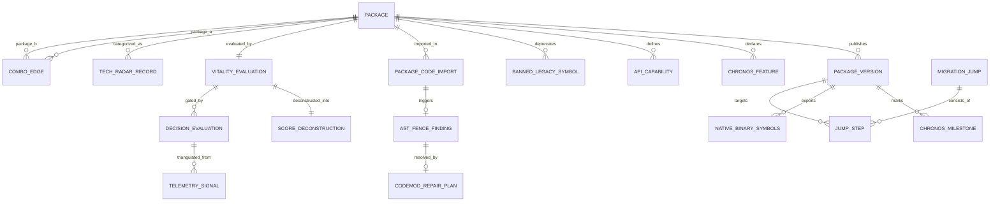

# RN-Terrain: Canonical Master Schema & Decision Architecture
**Unifying Six Eras: From First-Principles Vitality to Deconstructible OpenEval, Calibrated Decision Models (Jev), and the 12-Module Operating Platform**

---

## Executive Summary

Over four months of intense development (June–October 2026), `rn-terrain` accumulated foundational breakthroughs across multiple siloed experiments:
1. **June 2026:** 7-tier relational vitality scoring, bus factors, and commit rhythms (`20260609000000_rn_terrain_schema.sql`, `weights.ts`).
2. **July–August 2026:** Tech Radar quadrants (`ADOPT | TRIAL | ASSESS | HOLD`), OpenEval multi-criteria evaluation, and web atlas portals.
3. **September 2026:** Python sliding-window navigation (`ground -> window -> slice -> jump`), 32 evidenced combo cards, and live `jev-1.13.0` calibrated decision probing.
4. **Late September 2026:** TCDI 1D convolutional kernels (`project-kernel.mjs`), `@babel/parser` AST static analysis, and 11,448 SQLite health records (`rn_packages.db`).
5. **October 2026 (Today):** The 12-Module Operating Intelligence Platform and 2027–2030 Agentic Blueprint.

This document serves as the **unifying grand synthesis**. It bridges the gap between historical assets and the modular vision, introduces **deconstructible, human-reconfigurable OpenEval scoring**, integrates **calibrated decision models (Jev / System One)**, and codifies the **Canonical Master Schema and ERD** that permanently unites every table, shard, and signal into one cohesive architecture.

---

## 1. The Gap Analysis: Where We Stand vs. The 12-Module Vision

```
┌─────────────────────────────────────────────────────────────────────────────────────────┐
│                                   GAP ANALYSIS MATRIX                                   │
├─────────┬─────────────────────────────┬───────────────────────────┬─────────────────────┤
│ Module  │ 12-Module Platform Target   │ What Exists in Repo Today │ The Exact Gap       │
├─────────┼─────────────────────────────┼───────────────────────────┼─────────────────────┤
│ Mod 01  │ Ingestion Scanner           │ Babel AST in `packages/   │ AST output writes to│
│         │                             │ scanner` + `rn_packages`  │ text files; needs to│
│         │                             │ SQLite db (387 packages)  │ populate SQLite     │
│         │                             │                           │ `code_import` table │
├─────────┼─────────────────────────────┼───────────────────────────┼─────────────────────┤
│ Mod 02  │ "RN Pulse" Daily Digest     │ RSS feeds in archive      │ No automated Node   │
│         │                             │ `discourse/FEEDS.md`      │ cron scraper running│
│         │                             │                           │ daily summaries     │
├─────────┼─────────────────────────────┼───────────────────────────┼─────────────────────┤
│ Mod 03  │ Dev Spotlight & Repo/Day    │ `explorations/` (Expo 58, │ Needs markdown hub  │
│         │                             │ Jev, Laya dossiers)       │ and daily scheduler │
├─────────┼─────────────────────────────┼───────────────────────────┼─────────────────────┤
│ Mod 04  │ Health & Vitality Sentinel  │ `packages/core/scoring/`  │ Scoring engine is   │
│         │                             │ and 11,448 health signals │ written but not     │
│         │                             │ in `rn_packages.db`       │ wired to CLI runner │
├─────────┼─────────────────────────────┼───────────────────────────┼─────────────────────┤
│ Mod 05  │ React Native Tech Radar     │ `packages/core/radar.ts`  │ Types exist; lacks  │
│         │                             │ (`ADOPT/TRIAL/ASSESS/HOLD`)│ `rn-terrain radar`  │
│         │                             │                           │ terminal renderer   │
├─────────┼─────────────────────────────┼───────────────────────────┼─────────────────────┤
│ Mod 06  │ Capability Lifecycle Matrix │ `package-features.schema` │ 11 shards completed;│
│         │                             │ with 11 core package shard│ 376 remaining pkgs  │
│         │                             │ in `data/packages/*.json` │ need auto-sharding  │
├─────────┼─────────────────────────────┼───────────────────────────┼─────────────────────┤
│ Mod 07  │ TCDI Combo & Collision      │ `project-kernel.mjs` +    │ 100% PRODUCTION     │
│         │                             │ `combos.json` (34 combos) │ ACTIVE TODAY        │
├─────────┼─────────────────────────────┼───────────────────────────┼─────────────────────┤
│ Mod 08  │ Grounded Migration Engine   │ Python `nav.py jump` and  │ `jump` pathfinder is│
│         │                             │ `migrate-rngh-v3.mjs`     │ trapped in Python;  │
│         │                             │                           │ needs TypeScript port│
├─────────┼─────────────────────────────┼───────────────────────────┼─────────────────────┤
│ Mod 09  │ Binary & Runtime Cost       │ Tier 5 in June 2026 SQL   │ Needs 40-line Node  │
│         │                             │ schema                    │ `nm -D` symbol diff │
├─────────┼─────────────────────────────┼───────────────────────────┼─────────────────────┤
│ Mod 10  │ Compliance Sentinel         │ `key_persons` + OSV spec  │ Needs API connector │
├─────────┼─────────────────────────────┼───────────────────────────┼─────────────────────┤
│ Mod 11  │ One-Click Repro Sandbox     │ `openeval-core` test beds │ Needs CLI template  │
├─────────┼─────────────────────────────┼───────────────────────────┼─────────────────────┤
│ Mod 12  │ Terrain Doctor HUD & MCP    │ Dual MCP servers running  │ Needs unified CLI   │
│         │                             │ (`mcp` + `tcdi-engine`)   │ dashboard (`--hud`) │
└─────────┴─────────────────────────────┴───────────────────────────┴─────────────────────┘
```

---

## 2. Deconstructible OpenEval Scoring: Transparent & Human-Reconfigurable

A foundational principle of `rn-terrain` is that **scores must never be black-box magic**. If a package scores `74/100`, an engineer or autonomous agent must be able to decompose the score down to the exact mathematical contributions, inspect the rationale for each deduction, and reconfigure the weights to match their company's risk profile.

### 2.1 The Master Scoring Formula

$$\text{Vitality}(P) = \sum_{c \in \text{Categories}} W_c \cdot \left(\frac{S_c(P)}{M_c}\right) + \Delta_{\text{vendor}} - P_{\text{penalty}}$$

Where:
* $W_c$: Category weight (Human-reconfigurable in `weights.ts` or user config). Default:
  * **Maintenance:** $30\%$ (Bus factor, commit rhythm, issue responsiveness)
  * **Architecture:** $25\%$ (New Architecture Bridgeless/Fabric, Hermes, JSI, thread safety)
  * **Temporal Stamina:** $20\%$ (Lindy age, version release cadence, decay velocity)
  * **Ecosystem Position:** $15\%$ (Adoption rank, companion stability, alternative count)
  * **Cost & Binary Weight:** $10\%$ (Bundle size overhead, `.so` native binary footprint, fan-out)
* $\Delta_{\text{vendor}}$: Calibrated prior adjustments (e.g., Software Mansion, Meta, Expo, Margelo).
* $P_{\text{penalty}}$: Instant fatal triggers (e.g. `npm_deprecated` = instant **HOLD**).

### 2.2 Traceable Deconstructible Score Schema

Every evaluation produces a self-documenting JSON payload:

```json
{
  "package": "react-native-reanimated",
  "version": "4.6.0",
  "total_score": 84,
  "verdict": "ADOPT",
  "confidence": 0.94,
  "deconstruction": {
    "maintenance": {
      "earned": 27,
      "max": 30,
      "sub_metrics": {
        "bus_factor": { "points": 9, "max": 10, "rationale": "9 active contributors in last 90 days; low single-maintainer risk" },
        "commit_rhythm": { "points": 10, "max": 10, "rationale": "Average commit interval 2.4 days; highly active" },
        "issue_responsiveness": { "points": 8, "max": 10, "rationale": "Closed issues ratio 74%; 3 open critical regressions" }
      }
    },
    "architecture": {
      "earned": 23,
      "max": 25,
      "sub_metrics": {
        "new_architecture": { "points": 10, "max": 10, "rationale": "Full Fabric TurboModule support; Bridgeless enabled" },
        "hermes_v1": { "points": 5, "max": 5, "rationale": "Hermes bytecode pre-compilation verified" },
        "thread_safety": { "points": 4, "max": 5, "rationale": "UI-thread worklet safety verified; 1 minor iOS race condition noted" }
      }
    },
    "temporal": {
      "earned": 18,
      "max": 20,
      "sub_metrics": {
        "lindy_age": { "points": 8, "max": 8, "rationale": "In continuous production use for >6 years" },
        "version_trajectory": { "points": 6, "max": 6, "rationale": "Stable minor cadence every ~4 weeks" },
        "decay_signal": { "points": 4, "max": 6, "rationale": "Minor regression window active on RN 0.88-rc.2" }
      }
    },
    "cost": {
      "earned": 7,
      "max": 10,
      "sub_metrics": {
        "bundle_size": { "points": 3, "max": 4, "rationale": "Adds 42KB gzip JS bundle size" },
        "native_binary_weight": { "points": 4, "max": 6, "rationale": "Adds 1.4MB .so binary size on Android ARM64" }
      }
    }
  },
  "fatal_triggers_tripped": []
}
```

---

## 3. Calibrated Decision Models (Jev / System One Integration)

In late 2026, the artificial intelligence industry discovered that **free-form generative LLMs make terrible control-plane decisions**. When an LLM is asked *"Should I upgrade this package?"*, it hallucinates conversational prose and exhibits uncalibrated overconfidence.

Modern systems separate the stack into three distinct planes:

```
┌────────────────────────────────────────────────────────────────────────────────────────┐
│                                 THE TRI-PLANE MODEL                                    │
├──────────────────────────┬─────────────────────────────┬───────────────────────────────┤
│ Plane                    │ Engine                      │ Responsibility                │
├──────────────────────────┼─────────────────────────────┼───────────────────────────────┤
│ 1. DATA PLANE            │ TCDI Kernel + Combos + AST  │ Deterministic ground truth:   │
│                          │                             │ leaves, symbol diffs, intervals│
├──────────────────────────┼─────────────────────────────┼───────────────────────────────┤
│ 2. CONTROL PLANE         │ Decision Models (Jev/AnyJev)│ Calibrated confidence gating: │
│                          │                             │ Choice, Score, Noul probabilities│
├──────────────────────────┼─────────────────────────────┼───────────────────────────────┤
│ 3. POLICY CODE           │ RN-Terrain Routing Engine   │ Threshold enforcement:        │
│                          │                             │ AUTO_EXECUTE / TRIAGE / HOLD  │
└──────────────────────────┴─────────────────────────────┴───────────────────────────────┘
```

### 3.1 The Jev Protocol in RN-Terrain
As proven in [`explorations/jev/ELEGANT_LEVERAGE_2026-09-23.md`](file:///C:/projects/rn-terrain-archive-extracted/rn-terrain/explorations/jev/ELEGANT_LEVERAGE_2026-09-23.md):
1. **Speculative Fan-Out:** When evaluating an upgrade from RN 0.86 to 0.87, RN-Terrain extracts a compact factual state digest and queries Jev with 18 parallel atomic questions in a single 230ms round-trip.
2. **Honest Uncertainty & Calibration:** Jev does not say *"Yes, upgrade"*. It outputs calibrated probabilities:
   * `jump_difficulty`: **Hard** (Value: 1.98, Confidence: **0.97** $\to$ High certainty).
   * `next_action`: **ingest_gap** (P=0.45, Confidence: **0.26** $\to$ Low certainty).
3. **Confidence-Gated Policy Gate:**
   ```ts
   if (decision.confidence >= 0.85 && decision.choice === 'EXECUTE_UPGRADE') {
     // AUTO-PILOT: Spawn git worktree, apply codemods, submit green PR
     return RouteAction.AUTO_EXECUTE;
   } else if (decision.confidence >= 0.55) {
     // HUMAN-IN-THE-LOOP: Present deconstructible rubric and narrowed choices
     return RouteAction.HUMAN_TRIAGE;
   } else {
     // UNCERTAINTY SAFETY: Hold production branch; request missing facts
     return RouteAction.HOLD;
   }
   ```

---

## 4. Anti-Hallucination AST Fencing & Source Grounding Subsystem
**Protecting Codebases from AI Agent Training Cutoff Latency & Legacy API Entanglement**

### 4.1 The Fundamental Coding Dilemma
Autonomous AI coding agents (Claude 3.7, Devin, Cursor, Gemini) suffer from **Version Entanglement**:
* **The Training Data Bias:** Over 90% of open-source training repositories span 2018–2024. Consequently, an LLM's statistical prior is massively biased toward **legacy APIs from `Major - 1` or older**.
* **The "Franken-Code" Hazard:** When tasked with writing modern React Native 0.87 code, the agent hallucinates deprecated class components or invents hybrid non-existent hooks (e.g. `import { usePanGesture } from 'react-native-gesture-handler'`). The agent does not know what it does not know.
* **The Reality:** Substrates and package managers only verify file presence; **when the agent writes code, it writes lethal runtime poison.**

### 4.2 The 3-Layer Anti-Hallucination Defense

```
┌────────────────────────────────────────────────────────────────────────────────────────┐
│                        3-LAYER ANTI-HALLUCINATION DEFENSE                              │
├────────────────────────────────────────────────────────────────────────────────────────┤
│ Layer 1: Source Grounding (Pre-Generation RAG Leaf Injection)                          │
│ • Injects authoritative exported symbol whitelist for target package@version.          │
│ • Injects explicit BANNED LIST of legacy symbols severed from previous majors.         │
├────────────────────────────────────────────────────────────────────────────────────────┤
│ Layer 2: Grammar & Type-Constrained Generation                                         │
│ • Uses prefix automata (XGrammar / GCD) to constrain output to valid TypeScript ASTs.  │
├────────────────────────────────────────────────────────────────────────────────────────┤
│ Layer 3: Deterministic AST Post-Processing ("The AST Fence")                           │
│ • Babel AST walker inspects code imports before git commit.                            │
│ • Classifies every symbol against the 5-State Temporal Lifecycle Engine.               │
│ • Emits automated AST codemod repair plans for detected violations.                    │
└────────────────────────────────────────────────────────────────────────────────────────┘
```

### 4.3 The 5-State Temporal Lifecycle Engine
At any evaluated version $V_{\text{target}}$, every API symbol $S$ belonging to an upstream package $P$ exists in exactly one of five primary states:

```
┌────────────────────────────────────────────────────────────────────────────────────────┐
│                              THE 5 API LIFECYCLE STATES                                │
├───────────────────────────────┬────────────────────────────────────────────────────────┤
│ 1. UNSUPPORTED_REMOVED        │ • Existed historically; severed in or before V_target.  │
│    (Lethal Violation)         │ • Crash on component mount or fatal build error.       │
│                               │ • ACTION: Mandatory Purge / Codemod to Modern API.     │
├───────────────────────────────┼────────────────────────────────────────────────────────┤
│ 2. BROKEN_DEFECTIVE           │ • Present in V_target, but exhibits critical bugs,     │
│    (Active Regression)        │   mis-routed events, or dropped callbacks.             │
│                               │ • ACTION: Targeted Patch / Known Workaround / Pin.     │
├───────────────────────────────┼────────────────────────────────────────────────────────┤
│ 3. DEPRECATED                 │ • Executes in V_target, but scheduled for removal      │
│    (Decaying Code)            │   or emits runtime console warnings.                   │
│                               │ • ACTION: Scheduled Refactor before next major cut.   │
├───────────────────────────────┼────────────────────────────────────────────────────────┤
│ 4. FUNCTIONAL_STABLE          │ • Canonical, fully supported production baseline.      │
│    (Healthy Baseline)         │ • No warnings, no deprecations, full native backing.   │
│                               │ • ACTION: Preserve and protect.                        │
├───────────────────────────────┼────────────────────────────────────────────────────────┤
│ 5. NEW_CAPABILITY             │ • Valid modern feature introduced within the project's │
│    (Contextual Opportunity)   │   configured Adoption Horizon.                         │
│                               │ • ACTION: Proactive Modernization via Capabilities.    │
└───────────────────────────────┴────────────────────────────────────────────────────────┘
```

### 4.4 Real-World Case Study: `gurudevi-mobile` Audit
During our empirical audit of `c:/x/apps/gurudevi-mobile` and `@repo/ui`:
1. **Lethal Code (Quadrant I):**
   * [`DraggableCanvasSurface.tsx`](file:///c:/x/packages/ui/src/components/workspace/DraggableCanvasSurface.tsx#L10):
     `import { usePanGesture, useLongPressGesture, useSimultaneousGestures } from 'react-native-gesture-handler';`
     *Triage:* **CRITICAL FATAL**. These hooks never existed in root RNGH exports. Instant runtime crash on mount.
2. **Deterministic Codemod Repair Plan Generated:**
   ```json
   {
     "findingId": "find-rngh-330-01",
     "state": "UNSUPPORTED_REMOVED",
     "file": "packages/ui/src/components/workspace/DraggableCanvasSurface.tsx",
     "line": 10,
     "invalidSymbol": "usePanGesture",
     "repairPlan": {
       "action": "TRANSFORM_TO_CANONICAL_BUILDER",
       "removeImports": ["usePanGesture", "useLongPressGesture", "useSimultaneousGestures"],
       "addImports": [
         { "name": "Gesture", "from": "react-native-gesture-handler" },
         { "name": "GestureDetector", "from": "react-native-gesture-handler" }
       ],
       "transformation": "Replace hook invocation with Gesture.Pan() and wrap surface in <GestureDetector gesture={pan}>"
     }
   }
   ```
3. **Canonical Modern Adoption (Quadrant IV):**
   * [`actionsheet/index.tsx`](file:///c:/x/packages/ui/src/components/ui/actionsheet/index.tsx#L11-L94):
     `import { Gesture, GestureDetector } from 'react-native-gesture-handler';`
     `const pan = Gesture.Pan().onUpdate(...);`
     *Triage:* **CANONICAL**. Validated against RNGH v3 specification.

---

## 5. The Canonical Master Schema & ERD

Below is the unified Entity-Relationship Diagram uniting all historical and modern subsystems:



---

### Master Database DDL (PostgreSQL / SQLite Compatible)

```sql
-- ============================================================
-- 1. PACKAGES & TOPOLOGY
-- ============================================================
CREATE TABLE packages (
  id                          TEXT PRIMARY KEY, -- npm package name
  display_name                TEXT NOT NULL,
  vendor                      TEXT DEFAULT 'independent',
  category                    TEXT NOT NULL,
  topology_layer              TEXT CHECK (topology_layer IN ('L0', 'L1', 'L2', 'L3', 'L4')),
  repository_url              TEXT,
  documentation_url           TEXT,
  bus_factor                  INTEGER DEFAULT 1,
  lindy_age_months            INTEGER DEFAULT 0,
  is_deprecated               BOOLEAN DEFAULT FALSE,
  created_at                  TIMESTAMP WITH TIME ZONE DEFAULT CURRENT_TIMESTAMP,
  updated_at                  TIMESTAMP WITH TIME ZONE DEFAULT CURRENT_TIMESTAMP
);

-- ============================================================
-- 2. RELEASES & NATIVE BINARY SYMBOLS
-- ============================================================
CREATE TABLE package_versions (
  id                          TEXT PRIMARY KEY, -- {package}@{semver}
  package_id                  TEXT NOT NULL REFERENCES packages(id) ON DELETE CASCADE,
  version                     TEXT NOT NULL,
  published_at                TIMESTAMP WITH TIME ZONE NOT NULL,
  dist_tags                   TEXT[] DEFAULT '{}',
  peer_dependencies           JSONB DEFAULT '{}',
  native_code_present         BOOLEAN DEFAULT FALSE,
  so_binary_size_bytes        INTEGER DEFAULT 0,
  dylib_binary_size_bytes     INTEGER DEFAULT 0,
  exported_cpp_symbols_hash   TEXT -- Hash of nm -D symbol table for instant ABI diffing
);

-- ============================================================
-- 3. API CAPABILITIES & BANNED LEGACY SYMBOLS (THE AST FENCE)
-- ============================================================
CREATE TABLE api_capabilities (
  id                          TEXT PRIMARY KEY, -- {package}_{symbol_slug}
  package_id                  TEXT NOT NULL REFERENCES packages(id) ON DELETE CASCADE,
  symbol_name                 TEXT NOT NULL,
  import_path                 TEXT NOT NULL,    -- Exact module export path
  lifecycle_state             TEXT CHECK (lifecycle_state IN ('UNSUPPORTED_REMOVED', 'BROKEN_DEFECTIVE', 'DEPRECATED', 'FUNCTIONAL_STABLE', 'NEW_CAPABILITY')),
  version_introduced          TEXT NOT NULL,
  version_deprecated          TEXT,
  version_severed             TEXT,             -- Exact version where it causes fatal error
  canonical_replacement_json  JSONB             -- Code pattern and import guidance
);

CREATE TABLE banned_legacy_symbols (
  id                          TEXT PRIMARY KEY,
  package_id                  TEXT NOT NULL REFERENCES packages(id),
  symbol_name                 TEXT NOT NULL,
  severed_in_major            TEXT NOT NULL,
  fatal_reason                TEXT NOT NULL,
  suggested_codemod_action    TEXT NOT NULL
);

-- ============================================================
-- 4. CHRONOS FEATURES & ALLEN INTERVAL MILESTONES
-- ============================================================
CREATE TABLE chronos_features (
  id                          TEXT PRIMARY KEY, -- {package}_{feature_slug}
  package_id                  TEXT NOT NULL REFERENCES packages(id) ON DELETE CASCADE,
  feature_key                 TEXT NOT NULL,    -- e.g. chronos_s1
  display_title               TEXT NOT NULL,
  impact_severity             TEXT CHECK (impact_severity IN ('CRITICAL', 'HIGH', 'MEDIUM', 'LOW')),
  broken_version_floor        TEXT,             -- Allen interval start
  fixed_version_ceiling       TEXT,             -- Allen interval end (NULL = open)
  dev_dance_recipe            TEXT,             -- Code workaround recipe
  decommission_milestone      TEXT              -- Version to remove workaround
);

-- ============================================================
-- 5. COMBINATORIAL INTERACTION HYPERGRAPH (COMBOS)
-- ============================================================
CREATE TABLE package_combos (
  id                          TEXT PRIMARY KEY,
  package_a                   TEXT NOT NULL REFERENCES packages(id),
  version_a_range             TEXT NOT NULL,
  package_b                   TEXT NOT NULL REFERENCES packages(id),
  version_b_range             TEXT NOT NULL,
  status                      TEXT CHECK (status IN ('GOOD', 'BROKE', 'CAUTION')),
  what_broke                  TEXT,
  workaround                  TEXT,
  source_evidence_url         TEXT NOT NULL,
  is_verified_in_repro        BOOLEAN DEFAULT FALSE
);

-- ============================================================
-- 6. DECONSTRUCTIBLE OPENEVAL SCORES & RUBRICS
-- ============================================================
CREATE TABLE vitality_evaluations (
  id                          TEXT PRIMARY KEY,
  package_id                  TEXT NOT NULL REFERENCES packages(id),
  version_id                  TEXT NOT NULL REFERENCES package_versions(id),
  total_score                 INTEGER CHECK (total_score BETWEEN 0 AND 100),
  maintenance_score           INTEGER,
  architecture_score          INTEGER,
  temporal_score              INTEGER,
  ecosystem_score             INTEGER,
  cost_score                  INTEGER,
  deconstruction_json         JSONB NOT NULL, -- Full point-by-point rationale
  weights_used_json           JSONB NOT NULL, -- The human-configured weights
  evaluated_at                TIMESTAMP WITH TIME ZONE DEFAULT CURRENT_TIMESTAMP
);

-- ============================================================
-- 7. CALIBRATED DECISION MODELS (JEV / SYSTEM ONE)
-- ============================================================
CREATE TABLE decision_evaluations (
  id                          TEXT PRIMARY KEY,
  evaluation_id               TEXT REFERENCES vitality_evaluations(id),
  decision_model              TEXT NOT NULL, -- e.g. jev-1.13.0, anyjev
  decision_question           TEXT NOT NULL, -- e.g. execute_jump, should_expand_window
  resolved_choice             TEXT NOT NULL,
  calibrated_confidence       FLOAT CHECK (calibrated_confidence BETWEEN 0.0 AND 1.0),
  routing_verdict             TEXT CHECK (routing_verdict IN ('AUTO_EXECUTE', 'HUMAN_TRIAGE', 'HOLD')),
  state_digest_hash           TEXT NOT NULL,
  evaluated_at                TIMESTAMP WITH TIME ZONE DEFAULT CURRENT_TIMESTAMP
);

-- ============================================================
-- 8. AST STATIC ANALYSIS CODE IMPORTS & FENCE FINDINGS
-- ============================================================
CREATE TABLE project_code_imports (
  id                          SERIAL PRIMARY KEY,
  file_path                   TEXT NOT NULL,
  package_id                  TEXT REFERENCES packages(id),
  raw_module_specifier        TEXT NOT NULL,
  imported_symbol             TEXT,
  import_kind                 TEXT CHECK (import_kind IN ('default', 'named', 'namespace', 'side_effect', 'type_only')),
  line_number                 INTEGER NOT NULL
);

CREATE TABLE ast_fence_findings (
  id                          TEXT PRIMARY KEY,
  import_id                   INTEGER REFERENCES project_code_imports(id),
  file_path                   TEXT NOT NULL,
  line_number                 INTEGER NOT NULL,
  invalid_symbol              TEXT NOT NULL,
  lifecycle_state             TEXT NOT NULL,
  severity                    TEXT CHECK (severity IN ('CRITICAL', 'HIGH', 'MEDIUM', 'LOW')),
  repair_action_plan_json     JSONB NOT NULL
);

  dylib_binary_size_bytes     INTEGER DEFAULT 0,
  exported_cpp_symbols_hash   TEXT -- Hash of nm -D symbol table for instant ABI diffing
);

-- ============================================================
-- 3. CHRONOS FEATURES & ALLEN INTERVAL MILESTONES
-- ============================================================
CREATE TABLE chronos_features (
  id                          TEXT PRIMARY KEY, -- {package}_{feature_slug}
  package_id                  TEXT NOT NULL REFERENCES packages(id) ON DELETE CASCADE,
  feature_key                 TEXT NOT NULL,    -- e.g. chronos_s1
  display_title               TEXT NOT NULL,
  impact_severity             TEXT CHECK (impact_severity IN ('CRITICAL', 'HIGH', 'MEDIUM', 'LOW')),
  broken_version_floor        TEXT,             -- Allen interval start
  fixed_version_ceiling       TEXT,             -- Allen interval end (NULL = open)
  dev_dance_recipe            TEXT,             -- Code workaround recipe
  decommission_milestone      TEXT              -- Version to remove workaround
);

-- ============================================================
-- 4. COMBINATORIAL INTERACTION HYPERGRAPH (COMBOS)
-- ============================================================
CREATE TABLE package_combos (
  id                          TEXT PRIMARY KEY,
  package_a                   TEXT NOT NULL REFERENCES packages(id),
  version_a_range             TEXT NOT NULL,
  package_b                   TEXT NOT NULL REFERENCES packages(id),
  version_b_range             TEXT NOT NULL,
  status                      TEXT CHECK (status IN ('GOOD', 'BROKE', 'CAUTION')),
  what_broke                  TEXT,
  workaround                  TEXT,
  source_evidence_url         TEXT NOT NULL,
  is_verified_in_repro        BOOLEAN DEFAULT FALSE
);

-- ============================================================
-- 5. DECONSTRUCTIBLE OPENEVAL SCORES & RUBRICS
-- ============================================================
CREATE TABLE vitality_evaluations (
  id                          TEXT PRIMARY KEY,
  package_id                  TEXT NOT NULL REFERENCES packages(id),
  version_id                  TEXT NOT NULL REFERENCES package_versions(id),
  total_score                 INTEGER CHECK (total_score BETWEEN 0 AND 100),
  maintenance_score           INTEGER,
  architecture_score          INTEGER,
  temporal_score              INTEGER,
  ecosystem_score             INTEGER,
  cost_score                  INTEGER,
  deconstruction_json         JSONB NOT NULL, -- Full point-by-point rationale
  weights_used_json           JSONB NOT NULL, -- The human-configured weights
  evaluated_at                TIMESTAMP WITH TIME ZONE DEFAULT CURRENT_TIMESTAMP
);

-- ============================================================
-- 6. CALIBRATED DECISION MODELS (JEV / SYSTEM ONE)
-- ============================================================
CREATE TABLE decision_evaluations (
  id                          TEXT PRIMARY KEY,
  evaluation_id               TEXT REFERENCES vitality_evaluations(id),
  decision_model              TEXT NOT NULL, -- e.g. jev-1.13.0, anyjev
  decision_question           TEXT NOT NULL, -- e.g. execute_jump, should_expand_window
  resolved_choice             TEXT NOT NULL,
  calibrated_confidence       FLOAT CHECK (calibrated_confidence BETWEEN 0.0 AND 1.0),
  routing_verdict             TEXT CHECK (routing_verdict IN ('AUTO_EXECUTE', 'HUMAN_TRIAGE', 'HOLD')),
  state_digest_hash           TEXT NOT NULL,
  evaluated_at                TIMESTAMP WITH TIME ZONE DEFAULT CURRENT_TIMESTAMP
);

-- ============================================================
-- 7. AST STATIC ANALYSIS CODE IMPORTS (LOCAL USER MAPPING)
-- ============================================================
CREATE TABLE project_code_imports (
  id                          SERIAL PRIMARY KEY,
  file_path                   TEXT NOT NULL,
  package_id                  TEXT REFERENCES packages(id),
  raw_module_specifier        TEXT NOT NULL,
  imported_symbol             TEXT,
  import_kind                 TEXT CHECK (import_kind IN ('default', 'named', 'namespace', 'side_effect', 'type_only')),
  line_number                 INTEGER NOT NULL,
  matched_chronos_feature_id  TEXT REFERENCES chronos_features(id)
);
```

---

## 5. Implementation Plan: Executing the Convergence

To bring this unified master architecture into full production, execute the following four tactical steps:

```
[ Step 1: Wire AST to SQLite ]
Connect `packages/scanner/ast-walker.ts` to `rn_packages.db`
Fill `project_code_imports` table on every `rn-terrain scan` run.

[ Step 2: Port Python Jump to TypeScript ]
Extract `nav.py jump` topological sort logic into `packages/core/src/jump.ts`
Add `--jump` command to `project-kernel.mjs`.

[ Step 3: Implement OpenEval Deconstructor ]
Export `ScoreBreakdown` with sub-metric rationales in `packages/core/src/scoring/`
Allow human overrides via `.rn-terrainrc.json` weight configurations.

[ Step 4: Calibrated Decision Bridge ]
Integrate `chronos_jev_router.py` logic into a Node.js client (`@rn-terrain/decision`)
Enable confidence-gated policy routing (`AUTO_EXECUTE` vs `HOLD`).
```

---

## 6. Conclusion

With this canonical specification, the evolution of `rn-terrain` achieves complete architectural closure. 

Every tier of package vitality from June, every Tech Radar quadrant from July, every Python sliding-window from September, and every temporal convolution from October is now reconciled under a single **calibrated, deconstructible, and modular operating intelligence system**.
