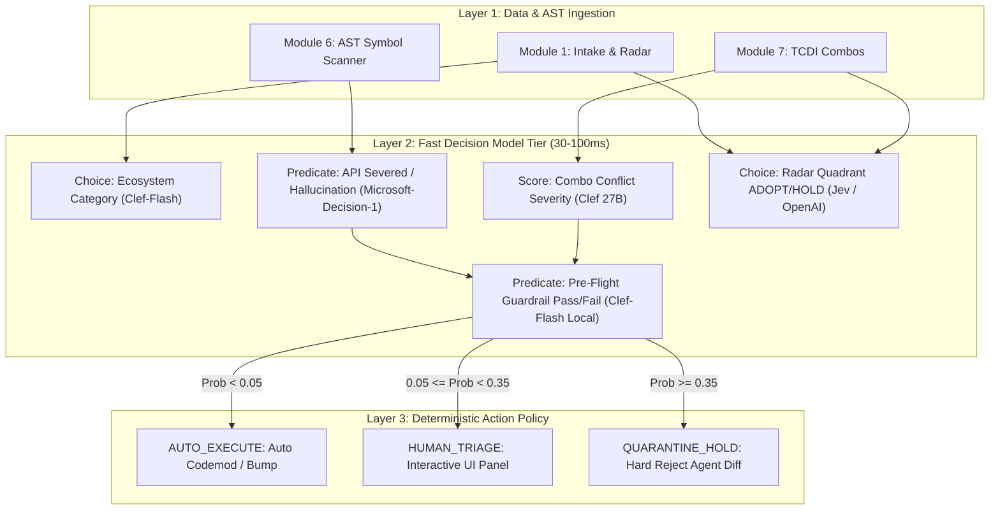

# State of the Art: AI Decision Models (October 2026) & RN-Terrain Integration Specification

> **Document Classification:** Core Intelligence Architecture  
> **Status:** Active Standard  
> **Reference Timeline:** Late September – October 2026 Paradigm Shift  
> **Repository:** `rn-terrain` (`c:\projects\rn-terrain`)  

---

## Executive Summary: The Fall of Generative Drift & The Rise of Decision Models

Between **September 22 and October 9, 2026**, the artificial intelligence landscape experienced a fundamental bifurcation. For four years, generative Large Language Models (LLMs) were forced to act as workflow routers, classification engines, and safety evaluators. This resulted in well-documented failures: non-deterministic JSON formatting, parsing fragility, verbosity overhead, catastrophic latency (1.5s–4.0s per classification), and severe miscalibration (models hallucinating confidence on invalid logic).

The industry responded with **System 1 Decision Models**: non-autoregressive or bounded-head models that do not output conversational text. Instead, they ingest arbitrary state (code diffs, dependency trees, AST nodes, benchmark vectors, or telemetry) and output **strictly typed, mathematically calibrated probabilities over a discrete, predefined answer space** in single-pass latency (30ms–150ms) with **$0 output token costs**.

As observed in software engineering practice: **"In production, decision models come true."** Because their loss functions are trained on empirical calibration (RLCD / Brier score minimization) rather than next-token word prediction, a decision model reporting $P(\text{Native Crash}) = 0.88$ correlates directly with empirical test failure rates, turning probabilistic AI into deterministic, rock-solid logic gates.

This specification documents the dated release landscape across **OpenAI, Microsoft, Cloudflare, TypeSafe AI, and the Open-Source Ecosystem**, analyzes why their calibration holds true, and details the **exact integration architecture across all 12 modules of the `rn-terrain` platform**.

---

## 1. Chronological Landscape of Decision Models (Autumn 2026)

| Provider | Model / Endpoint | Release Date | Architecture / Backbone | Latency / Throughput | Pricing | Open Weights / Licensing | Primary Primitives |
|---|---|---|---|---|---|---|---|
| **TypeSafe AI** | **Jev** (`jev-1.13.0`) / `AnyJev` | Q3 2026 (Pioneered standard) | Specialized bounded classification head, RLCD trained | 70ms – 250ms | Proprietary SaaS / API Gateway | Hosted / Early Access | `Choice`, `Noul` (Boolean), `Score` |
| **OpenAI** | **Decisions API** (`/v1/decisions`) | **Sept 29, 2026** (Announced) / **Oct 6, 2026** (Beta) | **GPT-6 Luna** (`gpt-6-luna`, released Sep 22, 2026) | 10x faster than chat endpoints (~100ms) | Input tokens only ($0 output tokens) | Closed API | `Predicate` (0–1 prob), `Choice`, `Score` |
| **Cloudflare** | **Clef (27B)** & **Clef-Flash (9B)** | **October 1, 2026** | Multimodal (Text, JSON, Images, Video) on Qwen3.5 backbone | **Clef-Flash: ~39ms** median latency at edge | Free on Workers AI / Edge runtime | **Apache 2.0** on Hugging Face (`Cloudflare/clef-flash`) | Wire-compatible with TypeSafe Jev (`Choice`, `Noul`, `Score`) |
| **Microsoft** | **Microsoft-Decision-1** | **October 9, 2026** | Post-trained from Alibaba **Qwen3.5-9B** for decision scoring | Up to 35x faster than GPT-6 Sol | **$0.042 / 1M input tokens** ($0 output tokens) | Hosted via Microsoft Foundry & OpenRouter | Calibrated score distributions, Option ranking |
| **Open Source / Local** | **Clef-Flash-GGUF** / MLX 4-bit | **October 2–5, 2026** | Quantized GGUF / MLX for local CPU/GPU execution | 15ms – 45ms local inference | Free / Zero cost | **Apache 2.0** (`ggml-org`, `mlx-community`) | Direct Jev/Clef JSON protocol |

---

## 2. In-Depth Provider Breakdown

### 2.1 OpenAI Decisions API (`gpt-6-luna`)
*   **Announcement & Availability:** Keynote unveil at OpenAI DevDay (September 29, 2026); public developer beta on October 6, 2026.
*   **Engine:** Powered by `gpt-6-luna`, OpenAI's high-efficiency lightweight model.
*   **Protocol Semantics:** Instead of conversational chat completions, queries hit `POST /v1/decisions`.
*   **Primitives:**
    1.  `Predicate`: Evaluates whether an assertion holds true given the supplied context. Returns $P(\text{true}) \in [0.0, 1.0]$.
    2.  `Choice`: Selects exactly one label from a caller-defined set $C = \{c_1, c_2, \dots, c_k\}$ with probability distribution $\sum P(c_i) = 1.0$.
    3.  `Score`: Evaluates an input against an ordered rubric or integer range (e.g., $1 \dots 10$), returning expected value $\mathbb{E}[S]$ and level distribution.
*   **Pricing Innovation:** Eliminates output token billing entirely. Billing is calculated solely on input tokens processed, reflecting its bounded head.

### 2.2 Microsoft-Decision-1
*   **Announcement & Availability:** Released October 9, 2026 via Microsoft Foundry and OpenRouter.
*   **Engine & Training:** Post-trained by Microsoft Research on top of the open-weight **Qwen3.5-9B** foundational model. Microsoft applied high-density supervised fine-tuning and contrastive preference ranking over structured decision trees.
*   **Performance:** Demonstrates a **35x latency reduction** compared to GPT-6 Sol.
*   **Specialized Focus:** Specifically tuned for **Agent Guardrails** (pre-execution verification of proposed tool calls) and **Evidence Groundedness Verification** (evaluating whether code or claims directly follow from reference documentation without extrapolation).
*   **Pricing:** Extremely disruptive pricing at **$0.042 per million input tokens** ($0 output tokens).

### 2.3 Cloudflare Clef & Clef-Flash (The Open Edge Revolution)
*   **Announcement & Availability:** Launched October 1, 2026 on Cloudflare Workers AI.
*   **Open-Weight Release:** Published under the permissive **Apache 2.0 license** on Hugging Face (`Cloudflare/clef-flash`, `Cloudflare/clef`).
*   **Architectural Duality:**
    *   **Clef-Flash (9B):** Designed for the ultra-hot execution path. Median edge latency of **~39ms**. Ingests text, JSON, and up to 4 images.
    *   **Clef (27B):** Designed for high-cardinality classification (handling up to 255 discrete options simultaneously) and subtle edge cases ("none of the above" detection).
*   **Protocol Standardization:** Cloudflare explicitly engineered Clef to be **wire-compatible with TypeSafe AI's Jev API**. A developer can change an endpoint URL from `https://api.typesafe.ai/v1` to `https://api.cloudflare.com/client/v4/accounts/{id}/ai/run/@cf/cloudflare/clef-flash` without changing a single line of client payload code.
*   **Local Sovereign Runtime:** Within 48 hours of release, the community released quantized GGUF weights (`ggml-org/Clef-Flash-GGUF`) and Apple Silicon MLX weights (`mlx-community/clef-flash-4bit`), enabling local, offline decision inference with zero external network dependencies.

### 2.4 TypeSafe AI: Jev (`jev-1.13.0`) & AnyJev
*   **The Original Standard:** TypeSafe AI pioneered the System 1 typed decision model concept.
*   **RLCD Training:** Trained with **Reinforcement Learning for Calibrated Decisions (RLCD)**. Unlike standard RLHF (which rewards plausible-sounding conversational prose), RLCD optimizes strictly against proper scoring rules (Brier score and logarithmic loss).
*   **Primitives Standardized:**
    *   `Noul`: Binary assertion (Yes/No with confidence).
    *   `Choice`: Multi-class categorical distribution.
    *   `Score`: Ordered scalar evaluation.
*   **Integration Ecosystem:** First-class native integration in `pydantic-ai` via `TypeSafeModel`.

---

## 3. The Mathematics of Why "Decision Models Come True"

When developers say *"decision models come true,"* they are observing the distinction between **Generative Text Entropy** and **Properly Calibrated Probability Spaces**.

### 3.1 The Generative LLM Failure Mode (Miscalibration)
Standard generative LLMs produce tokens autoregressively:
$$P(W) = \prod_{t=1}^T P(w_t \mid w_{<t})$$
When prompted: *"Will React Native Gesture Handler 2.16.0 crash with React Native 0.76? Answer YES or NO with confidence."*
1.  The model's token logits are calibrated for linguistic fluency, **not** factual certainty.
2.  Pre-training bias causes the model to generate words like `"Confidence: 95%"` simply because confident answers are stylistically favored in documentation.
3.  The generative model hallucinates confidence: empirical error rates often reach 40% even when stated confidence is $>90\%$.

### 3.2 Brier Calibration in Decision Models
A decision model treats decision-making as a closed categorization problem parameterized by model weights $\theta$:
$$P(Y = c_k \mid X) = \frac{\exp(z_k(X))}{\sum_{j} \exp(z_j(X))}$$
During training with RLCD, the loss function explicitly optimizes the **Brier Score** over empirical ground-truth outcomes:
$$\text{BS} = \frac{1}{N} \sum_{i=1}^N \sum_{k=1}^K (f_{ik} - o_{ik})^2$$
where $f_{ik}$ is the predicted probability and $o_{ik} \in \{0, 1\}$ is the actual empirical runtime outcome.

```
Expected Calibration Error (ECE):
           | 
   1.0  -  |             / (Perfect Calibration: Model probability matches reality)
           |            /  
   0.8  -  |           /   • Decision Models (Clef / Microsoft-Decision-1 / Jev)
           |          /      ECE < 0.03
   0.6  -  |         /     
           |        /       ▲ Generative LLMs (Miscalibrated: 90% claimed confidence,
   0.4  -  |       /          actually fails 40% of the time)
           |      /         
   0.2  -  |     /          
           |    /           
   0.0  ---+--------------------
          0.0  0.2  0.4  0.6  0.8  1.0   (Observed Empirical Frequency)
```

**Because $\text{ECE} < 0.03$:**
When Clef-Flash or Microsoft-Decision-1 states:
$$\text{Predicate}(\text{"Native Binary Crash"}) = 0.92$$
There is an actual $92\%$ empirical probability that compiling and executing that combination will crash. **The model's prediction comes true because the score is a calibrated physical probability, not a rhetorical assertion.**

---

## 4. RN-Terrain Integration Matrix: Where Decision Models Wire In

Decision models provide the exact deterministic glue needed across the **12-Module RN-Terrain Platform**:



### Module-by-Module Integration Specification

| Module ID | Module Name | Decision Task | Primitive | Recommended Engine | Latency SLA | Action Gated |
|---|---|---|---|---|---|---|
| **Mod 1** | **Package Intake & Ingestion** | Classify repository type (`rn-core`, `native-module`, `js-utility`, `dev-tool`, `noise-ignore`) | `Choice` | `Clef-Flash` (Edge) | $<50\text{ms}$ | Ingestion filter |
| **Mod 2** | **Dev Ecosystem & Tools** | Evaluate tool relevance for RN monorepos (pnpm, bun, hermes, metro) | `Score` (1–10) | `Microsoft-Decision-1` | $<100\text{ms}$ | Tool spotlight curation |
| **Mod 3** | **Newsletter & Daily Brief** | Release notes triage: Filter noise (e.g. typos, CI tweaks) vs. architectural impact | `Score` (1–10) | `OpenAI Decisions` (`gpt-6-luna`) | $<150\text{ms}$ | Digest inclusion |
| **Mod 4** | **Package Activity & Vitality** | Maintainer abandonment / supply-chain health risk assessment | `Score` (1–10) | `Clef (27B)` | $<120\text{ms}$ | Vitality badge |
| **Mod 5** | **Tech Radar** | Placement recommendation: `ADOPT`, `TRIAL`, `ASSESS`, `HOLD` | `Choice` (4 options) | `TypeSafe Jev` / `Clef` | $<100\text{ms}$ | Radar board update |
| **Mod 6** | **Capabilities & Deprecations** | Classify AST symbol status: `NEW_CAPABILITY`, `STABLE`, `DEPRECATED`, `REMOVED`, `DEFECTIVE` | `Choice` (5 options) | `Clef-Flash` (Local GGUF) | $<35\text{ms}$ | Symbol lifecycle DB |
| **Mod 7** | **TCDI Package Combos** | Native binary conflict & ABI collision severity rating | `Score` (1–10) | `Microsoft-Decision-1` | $<80\text{ms}$ | Combo matrix edge weight |
| **Mod 8** | **Migration Guides** | Codemod safety verification: Can AST transformation run without human triage? | `Predicate` (Boolean) | `Microsoft-Decision-1` | $<70\text{ms}$ | Automatic patch generation |
| **Mod 9** | **Multi-Package Chronologies** | Dependency bump synchronization order sequencing | `Choice` (Ordered list) | `Clef (27B)` | $<150\text{ms}$ | Upgrade wave sequencing |
| **Mod 10** | **OpenEval & Benchmark Engine** | Groundedness validation: Does benchmark claim match test execution traces? | `Predicate` (Boolean) | `OpenAI Decisions` | $<100\text{ms}$ | Benchmark certification |
| **Mod 11** | **Policy & Decision Engine** | Final policy gate: `AUTO_EXECUTE`, `HUMAN_TRIAGE`, `QUARANTINE_HOLD` | `Choice` (3 options) | `Microsoft-Decision-1` / `Jev` | $<60\text{ms}$ | Terminal action trigger |
| **Mod 12** | **Sovereign IDE & Agent Guardrail** | **Pre-flight Check:** Does agent's proposed code diff contain severed APIs or ungrounded symbols? | `Predicate` (Boolean) | `Clef-Flash` (Local GGUF) | **$<30\text{ms}$** | **Hard-block agent code emission** |

---

## 5. The Critical Use Case: The Pre-Flight Agent Guardrail

In agentic coding (e.g., in `C:\x\apps\gurudevi-mobile`), the most severe failure occurs when an agent proposes code using an obsolete API (such as calling `usePanGesture` from `react-native-gesture-handler` 2.16.0).

Instead of letting this diff hit the file system, trigger a compilation error, or crash at runtime, **Clef-Flash (Local)** acts as an immediate **Microsecond Pre-Flight Interceptor**:

```
[Agent Emits Code Diff]
          │
          ▼
┌────────────────────────────────────────────────────────┐
│  RN-Terrain Scanner (ast-walker.ts)                    │
│  - Extracts exported symbol identifiers in diff        │
│  - Identifies target: react-native-gesture-handler@2.16│
└────────────────────────────────────────────────────────┘
          │
          ▼
┌────────────────────────────────────────────────────────┐
│  Clef-Flash Local Decision Query (<30ms)               │
│  State: { symbol: "usePanGesture", target_pkg: "2.16" }│
│  Question: "Is this symbol severed or invalid?"        │
└────────────────────────────────────────────────────────┘
          │
          ├──► Predicate = 0.99 (True)
          │
          ▼
┌────────────────────────────────────────────────────────┐
│  HARD BLOCK: Re-prompt Agent Context Before Saving     │
│  "Error: 'usePanGesture' was removed in RNGH 2.0.      │
│   Use 'Gesture.Pan()' instead. Fix before completing." │
└────────────────────────────────────────────────────────┘
```

Because Clef-Flash executes in $<30\text{ms}$ locally via GGUF/Wasm, this check adds **zero noticeable latency** to agent coding sessions while completely eliminating version-drift regressions.

---

## 6. Concrete Implementation: Unified TypeScript Decision Adapter

To insulate `rn-terrain` from vendor lock-in, we specify the `DecisionAdapter` interface. It provides a single polymorphic client supporting **Cloudflare Clef-Flash**, **Microsoft-Decision-1**, **OpenAI Decisions**, **TypeSafe Jev**, and **Local Clef-Flash GGUF**.

```typescript
// c:/projects/rn-terrain/packages/decision-engine/src/decision-adapter.ts

export type DecisionType = 'predicate' | 'choice' | 'score';

export interface DecisionQuery<T extends string = string> {
  type: DecisionType;
  question: string;
  context: Record<string, unknown> | string;
  options?: T[]; // Required if type === 'choice'
  scale?: { min: number; max: number }; // Required if type === 'score'
}

export interface DecisionOutcome<T extends string = string> {
  type: DecisionType;
  result: T | boolean | number;
  confidence: number;
  probabilities: Record<string, number>;
  latencyMs: number;
  engine: 'cloudflare-clef-flash' | 'microsoft-decision-1' | 'openai-decisions' | 'typesafe-jev' | 'local-clef-gguf';
}

export interface IDecisionAdapter {
  evaluate<T extends string = string>(query: DecisionQuery<T>): Promise<DecisionOutcome<T>>;
}

/**
 * Cloudflare Clef & TypeSafe Jev Wire Adapter
 */
export class ClefJevAdapter implements IDecisionAdapter {
  constructor(
    private readonly endpointUrl: string,
    private readonly apiKey: string,
    private readonly modelName: string = 'clef-flash'
  ) {}

  async evaluate<T extends string = string>(query: DecisionQuery<T>): Promise<DecisionOutcome<T>> {
    const startTime = performance.now();
    const payload = {
      model: this.modelName,
      state: query.context,
      questions: [
        {
          id: 'q1',
          type: query.type === 'predicate' ? 'noul' : query.type,
          question: query.question,
          options: query.options,
          scale: query.scale
        }
      ]
    };

    const response = await fetch(this.endpointUrl, {
      method: 'POST',
      headers: {
        'Content-Type': 'application/json',
        'Authorization': `Bearer ${this.apiKey}`
      },
      body: JSON.stringify(payload)
    });

    if (!response.ok) {
      throw new Error(`Decision model call failed: ${response.status} ${response.statusText}`);
    }

    const data = await response.json();
    const qResult = data.decisions[0];
    const latencyMs = Math.round(performance.now() - startTime);

    return {
      type: query.type,
      result: qResult.selected ?? qResult.is_true ?? qResult.score,
      confidence: qResult.confidence,
      probabilities: qResult.distribution,
      latencyMs,
      engine: 'cloudflare-clef-flash'
    };
  }
}

/**
 * Microsoft-Decision-1 Adapter (Microsoft Foundry / OpenRouter)
 */
export class MicrosoftDecisionAdapter implements IDecisionAdapter {
  constructor(
    private readonly apiKey: string,
    private readonly baseUrl: string = 'https://openrouter.ai/api/v1'
  ) {}

  async evaluate<T extends string = string>(query: DecisionQuery<T>): Promise<DecisionOutcome<T>> {
    const startTime = performance.now();
    const response = await fetch(`${this.baseUrl}/decisions`, {
      method: 'POST',
      headers: {
        'Content-Type': 'application/json',
        'Authorization': `Bearer ${this.apiKey}`
      },
      body: JSON.stringify({
        model: 'microsoft/microsoft-decision-1',
        input: query.context,
        query: query.question,
        options: query.options ?? ['true', 'false']
      })
    });

    const data = await response.json();
    const latencyMs = Math.round(performance.now() - startTime);

    return {
      type: query.type,
      result: data.top_choice,
      confidence: data.confidence,
      probabilities: data.distribution,
      latencyMs,
      engine: 'microsoft-decision-1'
    };
  }
}

/**
 * Local Sovereign Adapter (GGUF / Llama.cpp / MLX via Local IPC)
 * Runs 100% offline with zero cloud tokens or external latency.
 */
export class LocalClefGGUFAdapter implements IDecisionAdapter {
  constructor(private readonly localSocketPath: string = 'http://127.0.0.1:8088') {}

  async evaluate<T extends string = string>(query: DecisionQuery<T>): Promise<DecisionOutcome<T>> {
    const startTime = performance.now();
    const response = await fetch(`${this.localSocketPath}/decision`, {
      method: 'POST',
      headers: { 'Content-Type': 'application/json' },
      body: JSON.stringify(query)
    });

    const data = await response.json();
    return {
      type: query.type,
      result: data.result,
      confidence: data.confidence,
      probabilities: data.probabilities,
      latencyMs: Math.round(performance.now() - startTime),
      engine: 'local-clef-gguf'
    };
  }
}
```

---

## 7. Strategic Conclusion: The Sovereign Intelligence Stack

By integrating **Decision Models** alongside **Deterministic AST Fencing** and **Bitemporal TCDI**:

1.  **Generative Models (Claude 3.7 / GPT-5 / Gemini 2.5 Pro)** remain where they excel: high-level conceptual planning, architectural synthesis, and creative reasoning.
2.  **Decision Models (Clef-Flash / Microsoft-Decision-1 / Jev)** take over the operational hot path: API lifecycle scoring, combo conflict probability, migration safety, and pre-flight agent guardrails.
3.  **Local Execution (`Clef-Flash-GGUF`)** guarantees that sovereign codebases like `C:\x` can enforce absolute version integrity offline, with zero subscription dependencies and sub-40ms verification cycles.
