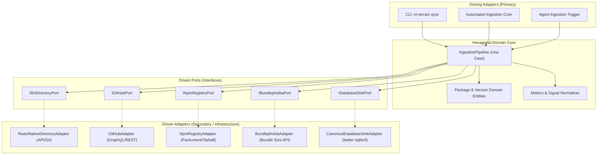

# Pre-Flight Agent Compass, Rust Tooling Synergy, Callstack Apex Models, and Hexagonal Ingestion Architecture

> **Document Classification:** System Architecture, Agent Gateway & Polyglot Ingestion Standard  
> **Status:** Active Production Standard (Autumn 2026)  
> **Repository:** `rn-terrain` (`c:\projects\rn-terrain`)  
> **Consumer Repositories:** Sovereign Monorepo (`C:\x`), `apps/gurudevi-mobile`, `@repo/ui`  

---

## Executive Summary: The Agent's First Stop Before Touching React Native

When an AI coding agent (Claude Code, Cursor, Copilot, Gemini CLI, or custom autonomous subagent) begins work on a React Native repository, its single greatest hazard is **Pre-training Training Cutoff Entanglement**. Because $>90\%$ of open-source React Native code on the web was written for legacy architectures (Paper bridge, Reanimated v2 worklets, React Native Gesture Handler v1), agents instinctively hallucinate severed APIs like `usePanGesture()` or `useAnimatedGestureHandler()`.

To solve this, `rn-terrain` establishes the **Agent Pre-Flight Compass**: the mandatory, microsecond-latency first stop for any coding agent before generating a single line of React Native code. 

Furthermore, this specification addresses three critical frontiers:
1. **The Rust Tooling Synergy:** Composing `rn-terrain` with the sovereign "Shiny Tools" suite (`rg`, `fd`, `sd`, `bat`, `eza`, `delta`, `oxlint`, `biome`, and `@ast-grep/napi`).
2. **Niche React Native Models & GNN Frontiers:** The emergence of Callstack's **Apex coding model** (generally available October 1, 2026), on-device `react-native-ai`, and Directed Graph Neural Networks (GNNs) trained over Code Property Graphs (CPGs).
3. **Hexagonal Data Ingestion (Ports & Adapters):** A decoupled, resilient ingestion engine uniting **React Native Directory**, **GitHub**, **npm registry**, and **Bundlephobia** into the canonical Bitemporal SQLite database.

---

## 1. The Pre-Flight Agent Compass: The First Place an Agent Looks

```
┌─────────────────────────────────────────────────────────────────────────────┐
│                       THE AGENT'S CODING LIFECYCLE                          │
│                                                                             │
│   ❌ TRADITIONAL (POISONED) WORKFLOW:                                       │
│   User Prompt ──► Agent Guesses APIs ──► Emits Major-1 Code ──► SIGSEGV Crash│
│                                                                             │
│   ✅ RN-TERRAIN COMPASS WORKFLOW:                                           │
│   User Prompt ──► [rn-terrain compass] ──► Grounded Whitelist ──► Clean Code │
│                         │                                                   │
│                         ├── 🚫 Forbidden / Severed APIs                     │
│                         ├── ✅ Canonical Modern Replacements                │
│                         ├── ⚡ New Architecture Flags (Fabric/Turbo)        │
│                         └── ⚠️ Peer Combo Conflicts                         │
└─────────────────────────────────────────────────────────────────────────────┘
```

### 1.1 The Compass Contract
Before an agent writes or modifies any `.tsx` file, it calls:
```bash
rn-terrain compass react-native-gesture-handler@2.16.0
# or via MCP:
tcdi_compass({ package_name: "react-native-gesture-handler", version: "2.16.0" })
```

### 1.2 Instant Structured Output (JSON / Terminal Card)
The Compass returns a single, dense, agent-optimized briefing:
```json
{
  "package": "react-native-gesture-handler",
  "version": "2.16.0",
  "architecture": "NEW_ARCHITECTURE_FABRIC_READY",
  "banned_severed_symbols": [
    {
      "identifier": "usePanGesture",
      "status": "UNSUPPORTED_REMOVED",
      "replacement": "Gesture.Pan()",
      "codemod_hint": "Wrap gesture in GestureDetector: <GestureDetector gesture={pan} />"
    }
  ],
  "allowed_modern_symbols": [
    "Gesture.Pan()",
    "Gesture.Tap()",
    "GestureDetector",
    "GestureHandlerRootView"
  ],
  "known_peer_conflicts": [
    {
      "peer": "react-native-reanimated",
      "safe_range": ">=3.10.0",
      "conflict_note": "Reanimated v2 hooks cause worklet thread crash"
    }
  ],
  "preflight_instruction": "STRICT WARNING: Do NOT import usePanGesture. Use Gesture.Pan() with GestureDetector."
}
```

By injecting this compass output into the agent's context window, the agent writes 100% version-grounded code on the first attempt.

---

## 2. The Rust Tooling Synergy: Composing with Sovereign "Shiny Tools"

In sovereign monorepos such as `C:\x`, developers maintain a suite of ultra-fast Rust CLI tools (the "Shiny Tools"):

| Rust Tool | Purpose | Synergy with `rn-terrain` |
|---|---|---|
| **`rg`** (*ripgrep*) | Line-by-line regex code search | Hot-path file discovery and fast text candidate pre-filtering before AST parsing |
| **`fd`** (*fd-find*) | Fast directory navigation | Traverses monorepo packages (`apps/`, `packages/`) ignoring gitignore in $<10\text{ms}$ |
| **`sd`** (*sd*) | Stream editor / Regex replacer | Fast batch string replacement during automated migration phases |
| **`bat`** (*bat*) | Syntax-highlighted file viewing | Terminal preview of codemod diffs and compass briefings |
| **`eza`** (*eza*) | Modern tree directory viewer | Visualizing package dependency hierarchies in terminal |
| **`delta`** (*git-delta*) | Syntax-highlighted git diffs | Visualizing pre-flight AST repair patches before committing |
| **`oxlint`** (*Oxc*) | Rust-based JS/TS linter | 50x faster than ESLint; checks syntax and basic errors before deep TCDI analysis |
| **`biome`** (*Biome*) | Rust formatter & analyzer | Formatting generated codemods and verifying AST cleanliness |
| **`@ast-grep/napi`** | Rust Tree-sitter AST engine | Powers `rn-terrain`'s structural pattern matching with zero Node compilation |

### Architectural Position:
`rn-terrain` does not reinvent low-level string manipulation or file-walking. Instead:
1.  **File Crawling:** Leverages `fd` or native fast FS.
2.  **Structural Semantics:** Handled by `@ast-grep/napi` (Rust Tree-sitter N-API).
3.  **Coordination & Graph Intelligence:** Executed in the `rn-terrain` TypeScript core with bitemporal SQLite.

---

## 3. Niche React Native Models & Callstack Apex Architecture

### 3.1 Callstack Apex Coding Model (October 2026)
On **October 1, 2026**, Callstack made its specialized **Apex coding model** generally available. 
*   **Domain Specialization:** Unlike broad frontier models (GPT-4o, Claude 3.5 Sonnet) whose pre-training data is 95% generic web code, Apex was specifically post-trained on **React Native New Architecture (Fabric/TurboModules), JSI bindings, and Next.js full-stack mobile bridges**.
*   **Agentic Skills:** Integrated natively with `callstackincubator/agent-skills` to provide context-aware mobile debugging, memory profiling, and gesture migration.
*   **On-Device Models:** Supported by Callstack's `react-native-ai` for offline local-first inference on mobile hardware via MLC LLM.

### 3.2 Directed Graph Neural Networks (GNNs) on Code Property Graphs
The frontier of code reasoning is shifting from flat sequence tokenization to **Directed Graph Neural Networks (DGNNs)** operating on **Code Property Graphs (CPGs)**:

```
[TypeScript TurboModule Spec]
         │ (AST edge)
         ▼
[C++ JSI Header Node] ──── (Call Graph) ───► [Android JNI / Kotlin Method Node]
         │
         │ (Taint / Dataflow Edge)
         ▼
[Fabric Shadow Tree Node]
```

1.  **Node Representations:** Every node represents an AST element, basic block, or native bridge binding.
2.  **Edge Representations:** Directed typed edges (`imports`, `invokes_jsi`, `marshals_jni`, `flows_to`).
3.  **Graph Convolution:** A specialized Graph Convolutional Network (GCN / GAT) computes node embeddings $\mathbf{h}_v^{(l+1)} = \sigma \left( \sum_{u \in \mathcal{N}(v)} \mathbf{W} \mathbf{h}_u^{(l)} \right)$.
4.  **Collision Prediction:** When a package version bumps, the DGNN predicts binary ABI incompatibilities without needing to execute a 15-minute native Gradle compilation build.

---

## 4. Hexagonal Architecture: Multi-Source Data Ingestion Engine

To continuously feed the canonical Bitemporal SQLite database, `rn-terrain` utilizes **Hexagonal Architecture (Ports & Adapters)**. This insulates domain logic from third-party API changes, rate limits, and network volatility.



### 4.1 The Driven Ports (Interfaces)

1.  **`IRnDirectoryPort`**:
    - `fetchDirectoryCatalog(): Promise<RnDirectoryEntry[]>`
    - Ingests curated Expo SDK compatibility, New Architecture support flags, and maintainer classifications.
2.  **`IGitHubPort`**:
    - `fetchRepoMetrics(owner: string, repo: string): Promise<GitHubRepoMetrics>`
    - Ingests stargazers, open issue ratio, release tags, commit cadence, and changelog markdown.
3.  **`INpmRegistryPort`**:
    - `fetchPackument(packageName: string): Promise<NpmPackument>`
    - Ingests versions, publish dates, dist-tags (`latest`, `next`), peer dependencies, and tarball URLs.
4.  **`IBundlephobiaPort`**:
    - `fetchBundleMetrics(packageName: string, version: string): Promise<BundleMetrics>`
    - Ingests minified byte size, gzip byte size, dependency graph depth, and tree-shaking flags.
5.  **`IDatabaseSinkPort`**:
    - `persistPackageRecord(pkg: PackageRecord): void`
    - `persistVersionEpoch(v: PackageVersionRecord): void`
    - `persistApiSymbols(symbols: ApiSymbolRecord[]): void`

### 4.2 Ingestion Orchestrator Flow
```
For target package P:
  1. npm Adapter -> Get all release epochs & publish dates
  2. RN Directory Adapter -> Get New Arch & Expo compatibility flags
  3. GitHub Adapter -> Fetch release changelog markdown & commit cadence
  4. Bundlephobia Adapter -> Fetch minified/gzip bundle sizes
  5. Scanner Engine -> Parse package.json exports & typings for severed symbols
  6. Database Sink -> Atomic transaction commit into Bitemporal SQLite DB
```

---

## 5. Concrete TypeScript Implementation Plan

1.  **Agent Compass Module (`packages/core/src/compass/`):**
    - `compass.ts`: Generates the structured pre-flight briefing.
2.  **Hexagonal Ingestion Subsystem (`packages/core/src/ingestion/`):**
    - `ports.ts`: Defines domain ports for Directory, GitHub, npm, Bundlephobia, and DB sink.
    - `adapters/`: HTTP and mock adapters for each data provider.
    - `pipeline.ts`: Decoupled ingestion orchestrator with retry and caching policies.
3.  **CLI Command (`packages/cli/src/index.ts`):**
    - `rn-terrain compass <package> [version]`
4.  **MCP Tool (`packages/mcp/src/index.ts`):**
    - `tcdi_compass`
