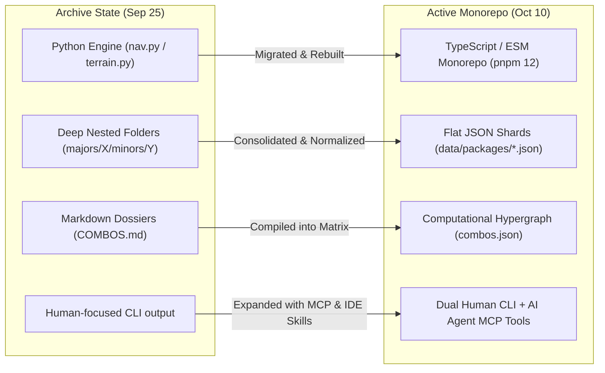

# Recursive Temporal Audit: RN-Terrain Archive vs. Current
**Applying Temporal Convolution & Bitemporal Lineage to the Project Itself**

---

## Executive Summary

Applying the TCDI framework **recursively** to the `rn-terrain` codebase reveals a profound evolutionary journey. 

We audited two core temporal states:
1. **Archive State (`C:\projects\rn-terrain-archive-extracted`)**: The historical foundation (captured ~September 25, 2026), characterized by Python-based sliding window operators, deep filesystem directory trees, and manually curated markdown dossiers.
2. **Current State (`C:\projects\rn-terrain`)**: The active production workspace (October 2026), structured as a high-performance TypeScript/ESM pnpm monorepo with AST static analysis, dual MCP servers, Next.js web interfaces, and compiled temporal combo kernels.

This audit maps what survived, what emerged, what was lost or left dormant, and how the codebase naturally evolved toward the 12-module master vision.

---

## 1. High-Level Metrics Comparison

```
┌─────────────────────────────────────────────────────────────────────────────────────────┐
│                               WORKSPACE METRICS COMPARISON                              │
├──────────────────────────────┬────────────────────────────┬─────────────────────────────┤
│ Metric                       │ Archive State (Sep 25)     │ Current State (Oct 10)      │
├──────────────────────────────┼────────────────────────────┼─────────────────────────────┤
│ Total Tracked Files          │ 528 files                  │ 671 files (excl. build/git) │
│ Total Size                   │ 3.20 MB                    │ 70.92 MB (incl. data/db)    │
│ Primary Programming Language │ Python (3.13) + Markdown   │ TypeScript + Node.js (ESM)  │
│ Markdown Knowledge Files     │ 440 files (.md)            │ 438 files (.md)             │
│ Structured JSON Datasets     │ 64 files (.json)           │ 64 files (.json)            │
│ TypeScript / JavaScript Code │ 0 files                    │ 95 files (.ts, .js, .mjs)   │
│ AST / Codemod Runners        │ 0 files                    │ 12 files (Babel, tsx, vitest)│
│ Monorepo Architecture        │ Single-folder hierarchy    │ pnpm workspace (5 packages) │
│ Agent Interfaces (MCP)       │ None                       │ 2 Servers (rn-terrain & tcdi)│
└──────────────────────────────┴────────────────────────────┴─────────────────────────────┘
```

---

## 2. What's There (The Bedrock Continuities)

The intellectual core of `rn-terrain` has remained remarkably steady across both eras:

1. **The Core Six Substrates:**
   Both versions focus on the critical native animation and bridge stack:
   * `react-native`
   * `react-native-reanimated`
   * `react-native-gesture-handler`
   * `react-native-nitro-modules` & `nitrogen`
   * `react-native-worklets` (Software Mansion)
   * `react-native-worklets-core` (Margelo)
2. **The Sliding Window Concept:**
   * In Archive: Expressed as `python3 navigator/nav.py window --ground g.json --scope minor`.
   * In Current: Expressed as `node docs/changelog-intelligence/engine/project-kernel.mjs --check`.
   * Both enforce the principle that compatibility is a window over a chronology, not a static SemVer string.
3. **The Evidence-Based Combo Graph:**
   * In Archive: 32 rigorously sourced entries in [`compat/COMBOS.md`](file:///C:/projects/rn-terrain-archive-extracted/rn-terrain/compat/COMBOS.md).
   * In Current: Compiled into 34 active machine-readable rules in [`docs/changelog-intelligence/data/compat/combos.json`](file:///c:/projects/rn-terrain/docs/changelog-intelligence/data/compat/combos.json).

---

## 3. What's Appearing / Emerging (The Evolution)

The active `rn-terrain` monorepo has evolved far beyond a static documentation repository into a full-stack intelligence engine:

```
┌─────────────────────────────────────────────────────────────────────────────────────────┐
│                                 EMERGENT SUBSYSTEMS                                     │
├─────────────────────────────────────────────────────────────────────────────────────────┤
│ 1. Static AST Analysis Pipeline (`packages/scanner`)                                    │
│    • `@babel/parser` AST traversal (`ast-walker.ts`) detecting deprecated native hooks. │
│    • Git drift tracker (`git-drift.ts`) computing SemVer distance across commits.       │
│    • Fence findings & radar findings accumulator (`accumulator.ts`).                    │
├─────────────────────────────────────────────────────────────────────────────────────────┤
│ 2. Automated Multi-Source Tool Bridge (`scripts/tool-bridge.mjs`)                       │
│    • Live API enrichment from React Native Directory (New Architecture verification).   │
│    • Live Expo SDK authoritative package pins (`--expo-pins 57.0.24`).                  │
│    • Microsoft `@rnx-kit/align-deps` alignment engine integration.                      │
├─────────────────────────────────────────────────────────────────────────────────────────┤
│ 3. Automated AST Codemod Migrations (`scripts/migrate-rngh-v3.mjs`)                     │
│    • Programmatic JSX/TSX transformations converting RNGH v2 syntax to v3 components.   │
├─────────────────────────────────────────────────────────────────────────────────────────┤
│ 4. Dual Database Substrate (`packages/core` & `data/packages/`)                         │
│    • Supabase PostgreSQL migrations (`20260609000000_rn_terrain_schema.sql`).           │
│    • Local high-speed SQLite database (`data/packages/rn_packages.db`).                 │
├─────────────────────────────────────────────────────────────────────────────────────────┤
│ 5. Agentic AI Sensory Layer (`packages/mcp` & `tcdi-engine`)                            │
│    • MCP tools (`audit_package`, `scan_project`, `tcdi_query_combo`, etc.)              │
│    • Antigravity IDE custom skill integration (`tcdi-audit`).                           │
├─────────────────────────────────────────────────────────────────────────────────────────┤
│ 6. Web Atlas Interface (`apps/github-atlas`)                                            │
│    • Next.js 15 + Turbopack web portal displaying ecosystem offers and pack matrices.   │
└─────────────────────────────────────────────────────────────────────────────────────────┘
```

---

## 4. What's Missing / Dormant (Treasures in the Archive)

The audit revealed several brilliant concepts and datasets in `rn-terrain-archive-extracted` that were left dormant during the TypeScript rewrite and should be resurrected into the 12-Module suite:

### 4.1 The Topological "Jump" Pathfinder (`nav.py jump`)
* **What it was:** In `navigator/nav.py`, the `--jump` command took a Ground stack and a Target stack and computed the **exact ordered migration sequence**:
  * *Example:* `RN 0.86.3` $\to$ `RN 0.87.1` forced `Expo 57.0.24`, which forced `Reanimated 4.7.0`, which ordered the updates: `RN -> Expo -> Reanimated`.
* **Current Status:** **Dormant.** Current `project-kernel.mjs` checks compatibility, but does not calculate the multi-step topological migration sequence.
* **Destination in 12-Module Suite:** **Module 08 (`@rn-terrain/migrate`)**.

### 4.2 Community Discourse & Stream Feeds (`discourse/stream` & `FEEDS.md`)
* **What it was:** The archive contained an early surveillance system tracking Discourse feeds, RSS streams, and discussion patterns (`patterns.md`, `FEEDS.md`).
* **Current Status:** **Missing.** The active monorepo does not yet have an automated RSS/Discourse harvester.
* **Destination in 12-Module Suite:** **Module 02 (`@rn-terrain/pulse`)** & Omni-Channel Harvester.

### 4.3 The "Fixed-Later" Gaps Policy (`fixed-later-index.json`)
* **What it was:** An explicit ledger of known issues that were closed/fixed in upstream repos but lacked a verified patch release version, tracked under a strict "gaps policy" to prevent hallucinations.
* **Current Status:** Partially flattened into `transition_milestones.fixed = null`.
* **Destination in 12-Module Suite:** **Module 04 (`@rn-terrain/vitality`)** & Confidence Triangulation.

### 4.4 Domain Research Dossiers (`explorations/`)
* **What it was:** Deep technical analyses: `expo-58-deep-dive-2026-09-23.md`, `jev-integration-2026-09-23.md`, and `laya-evidence-2026-09-23.md`.
* **Current Status:** Omitted from active documentation indexing.
* **Destination in 12-Module Suite:** **Module 03 (`@rn-terrain/spotlight`)**.

---

## 5. Architectural Shifts: How Things Changed



### Shift 1: Storage Format (Hierarchical $\to$ Flat Shards)
* **Archive:** Spread version records across hundreds of nested folders (`packages/react-native-reanimated/majors/3/minors/0/patches/0.md`).
* **Current:** Flattened into single high-density JSON package shards (`data/packages/react-native-reanimated.json`) indexed by `chronos_sN` keys.

### Shift 2: Execution Engine (Python $\to$ TypeScript / Node.js)
* **Archive:** Depended on Python 3.13 (`__pycache__`, `nav.py`).
* **Current:** Fully consolidated onto the Node.js / TypeScript ecosystem, allowing native interoperability with Babel AST parsers, pnpm workspaces, and npm registry feeds.

### Shift 3: Target Consumer (Human Devs $\to$ Dual Human + Autonomous Agents)
* **Archive:** Written primarily for human engineers reading markdown tables.
* **Current:** Formatted with strict JSON schemas (`package-features.schema.json`, `entry.schema.json`) and exposed via Model Context Protocol (MCP) servers for autonomous coding agents.

---

## 6. Recommendations & Action Items

To unite both repositories into the complete 12-Module platform:

1. **Port the Python Jump Pathfinder to TypeScript:**
   Convert `nav.py jump` logic into `packages/core/src/jump.ts` or add a `--jump` flag to `engine/project-kernel.mjs`.
2. **Resurrect `FEEDS.md` into the Omni-Channel Harvester:**
   Use the RSS feeds curated in the archive's `discourse/` folder as the seed list for the automated `RN Pulse` briefing engine.
3. **Clean Up Nested Directory Artifacts:**
   Prune the lingering `C:\projects\rn-terrain\rn-terrain\` nested folder that was left over from a previous tarball extraction.
4. **Surface the Tech Radar in the CLI:**
   Connect `packages/core/src/radar.ts` (`ADOPT | TRIAL | ASSESS | HOLD`) directly to the `packages/cli` runner so developers can run `rn-terrain radar <pkg>` today.
