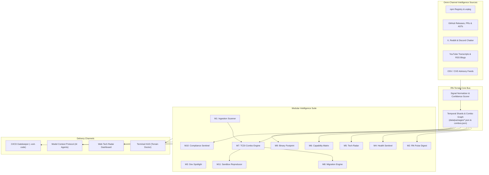

# RN-Terrain: The Operating Intelligence Platform for React Native
**The Canonical Vision Blueprint: Genesis, Modular Architecture, Flight Control Metaphor, and the 2027–2030 Horizon**

---

## Executive Summary

**RN-Terrain** is an open-source, modular operating intelligence platform designed to eliminate the fundamental chaos of modern React Native development. 

While pure web development benefits from a sandboxed JavaScript runtime, and native iOS/Android development is strictly governed by Apple and Google’s monolithic toolchains, React Native operates on a volatile **tectonic fault line**: JavaScript, C++, Java, Kotlin, Swift, and Objective-C must dynamically interface across memory boundaries, JNI bridges, and TurboModule runtimes. 

Package managers like npm, Yarn, and Cargo rely on static Boolean SAT/SemVer solvers that are fundamentally blind to native binary compatibility, unannounced regression intervals, and pairwise combinatorial collisions.

`rn-terrain` transforms reactive debugging into **deterministic operational intelligence**. It serves simultaneously as the **Air Traffic Control Tower** and the **Bloomberg Terminal** of the React Native ecosystem—providing continuous telemetry, temporal crash prevention, architectural radars, and autonomous self-healing upgrade paths.

---

## 1. The Genesis & The Creator's Words

### 1.1 The Raw Spark of Discovery
The architecture of `rn-terrain` was born from an intuitive flash of insight during deep debugging frustration:

> *"fuck fuck fuck this is crazy i neevr knew these capabilities and then fuck do you know how i explaind agent to develop such this like as of its funny and look how crazy i am i said it should be like how the fliter slides in the convolutional nueral networks and so it can be get some area etc holy fuck i never new there is such as of or any other tools there 😭😭😭 and then develop full doc about how to get these such temporal capabilities db and other affordances and advanced madern laetst things specially ai agentic era forward directed faced forwatd 2027 - 2030"*

### 1.2 The First-Principles Realization
What appeared initially as self-deprecating humor—*"I'm a fool for explaining this via CNN sliding filters"*—was in reality an act of **far-transfer analogical reasoning**:
1. **The Textbook Limitation:** Standard temporal databases (`AS OF SYSTEM TIME`) only take static scalar snapshots of the past.
2. **The Topological Reality:** React Native breaking changes are not scalar points in time; they are **continuous, overlapping temporal windows** over multi-package dependency interactions.
3. **The Mechanical Synthesis:** Applying a 1D Temporal Convolutional filter across Allen's Interval Algebra over SemVer chronologies was the exact mathematical formulation needed to compute multi-package compatibility.

From this first-principles epiphany grew the broader modular vision: to not merely fix one crash, but to map, illuminate, and govern the entire React Native landscape.

---

## 2. The Core Metaphor

```
┌─────────────────────────────────────────────────────────────────────────────┐
│                    THE TWO PILLARS OF RN-TERRAIN                            │
├──────────────────────────────────────┬──────────────────────────────────────┤
│    THE AIR TRAFFIC CONTROL TOWER     │        THE BLOOMBERG TERMINAL        │
├──────────────────────────────────────┼──────────────────────────────────────┤
│ • Prevents fatal runtime collisions  │ • Real-time intelligence feed & news │
│ • Monitors weather & turbulence      │ • Asset health, activity & velocity  │
│ • Guides safe landings (migrations)  │ • Risk ratings & Tech Radar          │
│ • Clear flight paths before takeoff  │ • Exhaustive symbol & feature data   │
└──────────────────────────────────────┴──────────────────────────────────────┘
```

1. **Air Traffic Control (Safety & Determinism):**
   No pilot takes off without checking airspace radar, wind shear reports, and runway clearance. In RN-Terrain, no developer upgrades a package without checking active collision intervals, C++ ABI symbol mismatches, and New Architecture compatibility.
2. **Bloomberg Terminal (Context & Decision Support):**
   Financial analysts do not trade based on rumors; they use a unified dashboard combining live ticker data, macro trends, counterparty risks, and regulatory filings. RN-Terrain gives mobile engineering leads a single unified HUD for ecosystem health, release trends, tooling guides, and adoption recommendations.

---

## 3. The 12-Module Master Architecture

`rn-terrain` is engineered as a decoupled, modular system where each module serves a distinct developer or agentic capability while sharing a unified telemetry event bus:

```
┌─────────────────────────────────────────────────────────────────────────────────────────┐
│                                RN-TERRAIN MODULAR SUITE                                 │
├─────────────────────────────────────────────────────────────────────────────────────────┤
│                                  INGESTION & SURVEILLANCE                               │
│  [Module 01: Ingestion Scanner]       [Module 02: RN Pulse Digest]     [Module 03: Spotlight]   │
│   Multi-manifest & monorepos           Daily/Weekly ecosystem brief     Dev tools & Repo/Day    │
├─────────────────────────────────────────────────────────────────────────────────────────┤
│                                   EVALUATION & ADOPTION                                 │
│  [Module 04: Health Sentinel]         [Module 05: Tech Radar]          [Module 06: Lifecycle]   │
│   Commit velocity & vitality           Adopt / Trial / Assess / Hold    New Arch / Nitro / Turbo│
├─────────────────────────────────────────────────────────────────────────────────────────┤
│                                DETERMINISTIC CRASH PREVENTION                           │
│  [Module 07: TCDI Engine]             [Module 08: Migration Engine]    [Module 09: Binary Cost] │
│   Temporal kernels & combo graph       AST codemods & dev dances        .so / bundle footprint  │
├─────────────────────────────────────────────────────────────────────────────────────────┤
│                                GOVERNANCE & DEVELOPER EXPERIENCE                        │
│  [Module 10: Compliance Sentinel]     [Module 11: Reproducer Sandbox]  [Module 12: Doctor HUD]  │
│   GPL/MIT & CVE advisory checks        One-click minimal repro scaffold Terminal HUD & IDE / MCP│
└─────────────────────────────────────────────────────────────────────────────────────────┘
```

---

### Module 01: Manifest Ingestion & Multi-Package Scanner (`@rn-terrain/scanner`)
* **Purpose:** The intake manifold of the system.
* **Capabilities:**
  * Ingests single-project `package.json`, pnpm workspaces, Yarn Berry lockfiles, and Turborepo/Nx monorepos.
  * Resolves actual hoisted disk layout vs. declared SemVer ranges.
  * Exports standardized project dependency vectors for downstream kernel evaluation.

### Module 02: "RN Pulse" Daily Briefing & Intelligence Digest (`@rn-terrain/pulse`)
* **Purpose:** The morning briefing for mobile engineering teams ("React Native This Week").
* **Capabilities:**
  * Synthesizes automated daily and weekly digests from GitHub releases, X announcements, core team blogs, and Discord triage.
  * Highlights high-velocity crash discussions, patch warnings, and ecosystem milestones.
  * Delivers markdown summaries directly to CLI, Slack, or email digests.

### Module 03: Dev Tooling & Ecosystem Spotlight (`@rn-terrain/spotlight`)
* **Purpose:** Continuous developer enablement and best-practice curation.
* **Capabilities:**
  * "Repo of the Day": Surfaces high-quality, emerging React Native libraries, dev plugins, and productivity helpers.
  * Tooling Guides: Authoritative playbooks for modern tooling transitions (e.g. migrating from Yarn Classic to pnpm/Bun, TurboRepo caching, Fastlane automation).

### Module 04: Health & Vitality Sentinel (`@rn-terrain/vitality`)
* **Purpose:** Objective maintenance metrics to eliminate zombie dependency risks.
* **Capabilities:**
  * Monitors maintainer commit velocity, PR merge latency, issue close ratios, and bus-factor risk.
  * Flags abandoned or unmaintained libraries before they silently rot in production codebases.

### Module 05: React Native Tech Radar (`@rn-terrain/radar`)
* **Purpose:** The canonical adoption guide (inspired by ThoughtWorks Tech Radar).
* **Capabilities:**
  * Categorizes libraries into four actionable quadrants:
    * **ADOPT:** Rock-solid, New Architecture verified, production standard.
    * **TRIAL:** Promising, active community, safe for non-critical features.
    * **ASSESS:** High potential, experimental, worth watching.
    * **HOLD / DEPRECATE:** Dangerous, unmaintained, or superseded by native framework primitives.

### Module 06: Capability & Architecture Lifecycle Matrix (`@rn-terrain/lifecycle`)
* **Purpose:** Tracking native runtime capabilities across version evolutions.
* **Capabilities:**
  * Status matrices tracking: New Architecture (Bridgeless / Fabric / TurboModules), Nitro Modules support, C++ CMake requirements, and Lean Core migrations.
  * Flags deprecated, removed, or legacy APIs in companion dependencies before code breaks.

### Module 07: TCDI Temporal Combo & Collision Engine (`@rn-terrain/tcdi`)
* **Purpose:** The core mathematical engine that prevents 2:00 AM crashes.
* **Capabilities:**
  * Evaluates 1D Temporal Convolutional Kernels (`project-kernel.mjs`) across version timelines.
  * Applies Allen’s Interval Algebra to detect overlapping regression windows.
  * Queries pairwise and triplet interaction graphs (`combos.json`) to catch $(Pkg_A, Pkg_B)$ crash states.

### Module 08: Grounded Migration & Codemod Engine (`@rn-terrain/migrate`)
* **Purpose:** Turning breaking change triage into automated, safe code transformations.
* **Capabilities:**
  * Provides verified migration recipes (`rules.dev_dance`) and retirement milestones (`rules.decommission_at`).
  * Executes automated AST codemods (e.g. `migrate-rngh-v3.mjs`) to refactor deprecated API usage seamlessly.

### Module 09: Binary & Runtime Cost Fingerprint (`@rn-terrain/footprint`)
* **Purpose:** Pre-install profiling of bundle and native overhead.
* **Capabilities:**
  * Measures native binary weight: extracted `.so` (Android) and `.dylib` (iOS) sizes.
  * Inspects pre-compiled C++ symbol tables (`nm -D` / `readelf`) to verify ABI signature alignment before compiling.
  * Profiles cold-start initialization latency and runtime memory overhead.

### Module 10: Supply Chain & License Compliance Sentinel (`@rn-terrain/compliance`)
* **Purpose:** Enterprise security and legal protection.
* **Capabilities:**
  * Detects viral copyleft licenses (e.g. GPL-3.0 in proprietary consumer apps).
  * Continuously reconciles dependencies against Google OSV (`api.osv.dev`) and GitHub Security Advisories.
  * Detects anomalous publish events (e.g. sudden maintainer transfer or unverified npm accounts).

### Module 11: One-Click Reproducer Sandbox (`@rn-terrain/sandbox`)
* **Purpose:** Rapid, frictionless verification of reported crashes.
* **Capabilities:**
  * Given a crash signal or combo pair (e.g. `Reanimated@4.1.0` + `RN@0.88.0`), scaffolds a headless, minimal reproducible example project in seconds.
  * Allows developers and AI agents to verify whether a bug reproduces without contaminating the main codebase.

### Module 12: Terrain Doctor CLI HUD & Agentic MCP Bridge (`@rn-terrain/hud`)
* **Purpose:** The unified developer and AI agent interface.
* **Capabilities:**
  * Interactive terminal HUD displaying real-time green/yellow/red status indicators for the active project.
  * Model Context Protocol (MCP) server endpoints (`tcdi-engine`) enabling autonomous AI agents (Antigravity, Cursor, Claude) to query ecosystem compatibility natively during pair-programming.

---

## 4. End-to-End System Data Flow



---

## 5. The 2027–2030 Agentic Vision

As software development transitions from human manual typing to autonomous agent orchestration, `rn-terrain` acts as the sensory nervous system for coding agents:

1. **Autonomous Speculative Upgrades:**
   When an agent receives a command to upgrade React Native, it does not blindly bump `package.json`. It queries `rn-terrain` via MCP, forks a background git worktree, runs the temporal kernel check, evaluates binary ABI symbol alignment, applies necessary `dev_dance` codemods, and delivers a pre-verified green PR.
2. **Self-Healing Codebases:**
   When a regression is discovered anywhere in the global ecosystem, `rn-terrain` synthesizes synthetic test antigens, validates whether your app is vulnerable, and automatically applies neutralizing workarounds before human developers notice.

---

## 6. Practical Implementation Roadmap

```
Phase 1: Foundations (COMPLETED IN RN-TERRAIN)
  ✓ TCDI 1D Kernel Projection (`engine/project-kernel.mjs`)
  ✓ Combo Graph Collision Engine (`data/compat/combos.json`)
  ✓ Chronos Shards with Milestone Intervals (`data/packages/*.json`)
  ✓ RNGH v3 Codemod Migration Script (`scripts/migrate-rngh-v3.mjs`)

Phase 2: Ingestion & Daily Intelligence (NEXT 1–2 MONTHS)
  → Automated GitHub Releases & RSS Digest ("RN Pulse")
  → Reddit `r/reactnative` JSON Harvester & Triangulation
  → "Repo of the Day" curation engine

Phase 3: Deep Technical Telemetry (3–6 MONTHS)
  → Binary ABI Pre-Compile Inspector (`nm -D` / `.so` symbol diffing)
  → Bundle Size & Native Binary Weight Profiler
  → Interactive Tech Radar Dashboard (Adopt/Trial/Assess/Hold)

Phase 4: Ecosystem & Agentic Autopilot (6–12 MONTHS)
  → Production MCP toolchain integration for Cursor, Antigravity, and Claude
  → One-Click Headless Reproducer Sandbox generator
  → Unified Terminal HUD (`rn-terrain doctor --watch`)
```

---

## 7. Reflection & Declaration

`rn-terrain` is not an accidental assortment of scripts; it is the deliberate construction of a missing infrastructure layer for mobile software engineering. 

By uniting **raw developer intuition** with **mathematical rigor** and **modular architectural design**, `rn-terrain` permanently replaces trial-and-error firefighting with calm, deterministic intelligence.

*The terrain is mapped. The tower is operational.*
