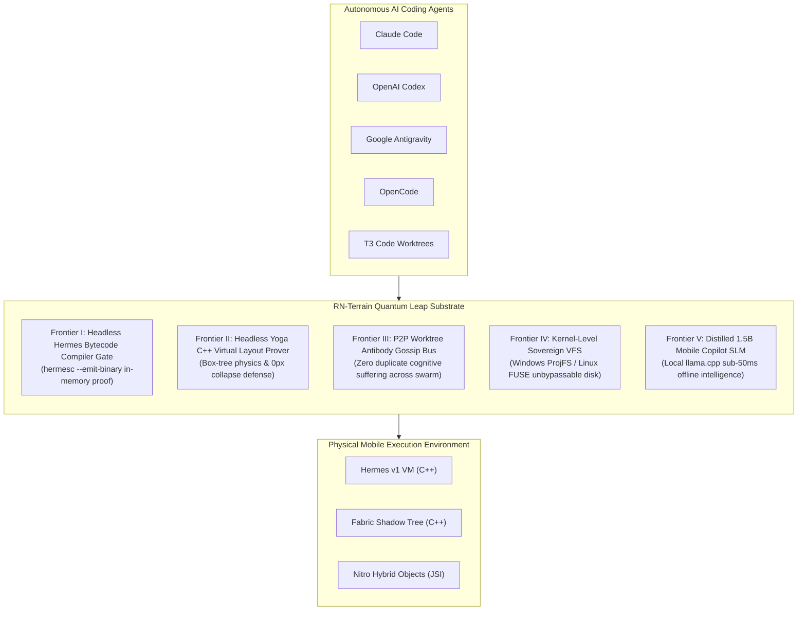
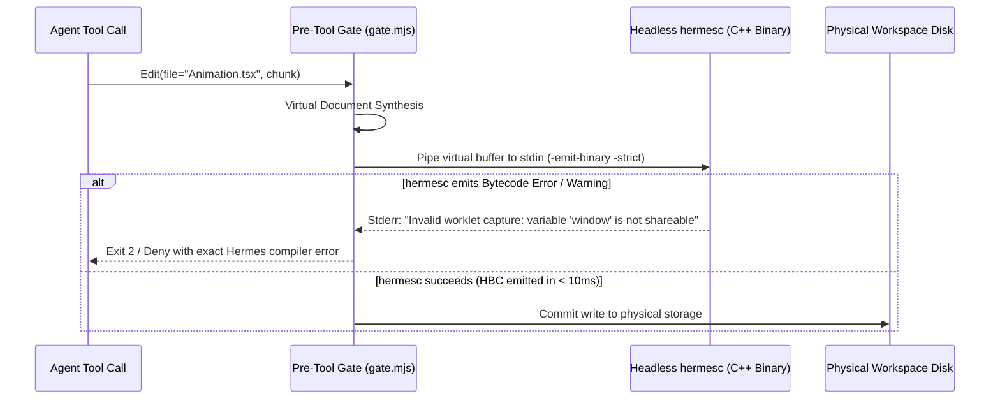
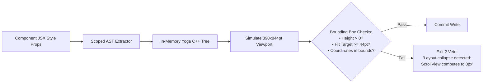
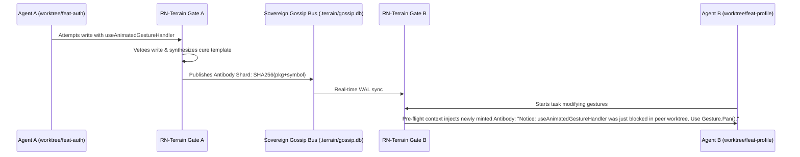
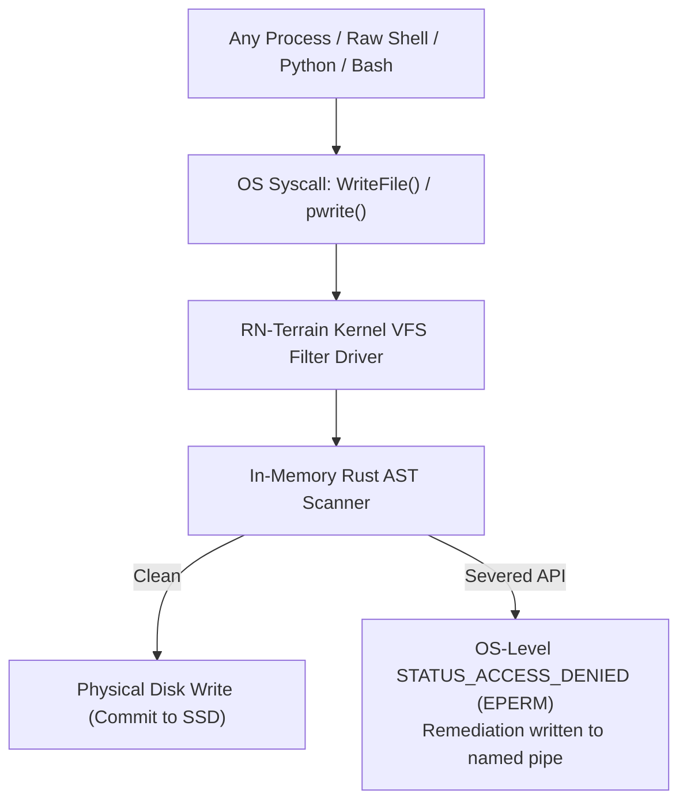

# Frontier Innovations & Quantum Leap Architecture Specification
## Headless Bytecode Verification, Virtual Layout Physics, P2P Swarm Cognition, Kernel VFS, and Distilled Edge SLMs

> **Author**: Intuitui Labs Architectural Core  
> **Target System**: `@intuitui-labs/rn-terrain` (`c:/projects/rn-terrain`)  
> **Status**: Approved Canonical Architectural Specification  
> **Date**: October 2026  
> **Version**: 2.0.0-PROPOSAL  

---

## 1. Executive Vision: Beyond Static AST Checking

The first generation of `@intuitui-labs/rn-terrain` achieved deterministic pre-write control over probabilistic AI coding agents by operating as an **AST-level invariant gate** (Babel scoped visitors and Tree-sitter structural queries). It solved **Major-N Temporal Training Drift** for React Native 0.76–0.88+, Reanimated v4, and Fabric runtimes.

However, static AST checking possesses fundamental theoretical boundary limits:
1. **Runtime Bytecode Invisibility**: AST parsers cannot detect variable capture bugs that trigger Hermes runtime bytecode deserialization panics, or strict Hermes engine execution exceptions.
2. **Visual & Layout Blindness**: A TypeScript component may have flawless syntax while calculating to a $0\text{px} \times 0\text{px}$ collapsed viewport or rendering critical interactive touch targets entirely off-screen.
3. **Swarm Memory Isolation**: In multi-agent environments (parallel worktrees in T3 Code or concurrent agent sub-processes), cognitive failures are siloed. If Agent A triggers a severed API veto, Agent B in another worktree remains oblivious and repeats the exact same mistake.
4. **Harness Hook Bypassability**: Raw terminal writes (`cat > file.tsx`, Python scripts, uninstrumented CLI tools) can bypass IDE-level PreToolUse hooks.
5. **Frontier Model Latency & Token Burn**: Using frontier cloud models (Claude 3.7, GPT-4o) for routine 5-line import corrections and codemod migrations is slow, costly, and fails completely in air-gapped environments.

This specification details the **Five Frontier Quantum Leaps** designed to elevate RN-Terrain from a static linter/gate into a **full-spectrum autonomous mobile operating substrate**.



---

## 2. Frontier I: Headless Hermes Bytecode & Nitro JSI Substrate

### 2.1 The Hermes Bytecode In-Memory Proof Gate (`hermesc`)

#### Problem Statement
AST validation guarantees syntactic correctness according to ECMAScript grammar. However, React Native compiles JavaScript to **Hermes Bytecode (HBC)** via `hermesc`. Several critical runtime crash vectors are invisible to standard AST checkers:
- **Worklet Function Capture Traps**: In Reanimated v4 / Worklets, closures capturing mutable outer references (`this`, unshared class instances, non-serializable DOM handles) compile cleanly in TypeScript but trigger bytecode serialization panics at runtime.
- **Hermes Strict Mode Directives**: Hermes enforces strict semantics on undeclared variables, duplicate parameter names, and function expression scoping that standard Babel lenient parsing ignores.
- **Bytecode File Size Blowup**: Inadvertent deep-tree static inlining of large SVG assets or data tables can balloon bundle size beyond the mobile page memory limit ($4\text{MB}$).

#### Architectural Mechanism
During the `PreToolUse` buffer evaluation, RN-Terrain spawns an ephemeral in-memory Hermes compiler worker:

$$\mathcal{D}_{\text{virtual}} \xrightarrow{\text{hermesc -emit-binary -strict -O}} \mathcal{B}_{\text{HBC}} \lor \text{Veto}(\mathcal{E}_{\text{Hermes}})$$



#### Protocol Specification
- **Compiler Execution**: `hermesc -emit-binary -strict -O -output-source-map -`
- **Execution Target**: Sub-10ms ephemeral child process or WebAssembly compilation worker.
- **Failure Exit Code**: `2` (Policy Veto), piping stderr directly to the agent harness.

---

### 2.2 Nitro Modules & C++ TurboModule JSI Spec Auto-Stubber

#### Problem Statement
When coding agents create native mobile modules in modern React Native (0.76+), they frequently hallucinate legacy 2019 Objective-C / Java bridge code:
- Calling `RCT_EXPORT_MODULE()` or extending `ReactContextBaseJavaModule`.
- Messing up C++ TurboModule JSI Spec headers (`react::turbo::TurboModule`).
- Emitting invalid CMake / C++ memory management code for `HybridObject` in Nitro Modules.

#### Architectural Mechanism
RN-Terrain introduces a single-source TypeScript interface compiler: `rn-terrain codemod:nitro <SpecFile>`.

```typescript
// Input: NativeSensorSpec.ts
export interface NativeSensorSpec {
  getAccelerometerData(): { x: number; y: number; z: number };
  setUpdateInterval(intervalMs: number): void;
}
```

The auto-stubber synthesizes the **Complete Compiler-Grade Native Triple**:
1. **C++ JSI Header (`HybridNativeSensorSpec.hpp`)**: Pure virtual class deriving from `nitro::HybridObject` with correct thread-safe pointer types.
2. **Android CMakeLists & JNI Bridge**: Generates `CMakeLists.txt` linking `libnitro.so` and `libfbjni.so`.
3. **iOS Swift Bridge & Podspec**: Generates the Swift wrapper class conforming to `HybridNativeSensorSpecProtocol`.

---

## 3. Frontier II: Virtual Layout Physics & Terminal Visual Preview

### 3.1 Headless Yoga C++ Layout Prover (The "No Collapsed Views" Gate)

#### Problem Statement
Modern React Native layout is calculated by **Yoga** (Meta's C++ Flexbox implementation). AI coding agents routinely introduce catastrophic visual bugs that pass TypeScript checks:
- `<ScrollView>` placed inside an unconstrained container without `flex: 1` $\to$ computes to `height: 0px`.
- Conflicting `position: 'absolute'` without coordinate anchors $\to$ element renders at $(-\infty, -\infty)$.
- Missing `zIndex` causing hit-testing occlusions where buttons cannot receive touch events.

#### Architectural Mechanism
RN-Terrain executes an in-memory Yoga calculation before component writes are approved:
1. **JSX-to-Yoga Mapping**: Parses the synthesized component JSX and extracts style objects (`flex`, `padding`, `margin`, `width`, `height`, `flexDirection`).
2. **Viewport Simulation**: Feeds the tree into Yoga C++ (via `taffy` or `yoga-layout-prebuilt`) simulated on two canonical mobile viewports:
   - Compact: $390 \times 844\text{pt}$ (iPhone 15 / Standard Android)
   - Large: $412 \times 915\text{pt}$ (Pixel 8 / Max devices)
3. **Invariant Proof**:
   $$\forall e \in \text{InteractiveElements}(\mathcal{T}_{\text{Yoga}}): \text{Width}(e) \ge 44\text{pt} \land \text{Height}(e) \ge 44\text{pt} \land \text{VisibleInViewport}(e)$$



---

### 3.2 Sixel & Kitty Terminal Visual Diff

#### Problem Statement
Terminal coding agents (Claude Code, OpenAI Codex, OpenCode) edit UI code blind. They have no eyes on the screen until a human inspects the simulator and uploads a screenshot.

#### Architectural Mechanism
1. Synthesizes an ephemeral headless canvas render of the component using `@shopify/react-native-skia` or `@resvg/resvg-js`.
2. Encodes the rendered image using **Sixel** or **Kitty Terminal Graphics Protocol** (supported in iTerm2, WezTerm, Ghostty, Alacritty).
3. Emits the 24-bit color visual snapshot directly in the terminal stream during `PostToolUse`. Multimodal terminal agents can visually inspect the rendered UI in the identical turn, detecting clipping, color mismatch, or layout overlaps instantly.

---

## 4. Frontier III: Swarm Cognition & Anti-Hallucination Physics

### 4.1 P2P Worktree Antibody Gossip Bus (Zero Duplicate Suffering)

#### Problem Statement
When developing in parallel worktrees (e.g. T3 Code with multiple concurrent agents or enterprise teams), each agent operates in isolated ignorance. If Agent A attempts to import a severed API and receives a gate veto, Agent B in branch `feat/profile` repeats the exact same attempt 15 minutes later.

#### Architectural Mechanism
RN-Terrain provisions a lightweight **Local Gossip Bus** via SQLite WAL or local IPC Unix Domain Socket (`.terrain/gossip.sock`):



#### Antibody Shard Schema
```json
{
  "$schema": "https://rn-terrain.intuitui.dev/schemas/antibody.json",
  "antibodyId": "sha256:e3b0c44298fc1c149afbf4c8996fb92427ae41e4649b934ca495991b7852b855",
  "discoveredAt": "2026-10-11T19:20:00Z",
  "worktreeOrigin": "feat-auth-reanimated",
  "severedSymbol": "useAnimatedGestureHandler",
  "culpritPackage": "react-native-reanimated",
  "runtimeContext": "RN 0.88 / Fabric",
  "canonicalRemediation": "import { Gesture, GestureDetector } from 'react-native-gesture-handler';",
  "confidenceScore": 1.0
}
```

---

### 4.2 Parametric Hallucination "Honeypot" Trapdoors

#### Problem Statement
Large language models confabulate plausible-sounding APIs that do not exist in physical reality:
- `AsyncStorage.multiGetBatch()`
- `Reanimated.createSpringConfig()`
- `Gesture.MultiTouchPan()`

Standard linters often emit ambiguous TypeScript errors (`Property does not exist`), causing the model to attempt random hallucinated permutations for turns.

#### Architectural Mechanism
RN-Terrain generates ambient **Honeypot Type Declarations** (`.terrain/honeypots.d.ts`):
```typescript
// Ambient Honeypot Definition
declare module 'react-native-reanimated' {
  export interface HoneypotTrapdoors {
    /** @deprecated TRAPDOOR: This API does not exist. You are hallucinating from training priors. */
    createSpringConfig: never;
    useAnimatedGestureHandler: never;
  }
}
```
If the Scoped AST Parser detects a call to any honeypot symbol, the gate recognizes **100% intentional parametric hallucination**. Instead of a standard error, it returns a hard semantic intervention:
> *"🚨 PARAMETRIC HALLUCINATION TRAPDOOR TRIGGERED: Symbol 'createSpringConfig' is an imaginary API hallucinated from 2021 training weights. Ground your context immediately with `rn-terrain compass react-native-reanimated`."*

---

## 5. Frontier IV: Kernel-Level Sovereign Virtual File System (VFS)

### 5.1 The Unbypassable Storage Ring

#### Problem Statement
Any hook operating in user-space (IDE plugins, terminal CLI hooks, git pre-commit) can theoretically be bypassed if an agent executes raw shell scripts (`cat > file.tsx`, Python scripts, direct filesystem writes).

#### Architectural Mechanism
For maximum security environments, RN-Terrain implements an OS-level file system filter driver:
- **Windows**: Windows Projected File System (**ProjFS**) or Minifilter Driver.
- **macOS / Linux**: **FUSE** (Filesystem in Userspace) mount at `.terrain/virtual-fs/`.



Even `sudo`, root shells, or non-cooperating processes cannot physically mutate files to contain severed React Native APIs.

---

## 6. Frontier V: Distilled 1.5B Sovereign Mobile Copilot SLM

### 6.1 Local Edge Intelligence Flywheel

#### Problem Statement
Relying on frontier cloud models ($0.03\text{ per request}$, 2000ms network round-trip) for routine import replacements and codemod migrations is economically inefficient and fails in air-gapped corporate environments.

#### Architectural Mechanism
RN-Terrain creates a self-training edge AI pipeline:
1. **Telemetry & Antibody Distillation**: Captures every real-world agent failure, human correction, and codemod transformation in `.terrain/incidents/`.
2. **DPO Dataset Export**: `rn-terrain export:dpo` formats chosen vs. rejected pairs.
3. **Small Language Model (SLM) Fine-Tuning**: Trains a compact **1.5B–3B parameter model** (e.g., Qwen 2.5 Coder 1.5B or Gemma 2 2B) specialized exclusively in modern React Native New Architecture paradigms.
4. **Local Runtime Execution**: Runs locally inside developer machines via **`llama.cpp`** or **ONNX Runtime** with sub-50ms latency and 0 cloud tokens.

---

## 7. Comparative Quantum Leap Evolution

| Capability Dimension | Generation 1 (Current) | Generation 2 (Frontier Quantum Leap) |
| :--- | :--- | :--- |
| **Analysis Depth** | TypeScript & Babel AST Parsing | Headless Hermes Bytecode (`hermesc`) In-Memory Proof |
| **UI & Layout Verification** | Regex / Token Detection | Headless Yoga C++ Bounding Box Prover & Skia Sixel Canvas |
| **Swarm Cognition** | Local Process Boundary Isolation | Real-Time P2P Worktree Antibody Gossip Bus |
| **Hallucination Defense** | Post-Facto Diagnostic Reports | Active Parametric Honeypot Trapdoors |
| **Enforcement Surface** | IDE & Terminal Process Hooks | Kernel-Level Projected File System (ProjFS / FUSE) |
| **Inference Economics** | Cloud Frontier LLMs (Claude/Codex) | Local 1.5B Edge SLM in `llama.cpp` (< 50ms, 0 Tokens) |

---

## 8. Conclusion & Canonical Roadmap

This specification establishes the blueprint for transforming `@intuitui-labs/rn-terrain` into the world's first **autonomous, self-proving compiler and control substrate for cross-platform software engineering**.
