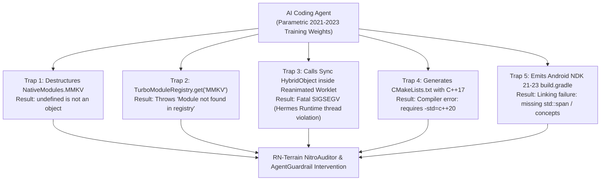

# Nitro Modules & C++ Native Architecture Convergence Specification

**Status**: CANONICAL ARCHITECTURE & DEFENSE SPECIFICATION  
**Author**: RN-Terrain Core Intelligence & Compiler Architecture Guild  
**Target Runtimes**: React Native 0.76+ / 0.80+ / 0.88+ (New Architecture / Fabric / JSI / Cxx)  
**Associated Tools**: `@intuitui-labs/rn-terrain`, `NitroAuditor`, `tcdi_nitro_audit`, `AgentGuardrail`

---

## 1. Executive Summary & Ecosystem Reality

The React Native native execution boundary is undergoing its most radical transformation since the introduction of the JavaScript Interface (JSI):
1. **The Bridge is Dead**: The legacy JSON asynchronous bridge (`RCTBridge` / `CatalystInstance`) has been officially severed in modern React Native New Architecture releases.
2. **Core TurboModules vs. Nitro Modules Convergence**:
   - While Meta officially standardized **TurboModules** and **Cxx TurboModules** in React Native core via `react-native-codegen`, the community faced heavy boilerplate when interfacing Swift, Kotlin, and pure C++.
   - **Nitro Modules** (created by Margelo / Marc Rousavy via `react-native-nitro-modules` and the `nitrogen` compiler) has gained explosive traction as the high-performance standard for flagship native libraries (e.g. `react-native-mmkv` v3+, `react-native-vision-camera`, `nitro-sqlite`, `react-native-fast-crypto`).
   - Community chatter on X/GitHub often discusses whether "Nitro is going to core" or "Nitro is replacing TurboModules". In reality, **React Native Core itself is converging on pure C++ interfaces across Fabric and JSI**, while **Nitro represents the ergonomic, statically compiled Swift-to-C++ and Kotlin-to-C++ JSI binding layer**.

---

## 2. Comparative Native Architecture Matrix

| Dimension | Legacy Bridge (Pre-0.70) | Standard Core TurboModules (0.76+) | Nitro Modules (`react-native-nitro-modules`) |
| :--- | :--- | :--- | :--- |
| **Communication Mechanism** | Async JSON serialization over message queue | Direct JSI function invocations | Direct JSI function & property accesses via `HybridObject` |
| **Dispatch Latency** | $\sim 5\text{ms} - 50\text{ms}$ | $\sim 0.05\text{ms} - 0.2\text{ms}$ | $\sim 0.005\text{ms} - 0.02\text{ms}$ (Sub-microsecond) |
| **Memory Sharing** | Deep copy / Base64 stringification | `jsi::ArrayBuffer` or HostObjects | Zero-copy C++ `std::shared_ptr<HybridObject>`, raw buffers, image frames |
| **Code Generation** | None (Runtime reflection) | `react-native-codegen` (JSON/Flow/TS specs) | `nitrogen` (`*.nitro.ts` compiling to C++, Swift, Kotlin) |
| **Swift / Kotlin Support** | Requires Obj-C & Java wrappers | Requires Obj-C++ (`.mm`) or complex C++ bridge | Native Swift 5.9+ direct C++ interop (`objcxx` mode) & direct JNI |
| **Thread Affinity** | Dedicated native background queue | Configurable (JS thread or background) | Runs directly on caller JS/Hermes thread via JSI |

---

## 3. The 5 Parametric Hallucination Traps for AI Coding Agents

Frontier LLMs (GPT-4o, Claude 3.5/3.7, Codex) were primarily trained on pre-2024 GitHub repositories. When interacting with Nitro-powered or modern C++ libraries, agents fall into 5 catastrophic failure modes:



### Trap 1: Legacy Bridge Destructuring
- **Hallucinated Agent Emission**:
  ```typescript
  import { NativeModules } from 'react-native';
  const { MMKV } = NativeModules; // Returns undefined!
  MMKV.setString('token', 'xyz'); // Crash: Cannot read property 'setString' of undefined
  ```
- **Canonical Nitro Reality**:
  ```typescript
  import { NitroModules } from 'react-native-nitro-modules';
  import type { HybridMMKVSpec } from 'react-native-mmkv';
  const mmkv = NitroModules.createHybridObject<HybridMMKVSpec>('MMKV');
  ```

### Trap 2: Standard TurboModule Confabulation
- **Hallucinated Agent Emission**:
  ```typescript
  import { TurboModuleRegistry } from 'react-native';
  const myModule = TurboModuleRegistry.get<Spec>('MyModule');
  ```
- **Canonical Nitro Reality**:
  Nitro modules are NOT registered with the React Native Core TurboModule manager; they exist in the global Nitro HybridObject registry.

### Trap 3: Worklet Thread Affinity Violations
- **Hazard**: Nitro HybridObjects are bound to the main Hermes JS runtime. If an agent executes a synchronous Nitro call inside a Reanimated worklet running on the UI thread without declaring worklet thread-safety, the process crashes with `SIGSEGV: runtime is not thread-safe`.
- **Remediation**: Wrap invocations in `runOnJS()` or configure worklet-safe HybridObject instances.

### Trap 4: Subminimal C++ Standard (`< C++20`)
- **Hazard**: Nitro C++ templates leverage C++20 concepts, `std::span`, and designated initializers.
- **Remediation**: Enforce `set(CMAKE_CXX_STANDARD 20)` and `set(CMAKE_CXX_STANDARD_REQUIRED ON)`.

### Trap 5: Outdated Android NDK (`< NDK 26`)
- **Hazard**: NDK 23/24 lacks full C++20 standard library implementations for Android ABI targets.
- **Remediation**: `ndkVersion = "26.1.10909125"` in `android/build.gradle`.

---

## 4. RN-Terrain Nitro Defense Substrate

To safeguard cross-platform projects against these failure modes, RN-Terrain provides four levels of defense:

### 1. `NitroAuditor` (`packages/scanner/src/nitro-auditor.ts`)
- Automatically discovers `*.nitro.ts` specification files and extracts `HybridObject` method and property signatures.
- Audits `CMakeLists.txt` for `CMAKE_CXX_STANDARD 20` compliance.
- Audits `android/build.gradle` for NDK 26+ compatibility.
- Scans agent code snippets for `NativeModules` and `TurboModuleRegistry` confabulations.

### 2. MCP Server Tool: `tcdi_nitro_audit`
Agents can directly execute pre-flight audits before writing native code:
```json
{
  "name": "tcdi_nitro_audit",
  "arguments": {
    "code_snippet": "const { MMKV } = NativeModules;",
    "project_dir": "."
  }
}
```
**Response**:
```json
{
  "isNitroProject": true,
  "violations": [],
  "codeFindings": [
    {
      "ruleId": "nitro/legacy-native-modules-access",
      "severity": "error",
      "message": "'MMKV' is a high-performance Nitro HybridObject. Destructuring it from legacy 'NativeModules' returns undefined and bypasses JSI.",
      "remediation": "Import 'NitroModules' from 'react-native-nitro-modules' and call 'NitroModules.createHybridObject<...>(\"MMKV\")'."
    }
  ]
}
```

### 3. Ambient Honeypot Declarations
RN-Terrain's `HoneypotEngine` marks known confabulations as `never` with `@deprecated TRAPDOOR` in `.terrain/honeypots.d.ts` so that TypeScript catches invalid invocations instantly at compile time.

---

## 5. Strategic Roadmap: "So Things Are Changing, And Then What?"

As React Native moves toward React Native 0.88+ and beyond:

1. **Autonomous HybridObject Synthesis**:
   Agents should be trained and prompted not to write manual C++ JSI boilerplate, but to define clean TypeScript `.nitro.ts` specs and allow `nitrogen` to generate verified C++, Swift, and Kotlin headers.
2. **Zero-Copy GPU & Memory Shaders**:
   Connecting Nitro C++ buffers with Skia / Metal / Vulkan will become the standard pattern for camera, video, audio, and ML inference pipelines in React Native.
3. **Universal Control-Plane Standard**:
   `@intuitui-labs/rn-terrain` acts as the unbypassable gatekeeper, ensuring that whether code is running in TurboModules, Fabric C++, or Nitro Modules, architectural safety, thread affinity, and memory models are mathematically proven before disk commit.
