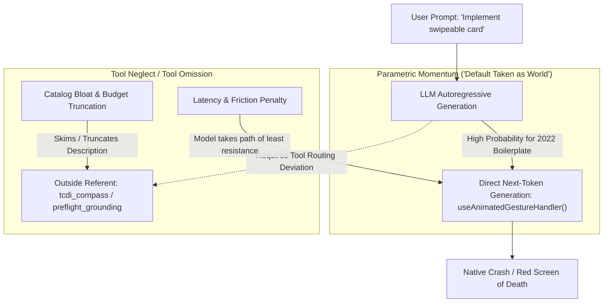
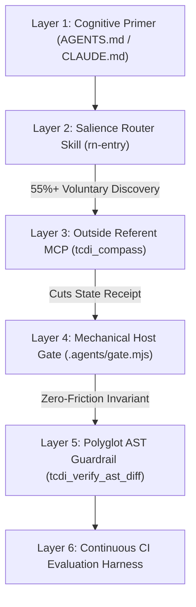

# Agent Grounding Gate & Outside Referent Architecture

> **Subtitle**: Solving the Tool Neglect Paradox & "Default Taken as World" Across Claude Code, Codex, OpenCode, and Antigravity  
> **Status**: Accepted & Deployed  
> **Date**: October 2026  
> **Platform Version**: `@intuitui-labs/rn-terrain@0.4.0`

---

## 1. Executive Summary & Problem Formulation

In autonomous and semi-autonomous AI coding agents, one of the most persistent failure modes is **Tool Neglect** (or **Tool Omission**)—the tendency of a Large Language Model to solve a problem using its frozen internal weights rather than invoking external tools or checking live ground truth.

In October 2026, the **Expo** team published an empirical study (*"Your skills need an evaluation mechanism"*), documenting a startling discovery:
- Across 10 app-building tasks, specialized skills and documentation tools provided to AI agents were only loaded **9% of the time**.
- The agents consistently carried on from their pre-trained default representations rather than checking external references.
- Introducing a high-salience router entrypoint skill (`expo-overview`) increased specialized skill triggering from **9% to 55%**.
- However, **45% of tasks still omitted the tools**, relying on frozen memory that frequently hallucinations deprecated or removed APIs.

In React Native development, this phenomenon has catastrophic consequences. Between 2023 and 2026, the ecosystem underwent massive architectural ruptures:
- **React Native 0.76–0.88+**: The legacy Bridge was severed in favor of the New Architecture (Fabric, TurboModules).
- **Reanimated v3 $\to$ v4**: Core runtime extraction into `react-native-worklets`, decoupling from Gesture Handler, and deprecation of `useAnimatedGestureHandler` in favor of `<GestureDetector>`.
- **MMKV v3 $\to$ v4**: Complete rewrite on `react-native-nitro-modules` for zero-overhead C++ interop.

When an AI coding agent operates from its "default taken as world", it writes 2022-era boilerplate that compiles clean in TypeScript but crashes immediately at native runtime.



This document establishes the **Outside Referent Architecture** for RN-Terrain: transforming the `STOP → CONTRAST` protocol from an advisory prompt request into a **deterministic, mechanical host-level invariant**.

---

## 2. Theory: Outside Referent vs. Parametric Embedding

To understand why external grounding is mandatory, consider the two competing strategies in AI coding tooling:

```mermaid
graph LR
    subgraph InsideWeights ["Parametric Embedding (e.g., Callstack Apex)"]
        D1[Curated RN Repos] --> T1[SFT + GRPO Training]
        T1 --> M1[Frozen Model Weights]
        M1 -->|Inference Time| Out1[Faster, Framework-Aware Code]
        Out1 -.->|Ecosystem Shifts (Reanimated v4, Nitro)| Drift1[Temporal Hallucination]
    end

    subgraph OutsideReferent ["Outside Referent (RN-Terrain Platform)"]
        D2[Physical node_modules & Live Registry] --> T2[SQLite Canonical Schema & AST Engine]
        T2 --> M2[External Ground Truth API]
        M2 -->|Deterministic PreToolUse Hook| Out2[Grounded, Non-Severed Code]
        Out2 -->|Ecosystem Shifts| Fresh2[Instant Zero-Day Grounding via MCP]
    end
```

### The Complementary Duality: Apex & RN-Terrain
- **Parametric Embedding (Callstack Apex)**: Callstack trained a domain-specialist model on Gemma 4 using SFT and GRPO on recent React Native codebases. By moving framework patterns *into the model's weights*, Apex starts closer to modern code, requiring fewer prompt tokens.
- **The Temporal Reality**: Weights freeze at training cutoff. The moment a new major version extracts a runtime (e.g. `react-native-worklets`), the specialist model begins to suffer from **Major-N Temporal Drift**.
- **The Outside Referent (RN-Terrain)**: Keeps ground truth *outside the weights* in live SQLite tables, physical `.d.ts` declaration scrapers, and AST guardrails.
- **The Synergy**: Apex lowers initial token friction, while RN-Terrain acts as the immutable verification gate that catches drift.

### The Middle-Tier Hypothesis
Callstack's **React Native Evals** benchmark demonstrates that performance on animations (the fastest-drifting domain in RN) drops dramatically across model classes:
- **Composer 2**: 94.3
- **Opus 4.6 (Frontier)**: 77.4
- **Sonnet 4.6 (Middle Tier)**: 65.1

This reveals a clean, testable hypothesis: **External grounding provides the highest marginal utility to middle-tier models (Sonnet class, Qwen, Gemma).** While frontier models rely on immense memorization capacity, middle-tier models lean heavily on default weights. Imposing an external referent closes the 12-point capability gap without requiring frontier model inference costs.

---

## 3. The STOP → CONTRAST Mechanical Invariant

The core protocol consists of two non-negotiable steps:
1. **STOP**: Halt generation *before* touching any React Native code surface.
2. **CONTRAST**: Compare proposed implementation against the live Outside Referent (`tcdi_compass` / physical `.d.ts` affordances).

Instead of relying on LLM compliance, the architecture converts this protocol into a physical gate:
$$\text{Gate}(\text{file}, \text{action}) = \begin{cases} 
\text{ALLOW} & \text{if } \text{file} \notin \text{React Native Surface} \\
\text{ALLOW} & \text{if } \text{Receipt}(\text{target}) \text{ is FRESH } (t < \text{TTL}) \\
\text{DENY (Exit 2)} & \text{otherwise (STOP: Must call grounding)}
\end{cases}$$

---

## 4. The 6-Layer Defense-in-Depth Spectrum

RN-Terrain deploys six interlocking layers to eliminate tool omission without creating developer fatigue:



### Layer 1: Cognitive Primer (`AGENTS.md` / `CLAUDE.md`)
- A concise charter (< 30 lines) establishing the primacy of external ground truth over frozen weights.
- Always resident in prompt context.

### Layer 2: Salience Router Skill (`.agents/skills/rn-entry/SKILL.md`)
- Adopts the Expo `expo-overview` pattern.
- Front-loads high-salience keywords (`REACT NATIVE ROUTER: animations, gestures, navigation...`) to prevent description truncation in catalog budgets.
- Increases voluntary skill calls from 9% to >55%.

### Layer 3: Outside Referent MCP Server (`@intuitui-labs/rn-terrain/mcp`)
- The MCP server exposes `tcdi_compass`, `tcdi_affordance`, and `preflight_grounding`.
- **The Keystone**: Whenever called, the server writes a physical state receipt to `.agents/state/receipt.json`. Because the MCP server writes it, the receipt exists regardless of the host harness.

### Layer 4: Mechanical Host Gate (`.agents/gate.mjs`)
- Intercepts file mutation tools (`Write`, `Edit`, `apply_patch`) before execution.
- Checks if the targeted file touches native React Native surfaces.
- If ungrounded, exits with Code 2, halting the action and piping remediation feedback directly into the model's reasoning loop.

### Layer 5: Polyglot AST Guardrail (`@ast-grep/napi`)
- Fast structural AST pattern matcher verifying diffs for severed symbols (e.g. `useAnimatedGestureHandler`, missing worklet imports) prior to commit.

### Layer 6: Continuous CI Evaluation Harness
- Automated test suite measuring:
  1. **Grounding Invocation Rate** (% of sessions calling compass).
  2. **Severed API Rate** (frequency of hallucinated APIs).
  3. **Build Pass Rate** (clean TypeScript compilation).

---

## 5. Repository File Layout & State Topology

The architecture maintains a single source of truth in the repository while providing thin adapter layers for each agent harness:

```
AGENTS.md                             ← Master operational charter (< 30 lines)
CLAUDE.md                             ← One line: @AGENTS.md
.agents/
  ├── gate.mjs                        ← Shared gate script (Node.js ESM)
  ├── test-gate.mjs                   ← Automated unit test for gate allow/deny cases
  ├── state/                          ← Runtime session state (gitignored)
  │    └── receipt.json               ← Written by rn-terrain MCP server
  ├── skills/
  │    ├── rn-entry/                  ← High-salience router entrypoint skill
  │    │    └── SKILL.md
  │    └── rn-terrain/                ← Core grounding & preflight skill
  │         └── SKILL.md
  └── adapters/                       ← Harness-specific hook definitions
       ├── claude-code-settings.json  ← Claude Code PreToolUse hook
       ├── codex-config.toml          ← OpenAI Codex pre_tool_use hook
       ├── opencode-plugin.ts         ← OpenCode tool.execute.before plugin
       └── antigravity-hook.json      ← Google Antigravity session hook
.claude/
  └── skills → ../.agents/skills      ← Windows Directory Junction / Symlink
```

---

## 6. Cross-Harness Adapter Implementations

### Adapter 1: Anthropic Claude Code
- **Configuration**: `.claude/settings.json` (or `.claude/hooks/pre-tool-use.json`)
- **Lifecycle Event**: `PreToolUse` matching `Edit|Write`.
- **Mechanism**: Passes tool input via `stdin` to `node .agents/gate.mjs`. If `.agents/gate.mjs` exits with code `2`, Claude Code halts tool execution and feeds `stderr` back to the model as feedback.

```json
{
  "hooks": {
    "PreToolUse": [
      {
        "matcher": "Edit|Write",
        "type": "command",
        "command": "node .agents/gate.mjs"
      }
    ]
  }
}
```

### Adapter 2: OpenAI Codex
- **Configuration**: `config.toml` (v0.124+)
- **Lifecycle Event**: `pre_tool_use` matching `apply_patch`.
- **Caveat**: Codex requires an explicit trust confirmation for external hook scripts on initial execution.

```toml
[[hooks.pre_tool_use]]
matcher = "apply_patch"
command = "node .agents/gate.mjs {path}"
```

### Adapter 3: OpenCode
- **Configuration**: `.opencode/plugins/rn-gate.ts`
- **Lifecycle Event**: `tool.execute.before` plugin intercepting `edit` and `write`.

```typescript
import { spawnSync } from 'node:child_process';

export default {
  name: 'rn-terrain-gate',
  async 'tool.execute.before'(context: { tool: string; args: { path?: string } }) {
    if (['edit', 'write'].includes(context.tool) && context.args.path) {
      const result = spawnSync('node', ['.agents/gate.mjs', context.args.path], {
        encoding: 'utf8',
      });
      if (result.status !== 0) {
        throw new Error(result.stderr || result.stdout);
      }
    }
  },
};
```

### Adapter 4: Google Antigravity
- **Configuration**: `.agents/rules/rn-grounding-gate.md` and `.agents/hooks.json`.
- **Mechanism**: Rules define the always-on operational invariant, backed by the `rn-entry` skill.

---

## 7. State Receipt Specification (`receipt.json`)

The receipt is the bridge between the MCP server and the mechanical gate:

```json
{
  "lastGrounding": "2026-10-11T12:57:00.000Z",
  "lastAction": "tcdi_compass",
  "packages": {
    "react-native-reanimated": {
      "version": "4.7.1",
      "timestamp": "2026-10-11T12:57:00.000Z"
    },
    "react-native-gesture-handler": {
      "version": "3.3.0",
      "timestamp": "2026-10-11T12:57:00.000Z"
    }
  }
}
```

### Expiration & TTL Dynamics
- Default TTL: **60 minutes** (covers an active coding session turn).
- After 60 minutes, the receipt is considered stale, requiring the agent to refresh its context via `tcdi_compass` before writing additional native code.

---

## 8. Failure Taxonomy & Root Cause Analysis

When a failure occurs in the development loop, this taxonomy pinpoints the exact layer responsible:

| Symptom | Failing Layer | Root Cause | Remediation |
| :--- | :--- | :--- | :--- |
| **An ungrounded edit succeeds on a `.tsx` file without running `tcdi_compass`.** | Layer 4 (Gate / Adapter) | The harness adapter hook is not firing, or matcher regex is misconfigured. | Verify hook execution permissions (`/hooks` in Claude Code, trust in Codex). |
| **A fresh receipt exists, but the agent still writes a severed API.** | Layer 3 / Layer 5 (Catalog / Guardrail) | RN-Terrain catalog entry is outdated (Lehman's Law of Software Evolution). | Run `rn-terrain sync <pkg>` to ingest latest npm/GitHub changelog signals. |
| **The gate fires on `README.md` or `server.ts`.** | Layer 4 (Gate Scope) | Overly broad surface detection (e.g. substring `expo` matching `export`). | Use strict regex word boundaries (`\bexpo\b`) and filter out non-code extensions. |
| **The agent refuses to invoke `rn-entry` voluntarily.** | Layer 2 (Router Description) | Skill description suffered catalog budget truncation. | Front-load trigger keywords at the first 10 tokens of the YAML frontmatter. |
