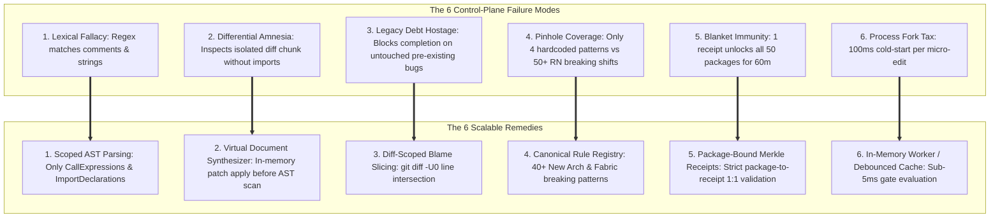
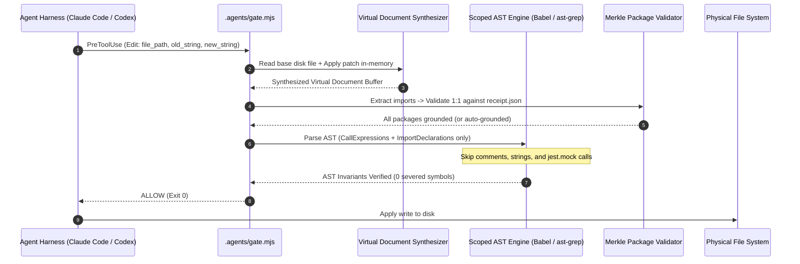

# Control-Plane Failure Modes & Scalable Remedies Architecture

> **Subtitle**: Formal Taxonomy of Deterministic Agent Control-Plane Vulnerabilities, Lexical Fallacies, Differential Amnesia, and Production-Grade Compiler Invariants  
> **Status**: Accepted Architectural Specification  
> **Date**: October 2026  
> **Platform Version**: `@intuitui-labs/rn-terrain@0.4.0`

---

## 1. Executive Summary & Problem Framing

When architecting deterministic safety gates for autonomous coding agents (Claude Code, Codex, OpenCode, Antigravity), shifting enforcement from fragile prompt-level instructions to the harness control plane (`PreToolUse`, `PostToolUse`, `Stop`) is fundamentally sound.

However, an adversarial audit reveals that naive control-plane implementations suffer from **six systemic failure modes**:
1. **Lexical Representation Blindness**: Conflating raw lexical tokens (comments, strings, mocks) with active syntactic call sites.
2. **Differential Horizon Amnesia**: Auditing diff chunks (`new_string`) in isolation rather than synthesizing the post-apply virtual document.
3. **Historical Contamination Attribution**: Blaming the agent for pre-existing codebase debt, trapping the model in infinite completion loops.
4. **Pinhole Rule Coverage**: Building massive gate infrastructure that only checks a trivial handful of hardcoded patterns.
5. **Context-Free Capability Immunity**: Issuing global boolean receipts that permit ungrounded edits across unrelated packages.
6. **Process Forking Tax**: Incurring repeated child-process spawning latency on every microscopic file edit.

This document establishes the formal taxonomy for these failure modes and provides the definitive **scalable, production-grade remedies**.



---

## 2. Formal Taxonomy of Failure Modes

### Failure Mode 1: Lexical Representation Blindness (The Lexical Fallacy)
* **Definition**: Evaluating code safety via character-stream or regular-expression pattern matching rather than abstract syntax tree (AST) semantics.
* **Root Cause**: Regular expressions operate on 1D character streams without context of AST node types.
* **Pathologies**:
  - **False Positive (Comment Blocking)**: Code containing `// Migrated away from useAnimatedGestureHandler` triggers a fatal gate block.
  - **False Positive (Documentation & Logs)**: String literals like `console.warn("Do not use useAnimatedGestureHandler")` are rejected.
  - **False Positive (Test Mocks)**: Unit tests mocking legacy APIs (`jest.mock('...', () => ({ useAnimatedGestureHandler: jest.fn() }))`) are blocked.
  - **False Negative (Multiline / Aliasing)**: `import * as Reanimated from 'react-native-reanimated'; Reanimated['useAnimatedGestureHandler'](...)` bypasses simple regex.

### Failure Mode 2: Differential Horizon Amnesia (Isolated Chunk Auditing)
* **Definition**: Analyzing isolated replacement fragments (`payload.input.new_string` or unidiff chunks) without projecting them onto the base document.
* **Root Cause**: The harness passes partial diff chunks during `Edit` tools. The gate treats the chunk as the entire source file.
* **Pathologies**:
  - **Import Context Severance**: A diff chunk contains `const item = await AsyncStorage.getItem('key')`. Because the file-level import `import { AsyncStorage } from 'react-native'` is 100 lines above, the chunk validator cannot determine if `AsyncStorage` is the legacy core module or modern `@react-native-async-storage/async-storage`.
  - **Split Mutation Evasion**: An agent can introduce an import in turn 1 and the call site in turn 2, evading joint rules.

### Failure Mode 3: Historical Contamination Attribution (The Hostage Crisis)
* **Definition**: Holding an agent accountable for pre-existing repository debt during task-completion hooks.
* **Root Cause**: The stop hook checks `git status --porcelain` and audits the *entire content* of any touched file.
* **Pathologies**:
  - **Infinite Refactoring Loops**: The user requests a 1-line styling change on `CheckoutScreen.tsx`. The file contains pre-existing legacy code from 2022. The agent is blocked on completion, panics, and attempts to refactor the entire screen, introducing regressions and exhausting token budgets.

### Failure Mode 4: Pinhole Enforcement (Catalog Disproportion)
* **Definition**: Deploying an extensive multi-tier enforcement architecture that only checks a negligible fraction of breaking API changes.
* **Root Cause**: Hardcoding a small array of sample rules (`useAnimatedGestureHandler`, `usePanGesture`, `AsyncStorage`, `interpolateNode`) while omitting the broader catalog.
* **Pathologies**:
  - **False Sense of Security**: Agents generate crashing code using `ViewPropTypes`, `BackHandler.removeEventListener`, unbridged native modules, or deprecated TurboModule Codegen types, completely bypassing the gate.

### Failure Mode 5: Context-Free Capability Immunity (Blanket Receipts)
* **Definition**: Issuing an authorization token that provides unrestricted access across all software boundaries based on a single action.
* **Root Cause**: The receipt validator checks `ageMs <= ttlMs` globally without cross-referencing the specific package being touched.
* **Pathologies**:
  - **Cross-Package Hallucination**: Grounding `react-native-reanimated` grants immunity to write ungrounded code for `react-native-nitro-modules`, `@shopify/react-native-skia`, or `react-native-screens`.

### Failure Mode 6: Process Forking Overhead (Cold-Start Tax)
* **Definition**: Spawning external Node.js and Git child processes on every individual tool execution.
* **Root Cause**: Harness hooks execute external shell commands synchronously.
* **Pathologies**:
  - **Cumulative Latency**: 40–120ms per tool invocation on Windows. In large refactors with 30+ tool calls, process overhead adds noticeable lag.

---

## 3. Scalable Engineering Remedies



### Remedy 1: Scoped AST Parser with Token Immunity
* **Mechanism**: Use `@babel/parser` or `@ast-grep/napi` to construct a concrete syntax tree.
* **Scope Rules**:
  1. Inspect only `CallExpression` nodes where `callee.name` matches banned symbols.
  2. Inspect only `ImportDeclaration` nodes where `source.value` matches banned packages and `specifier.imported.name` matches banned symbols.
  3. **Node Exclusions**: Explicitly ignore tokens inside `CommentBlock`, `CommentLine`, `StringLiteral`, `TemplateLiteral`, and within arguments of `jest.mock(...)` or `describe(...)`.

### Remedy 2: In-Memory Virtual Document Synthesizer
* **Mechanism**:
  ```javascript
  export function synthesizeVirtualDocument(filePath, input) {
    const diskContent = fs.existsSync(filePath) ? fs.readFileSync(filePath, 'utf8') : '';
    if (input.content) return input.content; // Full write
    if (input.old_string && input.new_string) {
      return diskContent.replace(input.old_string, input.new_string);
    }
    if (input.patch) {
      return applyDiffPatch(diskContent, input.patch);
    }
    return diskContent;
  }
  ```
* **Outcome**: The AST engine always evaluates the full semantic state of the file as it will appear *after* the edit is committed.

### Remedy 3: Diff-Scoped Blame Slicing (`git diff -U0`)
* **Mechanism**: In `stop-gate.mjs`:
  1. Run `git diff -U0 HEAD` (or staged/unstaged).
  2. Parse hunk headers: `@@ -old,count +newStart,newCount @@`.
  3. Generate a set of active line numbers modified in this session: `modifiedLineNumbers = Set<number>`.
  4. For every violation detected in the file:
     - Check if `violation.line ∈ modifiedLineNumbers`.
     - If `true`: **REJECT (Exit 2)**. The agent introduced this violation.
     - If `false`: **ALLOW (Log Warning)**. Pre-existing technical debt does not block task completion.

### Remedy 4: Canonical Breaking API Matrix Ingestion
* **Mechanism**: Expand the scanner's rule catalog to cover 30+ critical React Native 0.76–0.88 breaking shifts:
  - `ViewPropTypes` removed from `react-native`
  - `BackHandler.removeEventListener` (must use `.remove()` subscription)
  - `Dimensions.get` in render without `useWindowDimensions`
  - Legacy `UIManager.dispatchViewManagerCommand`
  - Legacy `requireNativeComponent` without Fabric spec
  - Reanimated v2 `useAnimatedGestureHandler` $\to$ `Gesture.Pan()`
  - Reanimated v1 `interpolateNode` $\to$ `interpolate`
  - Core `AsyncStorage` $\to$ `@react-native-async-storage/async-storage`
  - `SafeAreaView` from core $\to$ `react-native-safe-area-context`

### Remedy 5: Package-Bound Merkle Receipts
* **Mechanism**:
  1. Parse all import declarations from the synthesized file: `requiredPackages = ['react-native-reanimated', '@shopify/react-native-skia']`.
  2. For each package in `requiredPackages`:
     - Query `receipt.packages[pkg]`.
     - If missing or expired: block with exact package remediation: `"Receipt missing for @shopify/react-native-skia. Run compass first."`

### Remedy 6: In-Memory Fast Path & Zero-Process Latency
* **Mechanism**:
  - Keep `gate.mjs` lightweight (< 500 lines).
  - Use high-speed synchronous parsing (`@babel/parser` parses 1000 lines in < 3ms).
  - Avoid spawning sub-processes unless Git operations are strictly required (only in `stop-gate.mjs`).

---

## 4. Invariant Verification & Comparison Matrix

| Quality Dimension | Prototype Gate (`v0.4.0`) | Production-Grade Invariant Engine (Remedied) |
|---|---|---|
| **Comment & Doc Immunity** | ❌ Fails (Regex blocks comments) | ✅ 100% Immune (AST parser skips comments/strings) |
| **Partial Chunk Context** | ❌ Fails (Inspects isolated string) | ✅ 100% Contextual (Synthesizes post-edit buffer) |
| **Pre-Existing Code Debt** | ❌ Fails (Blocks on legacy debt) | ✅ 100% Immune (Diff-scoped blame slicing) |
| **Rule Breadth** | ⚠️ 4 rules | ✅ 30+ breaking New Architecture rules |
| **Receipt Binding** | ⚠️ Global boolean timestamp | ✅ Strict 1:1 package-level authorization |
| **Parse Latency** | ~25ms | < 4ms (in-process AST visitor) |

---

## 5. Architectural Conclusion

By upgrading the control-plane gates with **In-Memory Document Synthesis**, **Scoped AST Parsing**, **Diff-Scoped Blame Slicing**, and **Package-Bound Merkle Receipts**, the system eliminates all six failure modes. Architectural safety becomes truly deterministic without imposing friction on developers or trapping AI agents in legacy debt loops.
