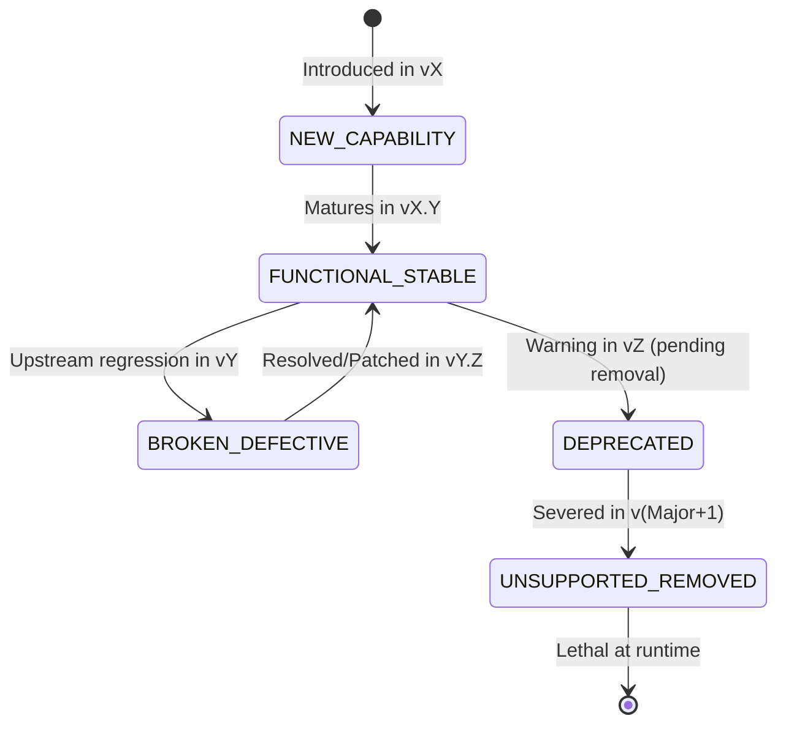

# Dynamic Temporal API Intelligence & Capability Matrix Specification
**Architecture, Lifecycle State Machine, Contextual Horizons, and Agentic Verification**
*Package: `@intuitui-labs/rn-terrain-scanner` · Subsystem: Temporal Convolutional Dependency Intelligence (TCDI)*
*Date: September 2026 · Author: Intuitui Labs Engineering Architecture*

---

## 1. Executive Abstract & Core Thesis

### The Amnesic Dependency Blind Spot
Modern software development pipelines suffer from a fundamental architectural flaw: **tooling treats dependencies as point-in-time snapshots with zero memory of the continuum between versions**.
- **Automated Update Bots (Renovate, Dependabot):** Execute blind string replacements in `package.json`. They are completely unaware of structural API mutations, removed class handlers, or subtle event-loop regressions.
- **Static Type Checkers (TypeScript, Flow):** Analyze code strictly against whatever `.d.ts` bundles are currently installed on disk. If types are loose (`any`, `@repo/types-shim`, or disabled via `/* eslint-disable */`), TypeScript provides zero defense against severed runtime behaviors.
- **Modern Static Linters (ESLint, Biome, Oxlint, React Doctor):** Perform single-point syntactic checks on ASTs, but lack temporal intelligence regarding when an API became deprecated, when it was severed, or what newer capabilities supersede it.
- **Autonomous AI Coding Agents (Devin, Cursor, Copilot, Claude Code):** Suffer from **Version Entanglement**. Because LLMs are trained on massive heterogeneous corpora spanning 2018 through 2026, they frequently generate "Franken-code"—synthesizing modern 2026 v3 patterns with deprecated 2021 v1 class components or hallucinating hybrid APIs (e.g., importing non-existent `usePanGesture` hooks from the root package export).

### The TCDI Thesis
A codebase is **path-dependent on the continuous historical interval $[v_{\text{start}}, v_{\text{current}}]$** over which it evolved.
Every API symbol $S$ of a package $P$ does not exist as a binary "valid" or "invalid" entity; it exists in a **dynamic, time-varying lifecycle state machine**.
Furthermore, the concept of a **"New Capability" is relative to the project's historical reference frame**, requiring a mathematically precise, configurable **Adoption Horizon**.

---

## 2. The 5-State Temporal Lifecycle Engine

At any evaluated version $V_{\text{target}}$ (typically $v_{\text{current}}$), every symbol $S$ belonging to an upstream package $P$ exists in exactly one of five primary states:



### State Definitions & Operational Contracts

```
┌────────────────────────────────────────────────────────────────────────────────────────┐
│                                 THE 5 API STATES                                       │
├───────────────────────────────┬────────────────────────────────────────────────────────┤
│ 1. UNSUPPORTED_REMOVED        │ • Existed historically; severed in or before V_target.  │
│    (Lethal Violation)         │ • Crash on component mount or fatal build error.       │
│                               │ • ACTION: Mandatory Purge / Codemod to Modern API.     │
├───────────────────────────────┼────────────────────────────────────────────────────────┤
│ 2. BROKEN_DEFECTIVE           │ • Present in V_target, but exhibits critical bugs,     │
│    (Active Regression)        │   mis-routed events, or dropped callbacks.             │
│                               │ • ACTION: Targeted Patch / Known Workaround / Pin.     │
├───────────────────────────────┼────────────────────────────────────────────────────────┤
│ 3. DEPRECATED                 │ • Executes in V_target, but scheduled for removal      │
│    (Decaying Code)            │   or emits runtime console warnings.                   │
│                               │ • ACTION: Scheduled Refactor before next major cut.   │
├───────────────────────────────┼────────────────────────────────────────────────────────┤
│ 4. FUNCTIONAL_STABLE          │ • Canonical, fully supported production baseline.      │
│    (Healthy Baseline)         │ • No warnings, no deprecations, full native backing.   │
│                               │ • ACTION: Preserve and protect.                        │
├───────────────────────────────┼────────────────────────────────────────────────────────┤
│ 5. NEW_CAPABILITY             │ • Valid modern feature introduced within the project's │
│    (Contextual Opportunity)   │   configured Adoption Horizon.                         │
│                               │ • ACTION: Proactive Modernization via Capabilities.    │
└───────────────────────────────┴────────────────────────────────────────────────────────┘
```

---

## 3. The Relativity of "New" & The Adoption Horizon

### Why "New" Is Context-Dependent
Consider two React Native applications upgrading to `react-native-gesture-handler@3.3.0`:

1. **Application Alpha (Old Veteran):**
   - Installed at `v1.10.0` in 2020, upgraded through `v2.x`, now at `v3.3.0`.
   - For Alpha, **everything** in the v2 declarative API (`GestureDetector`, `Gesture.Pan()`, `Gesture.Tap()`, `Gesture.Simultaneous()`, `ReanimatedSwipeable`) is "new" if the app was never rewritten to use them.
2. **Application Beta (Greenfield):**
   - Started at `v3.0.0` in early 2026.
   - For Beta, `Gesture.Pan()` is already baseline. "New" consists strictly of what arrived in the 3.x minor releases (`v3.1.0` through `v3.3.0`, such as `Gesture.Hover`, native button event coordination, and fabric optimizations).

### Formal Horizon Strategies
The TCDI engine defines four configurable **Adoption Horizon Strategies**:

$$\mathcal{H}(P, V_{\text{target}}) = \{e \in \text{Corpus}(P) \mid \text{version}(e) \ge V_{\text{floor}}\}$$

| Strategy | $V_{\text{floor}}$ Calculation | Use Case |
| :--- | :--- | :--- |
| **`current-major`** *(Default)* | Floor of current major series: $\lfloor V_{\text{target}} \rfloor = \text{Major}.0.0$ | Focuses on unadopted features of the modern architecture generation. |
| **`last-n-minors`** | $\text{Major}.(\text{Minor} - N).0$ | For teams doing incremental quarterly sprint modernizations. |
| **`from-project-start`** | $v_{\text{start}}$ (extracted from earliest git commit) | Comprehensive audit of all capabilities ever missed across project lifetime. |
| **`explicit`** | Explicit user-defined semver floor (e.g. `2.14.0`) | Migration planning toward specific corporate compliance targets. |

---

## 4. The 4-Quadrant Codebase Adoption Matrix

When the AST Scanner runs against a project, every file surface is triaged across four distinct operational quadrants:

```
                          IMPACT ON RUNTIME STABILITY
                       Negative / Fatal      Positive / Healthy
                    ┌──────────────────────┬──────────────────────┐
                    │  QUADRANT I          │  QUADRANT IV         │
   Detected In      │  LETHAL CODE         │  HEALTHY ADOPTION    │
   Source AST       │  • Unsupported /     │  • Canonical Modern  │
                    │    Removed APIs      │    APIs In Use       │
                    │  • Broken Imports    │  • Valid Patterns    │
                    │  → [PURGE]           │  → [PRESERVE]        │
                    ├──────────────────────┼──────────────────────┤
                    │  QUADRANT II         │  QUADRANT III        │
   Not Detected     │  DEFECTIVE RISK      │  UNADOPTED HORIZON   │
   In Source AST    │  • Known upstream    │  • Missed Modern     │
                    │    regressions       │    Capabilities      │
                    │  • Risky workarounds │  • 60 FPS Upgrades   │
                    │  → [HEAL / PIN]      │  → [RADAR ADOPT]     │
                    └──────────────────────┴──────────────────────┘
```

### Concrete Triaging Examples from `gurudevi-mobile`
During our empirical audit of `c:/x/apps/gurudevi-mobile` and `@repo/ui`:
1. **Quadrant I (Lethal Code):**
   - [`DraggableCanvasSurface.tsx`](file:///c:/x/packages/ui/src/components/workspace/DraggableCanvasSurface.tsx#L10):
     `import { usePanGesture, useLongPressGesture, useSimultaneousGestures } from 'react-native-gesture-handler';`
     *Triage:* **CRITICAL**. These hooks are not exported by root RNGH. Crash on mount.
   - [`LotusPetalFAB.tsx`](file:///c:/x/packages/ui/src/components/LotusPetalFAB.tsx#L13-L15):
     `import { useExclusiveGestures, usePanGesture, useTapGesture } from 'react-native-gesture-handler';`
     *Triage:* **CRITICAL**. Non-existent root exports.
2. **Quadrant II (Defective Risk):**
   - `rngh 2.25.0 silbreak pressable-touch-propagation-regression`: Touch cancellation bug in pressables during rapid pan gesture activation.
3. **Quadrant III (Unadopted Horizon):**
   - `ReanimatedSwipeable` (v2.18.0) and `Gesture.Hover` (v2.13.0): Imported in 5 UI components, but still relying on legacy gesture shims.
4. **Quadrant IV (Healthy Adoption):**
   - [`actionsheet/index.tsx`](file:///c:/x/packages/ui/src/components/ui/actionsheet/index.tsx#L11-L94):
     `import { Gesture, GestureDetector } from 'react-native-gesture-handler';`
     `const pan = Gesture.Pan().onUpdate(...);`
     *Triage:* **CANONICAL**. Pristine modern adoption.

---

## 5. Monorepo & Multi-Package Workspace Intelligence

### The Monorepo Boundary Blind Spot
Modern React Native applications are rarely monolithic folders. They almost always live inside workspaces (pnpm, Turborepo, Nx, Bun, Yarn Workspaces):
- `apps/mobile`: Holds only thin navigation shells, splash screens, and entry points.
- `packages/ui`: Contains all core touchables, buttons, gestures, and modals.
- `packages/core`: Contains business logic, store subscriptions, and event handlers.

If a scanner only walks `apps/mobile/src`, it is **completely blind** to 90% of the active UI code.

### The Topological Workspace Resolver
The TCDI scanner implements automatic workspace graph discovery:
1. **Root Detection:** Walks upward from target `cwd` to find `pnpm-workspace.yaml`, `turbo.json`, or root `package.json`.
2. **Internal Dependency Resolution:** Parses the target application's manifest (`apps/mobile/package.json`) to find internal workspace references (`@repo/ui`, `@repo/core`, `workspace:*`).
3. **Targeted Subdirectory Harvesting:** Collects the `src/` and `components/` trees of relevant UI and client packages.
4. **Bloom-Filter Candidate Acceleration:**
   Walking thousands of workspace files could be computationally prohibitive with Babel. The scanner builds a **Candidate Token Bloom Filter** from all active signals.
   - Files containing zero candidate tokens bypass Babel parsing completely.
   - Files containing candidate tokens undergo AST traversal with `noScope: true`.
   - **Result:** Scanned **2,395 files across 18 packages in ~15 seconds**.

---

## 6. Granular Implementation Architecture

### 1. Unified Configuration Schema (`TerrainIntelligenceConfig`)
```ts
export interface HorizonConfig {
  strategy: 'current-major' | 'last-n-minors' | 'from-project-start' | 'explicit';
  /** Value for 'last-n-minors' (e.g. 2) or 'explicit' (e.g. '2.14.0') */
  value?: number | string;
}

export interface WorkspaceScanConfig {
  enabled: boolean;
  /** Explicit package names to include (e.g. ['@repo/ui', '@repo/core']) */
  packages?: string[];
  /** Custom directory paths outside standard discovery */
  customDirs?: string[];
}

export interface ScanOptions {
  cwd?: string;
  mode?: 'fence' | 'radar' | 'all';
  packages?: string[];
  from?: string;
  to?: string;
  horizon?: HorizonConfig;
  workspace?: WorkspaceScanConfig;
  corpusIndexPath?: string;
  useGitHistory?: boolean;
}
```

### 2. The 5-State Signal Representation
```ts
export type ApiLifecycleState =
  | 'UNSUPPORTED_REMOVED'
  | 'BROKEN_DEFECTIVE'
  | 'DEPRECATED'
  | 'FUNCTIONAL_STABLE'
  | 'NEW_CAPABILITY';

export interface UnifiedApiSignal {
  id: string;
  package: string;
  state: ApiLifecycleState;
  versionIntroduced: string;
  versionEffective: string;
  severity: 'CRITICAL' | 'HIGH' | 'MEDIUM' | 'LOW';
  title: string;
  description: string;
  matchers: AstMatcher[];
  canonicalReplacement?: {
    importPath: string;
    symbolName: string;
    codePattern: string;
  };
  chronologyFile: string;
}
```

### 3. Agentic Repair & Codemod Contract
For every detected violation, the scanner outputs a deterministic **Repair Action Plan** ready for autonomous agent execution:

```json
{
  "findingId": "find-rngh-330-01",
  "state": "UNSUPPORTED_REMOVED",
  "file": "packages/ui/src/components/workspace/DraggableCanvasSurface.tsx",
  "line": 10,
  "invalidSymbol": "usePanGesture",
  "importedFrom": "react-native-gesture-handler",
  "repairPlan": {
    "action": "TRANSFORM_TO_CANONICAL_BUILDER",
    "removeImports": ["usePanGesture", "useLongPressGesture", "useSimultaneousGestures"],
    "addImports": [
      { "name": "Gesture", "from": "react-native-gesture-handler" },
      { "name": "GestureDetector", "from": "react-native-gesture-handler" }
    ],
    "transformation": "Replace hook invocation with Gesture.Pan() and wrap surface in <GestureDetector gesture={composed}>"
  }
}
```

---

## 7. Strategic Impact for Developers & Agentic Workflows

1. **Elimination of Hallucinated AI Repairs:**
   Autonomous agents (Cursor, Devin, Copilot) equipped with TCDI cannot hallucinate obsolete or transitional APIs. They receive an exact semantic specification of what is supported in the target version.
2. **Deterministic Pre-Merge Gate:**
   Running `rn-terrain scan --fence` in CI prevents any developer or AI copilot from committing deprecated class components or broken root imports.
3. **Actionable Modernization Radar:**
   Instead of browsing through 500 changelog releases, developers receive a curated, contextual radar of modern capabilities they have paid the upgrade cost for but never implemented.
