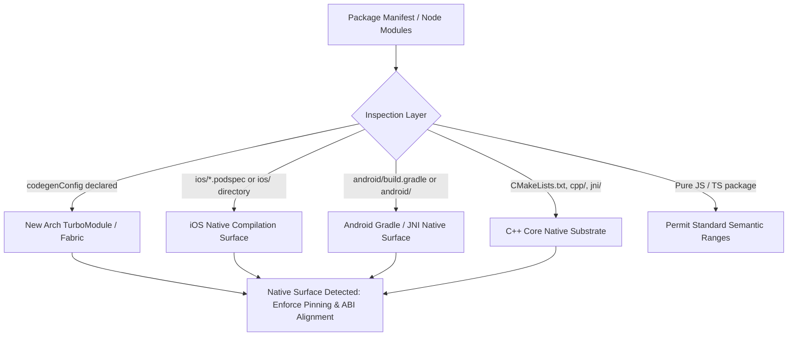

# Terrain Configuration & Local Shape

## 1. Overview: Beyond Hardcoded Pins

In the early stages of React Native ecosystem management, dependency checkers often relied on hardcoded lists of well-known libraries (such as `react-native-reanimated` or `@shopify/react-native-skia`) pinned to fixed versions.

However, real-world development diverges quickly:
- **Enterprise Forks**: Organizations frequently fork or rename core packages (e.g. `@mycorp/reanimated-enterprise` or `@internal/skia-engine`).
- **Proprietary Native Modules**: Teams author internal TurboModules, Fabric components, or C++ JNI engines that contain physical native compilation surfaces.
- **Custom ABI Policies**: Large organizations have internal platform SDKs that must be locked to exact versions to avoid linking conflicts across iOS CocoaPods and Android Gradle builds.

To solve this, RN-Terrain implements **Generalized Native Surface Detection** combined with **Configurable Local Shape**.

---

## 2. Generalized Native Surface Detection

Rather than relying purely on a string match of package names, RN-Terrain inspects the physical directory structure or declared package manifest to dynamically detect native surfaces:



### Detection Criteria
A package is dynamically classified as possessing a **Native Surface** if any of the following are true:
1. Manifest declares `codegenConfig` (React Native New Architecture code generation).
2. Manifest declares `react-native` sub-properties pointing to native source files.
3. Package folder contains `ios/*.podspec` or an `ios` directory.
4. Package folder contains `android/build.gradle`, `android/src/main/jni`, or `CMakeLists.txt`.
5. Package declared in internal or user configuration pins.

---

## 3. Two-Tier Diagnostic Engine

RN-Terrain's Dependency Doctor audits dependencies across two complementary tiers:

### Tier 1: Canonical Ecosystem Invariants
Evaluates the core baseline invariants known across the public React Native ecosystem:
- **Dialect Drift**: Detects whether legacy v2 / v3 syntax is mixed with v4 worklet syntax.
- **Algebraic Peer ABI Intersection**: Verifies that peer dependencies between React Native, Reanimated, Gesture Handler, and Skia mathematically overlap without ABI collision.
- **Floating Range Warning**: Flags native libraries declared with `^` (caret) or `*` (wildcard) that can silently download breaking native binaries during CI or fresh `npm install`.

### Tier 2: Repository Local Shape
Evaluates project-specific policies declared in `.terrainrc`, `terrain.config.json`, or `package.json#terrain`:
- Maps organization forks to known canonical packages using **Aliases**.
- Enforces strict exact pins on internal packages using **Local Pins**.
- Applies organizational linting rules using **Custom Rules**.
- Excludes grandfathered or development-only tools using **Ignore lists**.

---

## 4. Configuration Schema

You can define your local shape using any of the following configuration files in your repository root:
1. `.terrainrc` (JSON)
2. `.terrainrc.json`
3. `terrain.config.json`
4. `"terrain"` property in `package.json`

### Full Configuration Example

```json
{
  "$schema": "https://raw.githubusercontent.com/intuitui-labs/rn-terrain/master/schemas/terrain.schema.json",
  "preset": "standard",
  "aliases": {
    "@enterprise/custom-reanimated": "react-native-reanimated",
    "@enterprise/custom-gesture-handler": "react-native-gesture-handler"
  },
  "localPins": {
    "@enterprise/biometrics-core": {
      "exact": "3.2.0",
      "reason": "Compiled against internal C++ biometric vault v3 ABI"
    },
    "@enterprise/payments-native": {
      "exact": "1.0.4",
      "reason": "PCI-DSS certified native container; floating versions prohibited"
    }
  },
  "rules": {
    "disallowFloatingNativeRanges": true,
    "requireNewArchitectureSupport": true
  },
  "ignore": [
    "react-native-flipper"
  ]
}
```

---

## 5. Architectural Presets

RN-Terrain provides four built-in presets:

| Preset | Target Environment | Characteristics |
| :--- | :--- | :--- |
| **`standard`** (Default) | Production Bare React Native | Enforces exact versions on detected native surfaces; flags floating caret (`^`) ranges; audits peer ABI overlaps. |
| **`expo`** | Expo Managed / Continuous Native Gen | Aligns with Expo SDK release cycle; defers version resolution to `expo-doctor` and the official Expo SDK package matrix. |
| **`enterprise`** | Large Monorepos / Regulated Apps | Maximum rigidity. Prohibits any range qualifiers (`^`, `~`, `>=`) on any native dependency; requires explicit rationale for each local pin. |
| **`loose`** | Prototypes / Greenfield Spikes | Advisory warnings only; suppresses blocking exits on floating ranges. |

---

## 6. Running in CI / CD

To enforce your local shape during pull request checks:

```bash
# Exit code 1 if any local pins or native invariants are violated
npx @intuitui-labs/rn-terrain doctor:deps .
```

Or run the full ecosystem scorecard:

```bash
# Audits Rust tools, native dependencies, and Expo SDK in one shot
npx @intuitui-labs/rn-terrain doctor:all .
```
