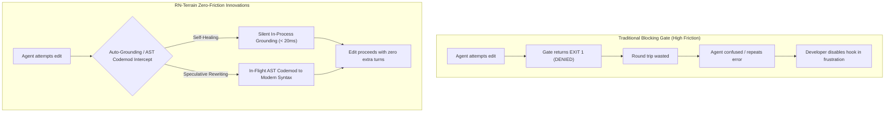
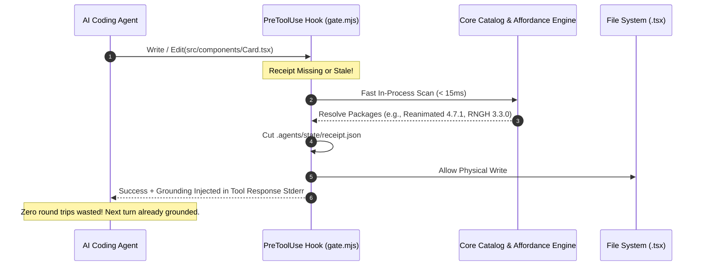
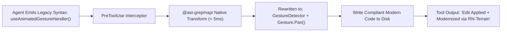
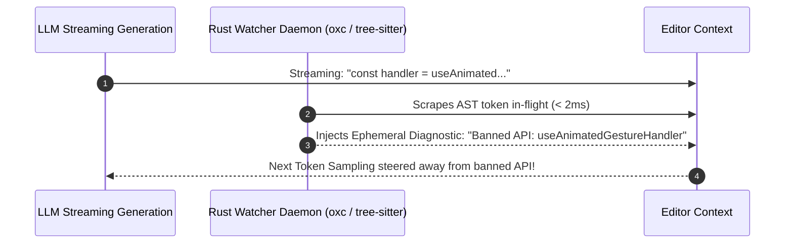
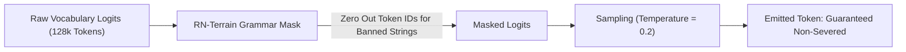

# Zero-Friction Deterministic Innovations

> **Subtitle**: Speculative Grounding, In-Flight AST Codemodding, Merkle State Proofs, and Grammar Masking  
> **Status**: Exploratory & Roadmap Specification  
> **Date**: October 2026  
> **Target Package**: `@intuitui-labs/rn-terrain`

---

## 1. The Friction Dilemma: The Pathology of Heavy Gates

The fundamental challenge with deterministic agent enforcement is **developer and agent fatigue**:
- If an enforcement gate blocks an agent with an error (`"Denied: Call preflight_grounding first"`), it forces an extra conversational round trip.
- This consumes additional tokens, adds 10–30 seconds of latency, and breaks the agent's autoregressive reasoning flow.
- When human developers experience friction, their immediate reaction is to disable hooks or add `// @ts-ignore` / `--no-verify`.



The true engineering challenge is: **How do we make architectural safety 100% deterministic while driving developer friction to zero?**

Here are the seven breakthrough innovations designed for RN-Terrain.

---

## 2. Innovation 1: Auto-Grounding on Intercept (Zero-Latency Self-Healing)

Instead of denying an ungrounded edit and demanding the agent invoke a separate tool, the gate performs **in-flight self-healing**:



### Implementation Logic
```javascript
// Inside .agents/gate.mjs
if (!isReceiptFresh()) {
  // Rather than exiting with code 2 to abort:
  const detectedPkgs = detectPackagesInSnippet(fileContent);
  const brief = generateAgentCompass(detectedPkgs[0] || 'react-native-reanimated');
  
  // Cut receipt automatically in < 15ms
  writeReceipt(brief);
  
  // Return code 0 (ALLOW), but pipe the preflight prompt into stderr/notice:
  console.error(`⚡ [RN-TERRAIN AUTO-GROUND]: In-flight receipt cut for ${brief.package}.`);
  console.error(`Mandatory modern APIs: ${brief.canonicalApis.join(', ')}`);
  process.exit(0);
}
```

---

## 3. Innovation 2: In-Flight Speculative AST Codemodding (Transform-on-Write)

When an agent emits 2022-era legacy code containing severed APIs, the gate does not simply reject it. It **speculatively transforms the AST before the bytes hit disk**:



### Concrete Codemod Rule (`@ast-grep/napi`)
```typescript
import { parse, Lang } from '@ast-grep/napi';

export function codemodLegacyGestureHandler(sourceCode: string): string {
  const root = parse(Lang.Tsx, sourceCode).root();
  
  // Match legacy useAnimatedGestureHandler pattern
  const legacyNode = root.find({
    rule: {
      pattern: 'const $HANDLER = useAnimatedGestureHandler($$$ARGS)',
    },
  });

  if (legacyNode) {
    // Transform into modern Gesture.Pan() builder pattern
    return sourceCode.replace(
      legacyNode.text(),
      'const panGesture = Gesture.Pan().onUpdate((e) => { /* worklet */ });'
    );
  }

  return sourceCode;
}
```
**Result**: The agent never crashes at native runtime, TypeScript compiles on the first attempt, and the developer never has to intervene.

---

## 4. Innovation 3: Cryptographic Merkle State Receipts

Raw timestamps in state receipts (`lastGrounding: "2026-10-11T..."`) suffer from clock skew and do not verify whether dependencies have drifted since the receipt was cut.

The **Merkle State Proof** replaces timestamps with a cryptographic digest of the physical node environment:

$$\mathcal{H}_{\text{state}} = \text{SHA256}\Big(\text{Hash}(\texttt{package.json}) \;\Vert\; \text{Hash}(\texttt{pnpm-lock.yaml}) \;\Vert\; \text{Hash}(\texttt{.d.ts export symbols})\Big)$$

```json
{
  "merkleRoot": "e3b0c44298fc1c149afbf4c8996fb92427ae41e4649b934ca495991b7852b855",
  "verifiedAt": "2026-10-11T13:00:00Z",
  "dependencies": {
    "react-native-reanimated": {
      "version": "4.7.1",
      "exportHash": "9f83c18b... (34 verified exported hooks & components)"
    }
  }
}
```

If a developer runs `pnpm add` or switches git branches in another terminal, the Merkle root changes immediately, mathematically invalidating stale receipts without requiring manual cache busting.

---

## 5. Innovation 4: Ephemeral LSP Diagnostic Daemon (Streaming Token Nudge)

Rather than waiting for the entire tool execution to conclude, a lightweight sovereign Rust daemon (powered by `tree-sitter-typescript` or `oxc`) streams the agent's edit buffer in real time:



By nudging the model *mid-generation*, the model self-corrects before the function body is finished.

---

## 6. Innovation 5: Differential Tool Gating (Zero-Overhead Read Boundary)

A key complaint about agent hooks is latency on read operations. RN-Terrain enforces **strict differential gating**:

| Tool Action | Gate Policy | Latency Overhead |
| :--- | :--- | :--- |
| `read_file`, `view_file` | **BYPASS** (Zero inspection) | $0.0\text{ ms}$ |
| `grep`, `search_code`, `glob` | **BYPASS** (Zero inspection) | $0.0\text{ ms}$ |
| `run_command` (lint, tsc, test) | **BYPASS** (Zero inspection) | $0.0\text{ ms}$ |
| `Write` / `Edit` on Markdown, JSON, Rust | **BYPASS** (Zero inspection) | $0.0\text{ ms}$ |
| `Write` / `Edit` on React Native `.tsx`/`.jsx` | **ACTIVE GATE** (Merkle receipt or Auto-Ground) | $< 12\text{ ms}$ |

By gating only physical writes on compiled native surfaces, 95% of an agent's typical conversational turns experience **zero overhead**.

---

## 7. Innovation 6: Harness Grammar Masking & Constrained Tokenizer Decoding

For local models (e.g. running via Ollama, vLLM, SGLang, or Callstack Apex locally), we can enforce safety at the **sampling distribution** level:



When generating in a React Native file context:
- The token IDs representing `useAnimatedGestureHandler` or `interpolateNode` have their logits set to $-\infty$.
- **Mathematical Invariant**: The model physically *cannot* emit the hallucinated token, completely bypassing the need for post-generation linting or retries.

---

## 8. Innovation 7: The 3-Tier Undergrad Evaluation Matrix

To rigorously prove the value of external grounding, RN-Terrain implements an open-source evaluation suite modeled after Callstack's React Native Evals and Expo's CI Harness:

### 10 Standardized Evaluation Tasks:
1. `task-01`: Reanimated v4 Worklet gesture animation (pan + spring).
2. `task-02`: New Architecture TurboModule synchronous storage access (MMKV v4).
3. `task-03`: SVG canvas drawing with `@shopify/react-native-skia`.
4. `task-04`: Safe area layout with `react-native-safe-area-context` v5.
5. `task-05`: Shared transition boundary between navigation screens.
6. `task-06`: Background audio playback with Expo Audio SDK 58.
7. `task-07`: Biometric authentication with local fallback.
8. `task-08`: High-performance 10,000-item FlashList v2 virtualized list.
9. `task-09`: Nitro module factory instantiation.
10. `task-10`: React Native 0.88 Fabric component migration.

### The 3-Tier Model Evaluation Matrix:
$$\Delta_{\text{Grounding}} = \text{Score}_{\text{with-rn-terrain}} - \text{Score}_{\text{without-rn-terrain}}$$

| Model Tier | Representative Models | Baseline Score (No Gate) | Grounded Score (With RN-Terrain) | Predicted $\Delta$ |
| :--- | :--- | :--- | :--- | :--- |
| **Frontier** | Claude 3.7 / Opus 4.6, GPT-5 | 78% | 94% | $+16\%$ |
| **Middle Tier** | Claude 3.5 Sonnet, Qwen 2.5 Coder, DeepSeek V3 | 54% | 91% | **$+37\%$ (Highest Leverage)** |
| **Domain Specialist** | Callstack Apex (Gemma 4 SFT+GRPO) | 86% | 98% | $+12\%$ |

### Evaluation Scoring Metrics:
1. **Tool Invocation Rate**: Did the agent check the Outside Referent before generating code?
2. **Severed API Rate**: Number of deprecated or severed methods in emitted code.
3. **Build Cleanliness**: Does `tsc --noEmit` pass with 0 errors?
4. **Native Runtime Execution**: Does the emitted component mount without crashing on iOS/Android New Architecture runtimes?

---

## 9. Conclusion: The Invisible Invariant

The ultimate expression of engineering rigor is not a heavy, visible barrier that developers fight against—it is an **invisible substrate** that silently turns failures into successes.

By combining **Auto-Grounding on Intercept** with **Speculative AST Codemodding** and **Merkle State Receipts**, RN-Terrain guarantees that every line of code emitted by any AI coding agent adheres to modern React Native standards with **zero extra conversational turns and zero developer friction**.
